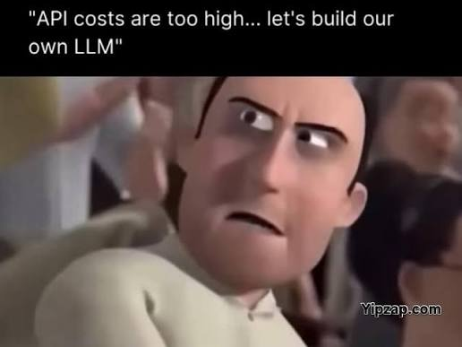
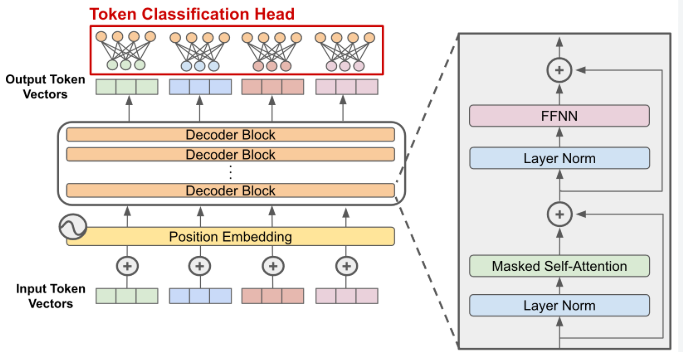
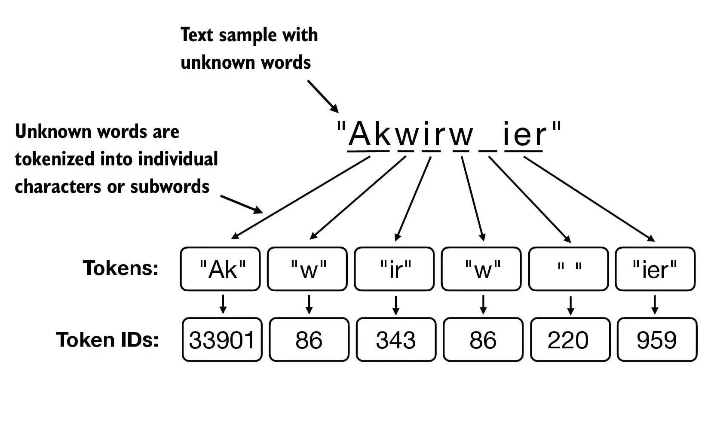

# Lesson 00: LLM Basics: Architecture, Tokens, Context Windows and Generation Parameters

### How a model works, how text becomes tokens, how much fits in a request, and how replies are sampled

A large language model (LLM) behind an API is a service like any other: you send a request, it does computation, it returns a response, and someone pays for the computation. What makes it different is the unit of work. The service does not process requests or bytes. It processes tokens, and almost every engineering decision around an LLM, including latency, cost, limits and what you must store yourself, follows from that fact.

This lesson builds that mental model. You will start with the architecture that sits behind every LLM, then zoom in on how text becomes tokens and how much text fits in one request. You will also meet the generation parameters that control how a reply is sampled and when it ends.

<p align="center">
  
</p>

### Learning Objectives

By the end of this lesson, you will be able to:

- **Describe** the architecture shared by most LLMs and how it generates text one token at a time.
- **Explain** how text is split into tokens and why limits and billing are measured in tokens, not words.
- **Define** the context window, list what counts toward it and say what happens when a request exceeds it.
- **Choose** values for temperature, top-p, max tokens and stop sequences for a task.

### Support Material

Go over:

- The paper *Attention is all you need* [Vaswani, A., et al. (2017). Attention is all you need. Advances in Neural Information Processing Systems, 30, 5998 to 6008.](Support_Material/NIPS-2017-attention-is-all-you-need-Paper.pdf)
- For a deeper explanation, see the articles [Decoder-Only Transformers: The Workhorse of Generative LLMs](https://cameronrwolfe.substack.com/p/decoder-only-transformers-the-workhorse) and [Understanding What an LLM is and How it Works - Attention at its Core](https://lecharles.medium.com/understanding-what-an-llm-is-and-how-it-works-3-4-attention-at-its-core-ec5eff7ec9d5).

---

### Lesson Content

#### What is inside the box

Before looking at tokens, context windows and generation parameters, it helps to know what is actually inside the model. A model's architecture is its blueprint: the way its layers are arranged to turn a sequence of input tokens into a prediction of the next one. Almost every LLM you will use, such as GPT, Llama, Mistral, Qwen or Gemma, shares one blueprint, the decoder-only transformer introduced in the paper *Attention Is All You Need* ([Vaswani et al., 2017](https://arxiv.org/abs/1706.03762)). The differences between models are mostly refinements on top of it, and a few alternative families exist.

> **The short version:** An LLM is a very large autocomplete. Your text is cut into tokens, each token becomes a list of numbers (a vector), and the vectors pass through a stack of identical layers. In those layers, attention lets every token look back at the earlier ones to decide what matters. At the end the model gives a score to every possible next token, one is picked and added to the text, and the whole process repeats until the reply is done. That is why replies are written one token at a time, and why tokens, not words, are what you are billed for and limited by.

A decoder-only transformer generates text autoregressively: it reads the sequence so far, predicts the next token, appends it, and repeats. This is the path one piece of text takes through the model.

```
text
  -> tokenizer              splits text into tokens, each with an integer ID
  -> embedding lookup       turns each ID into a vector (a list of numbers)
  -> transformer block x N  the same block repeated many times (dozens of layers)
        normalize -> self-attention -> add residual
        normalize -> feed-forward   -> add residual
  -> output layer           one score for every token in the vocabulary
  -> pick the next token    then repeat with the new token appended
```



Self-attention lets each token weigh the earlier tokens through queries, keys and values, with a causal mask that keeps it to the past. Generation reuses the keys and values of earlier tokens through a KV cache so that each new token does not recompute the whole sequence, and because attention cost grows with the square of the length, context windows are limited.

#### Models differ by refinements, not by design

Looking at flagship open-weight models of recent years, the surprising finding is how similar they are underneath: the same decoder backbone with RoPE, RMSNorm and SwiGLU. Most of the innovation since has been about efficiency, getting more capability for less memory and compute. These are the refinements you will see named in model announcements, in the survey of [Raschka (2025)](https://magazine.sebastianraschka.com/p/the-big-llm-architecture-comparison) and the architecture overview of [Sara Han Díaz (Pruna AI)](https://huggingface.co/blog/PrunaAI/llm-architectures-overview).

| Refinement | What it changes | Why it helps | Example |
| :-- | :-- | :-- | :-- |
| Grouped-query attention (GQA) | Several attention heads share the same key and value projections | Smaller KV cache and less memory traffic | Widely adopted, for example in Llama-family models |
| Multi-head latent attention (MLA) | Compresses keys and values into a smaller space before caching them | Much smaller KV cache, with quality reported on par with or better than standard attention | DeepSeek V3 |
| Mixture of experts (MoE) | Replaces the single feed-forward block with many "expert" blocks, and a router picks a few per token | Large total capacity, but only a fraction of it runs per token | DeepSeek V3: 256 experts, 9 active per token, so 37B of 671B parameters used |
| Sliding-window attention | Most layers attend only to a recent window of tokens, with an occasional full-attention layer | Lower memory for long inputs with little quality loss | Gemma 3: 5 local layers per 1 global layer, 1,024-token window |
| Normalization changes (QK-Norm, Pre-/Post-Norm placement) | Where and how values are rescaled inside each block | Steadier training | OLMo 2, Gemma 3 |
| Linear-attention hybrids | Replace some full attention layers with attention whose cost grows linearly with length | Cheaper long contexts | Qwen3-Next: 3 linear layers per 1 full layer |

#### Tokens: the unit everything is measured in

A language model computes with numbers, so any text you send has to be converted before the model can read it. The first step of that conversion is tokenization: dividing text into smaller units called tokens. The idea comes from natural language processing (NLP), the field of getting computers to work with human language, where tokenizing is the standard first step before tasks such as search or sentiment analysis. LLMs reuse the idea in a more refined form, and almost every limit and price you meet later is measured in the units it produces.

Subword tokenizers learn their splits from a large body of text, called a training corpus. The best-known method, used in GPT-4, Llama and Mistral, is byte pair encoding (BPE). It starts with a vocabulary of single characters (or raw bytes), counts which pair of neighboring symbols occurs most often in the corpus, and merges that pair into a new vocabulary entry. It repeats this until the vocabulary reaches a target size. As an illustration, if "low" appears constantly, the pieces l, o and w quickly merge into a single token "low", while a rarer word like "lowest" ends up as "low" plus "est". Even if the model encounters a brand-new typo or foreign word, it can fall back to smaller subword or byte pieces rather than failing.



The outcome is a vocabulary of tens of thousands to a few hundred thousand entries, and each entry has an integer ID. Those IDs, not letters, are what the model actually receives. Common words are usually a single token, rare words split into several, and because the process can fall back to small pieces such as individual bytes, any text can still be represented. Tokens matter because everything that can be limited or priced is expressed in them: the context window, the maximum reply length, rate limits and the bill. Each model family has its own tokenizer, so a count made for one model does not transfer to another, and you should always count with the tokenizer of the model you will deploy. Tokenization levels (word, character, subword, sentence, n-gram) and the main subword methods (BPE, WordPiece, SentencePiece) are surveyed in [this GeeksforGeeks overview](https://www.geeksforgeeks.org/nlp/nlp-how-tokenizing-text-sentence-words-works/) (last updated May 6, 2026).

#### The context window is the model's working memory

A context window is the maximum amount of text, measured in tokens, that a large language model can hold and reference while generating a response. It includes everything the model can "see" during a single interaction, and there is a lot of literature on handling it effectively, some of which later modules cover. The following count toward it:

- The user's prompt and the system prompt: what was asked, plus system configuration such as a chatbot's behavioral instructions.
- Conversation history: prior exchanges in the session.
- Retrieved documents: content pulled in through retrieval-augmented generation (RAG) or tool calls.
- Tool definitions and outputs: results from API calls, database queries or other agent actions.
- The model's own response, which also counts against the limit.

A bigger window does not mean better recall. The usable part of the window is much smaller than the advertised one: [Modarressi et al. (2025)](https://arxiv.org/abs/2502.05167) tested 12 models that accept at least 128,000 tokens and found that, already at 32,000 tokens, 10 of them fell below half of their short-input accuracy once the question and the relevant passage did not share the same words. Where the information sits matters too, though less than it used to: [Veseli et al. (2025)](https://arxiv.org/abs/2508.07479) found that models still use the middle of an input worst while it fills less than half of the window, and favour whatever is closest to the end as it approaches the limit. Curating what goes into the window therefore matters more than filling it.

#### Generation parameters control how a reply is sampled

LLM hyperparameters are external settings configured before training, fine-tuning or inference to guide how a model learns or generates text. At inference time the ones you tune most are the generation parameters. For shorter and more predictable outputs one might set temperature and max tokens to lower values, and terminology varies by provider while the base concepts are the same.

| Parameter | What it controls | Typical values | Use it to |
| :-- | :-- | :-- | :-- |
| `temperature` | How sharp or flat the probability distribution is before sampling | 0 to 1 (up to 2 on some providers) | Go low for extraction, classification and code. Go higher for brainstorming and creative text |
| `top_p` (nucleus sampling) | Keeps only the smallest set of tokens whose probabilities add up to p | 0 to 1, often near 1 | Cut off very unlikely tokens. Usually tune this or temperature, not both |
| `top_k` | Keeps only the k most likely tokens | A whole number such as 40 | Same goal as `top_p` with a fixed count. Not offered by every provider |
| `max_tokens` (also `max_output_tokens`) | Hard ceiling on output length | Up to the model's output limit | Cap cost and length. Too low and the reply is cut off |
| `stop` / `stop_sequences` | Strings that end generation the moment the model produces them, and are not returned | A list of strings | Stop at a delimiter such as `END`, saving tokens and trailing chatter |
| `frequency_penalty`, `presence_penalty` | Lowers the odds of tokens already used (frequency grows with each repeat, presence is flat) | About -2 to 2, where offered | Reduce repetition or push toward new topics |
| `seed` | Fixes the random seed used in sampling | A whole number | Make runs more repeatable, as a best effort only |
| Reasoning effort / thinking | How much the model reasons before answering | Levels such as low, medium, high | Trade quality on hard problems against time and tokens |

#### In practice

Count tokens with the tokenizer of the model you deploy, and look at how many your system prompt, tool definitions and retrieved passages use before the user has typed a word. Keep temperature low for anything your code has to parse and raise it only for text that benefits from variety, and always set a `max_tokens` that is high enough for the longest valid answer and low enough to bound cost. When behavior surprises you, the architecture explains most of it: the model reads left to right, writes one token at a time, and can only use what is inside the window.

**Summary:**
- Most LLMs are decoder-only transformers: tokens, embeddings, repeated attention and feed-forward blocks, then a score for every vocabulary entry, generated one token at a time.
- Models differ mainly through efficiency refinements such as GQA, MLA, mixture of experts and sliding-window attention.
- Tokenization turns text into integer IDs with learned subword vocabularies. Limits, rate limits and prices are all token-based, so recount per model.
- The context window holds everything in one request, including the reply, and bigger is not always better. Temperature, top-p, max tokens and stop sequences shape each reply.

---

### References

- Vaswani et al. (2017), [Attention Is All You Need](https://arxiv.org/abs/1706.03762). The transformer.
- Veseli et al. (2025), [Positional Biases Shift as Inputs Approach Context Window Limits](https://arxiv.org/abs/2508.07479).
- Modarressi et al. (2025), [NoLiMa: Long-Context Evaluation Beyond Literal Matching](https://arxiv.org/abs/2502.05167), ICML 2025.
- Raschka (2025), [The Big LLM Architecture Comparison](https://magazine.sebastianraschka.com/p/the-big-llm-architecture-comparison). The shared backbone and the efficiency refinements, including the figures quoted for DeepSeek V3, Gemma 3 and Qwen3-Next.
- Sara Han Díaz, [LLM Architectures Explained: What Powers Today's Top Models](https://huggingface.co/blog/PrunaAI/llm-architectures-overview), Pruna AI on the Hugging Face blog. Architecture families and the attention walk-through.
- [Tokenization in NLP](https://www.geeksforgeeks.org/nlp/nlp-how-tokenizing-text-sentence-words-works/), GeeksforGeeks (updated May 6, 2026). Tokenization levels and subword methods. The BPE walk-through above is an illustration.

### Further Reading

- [Lesson 01: Structured Outputs](01-structured-outputs.md) - the next lesson.
