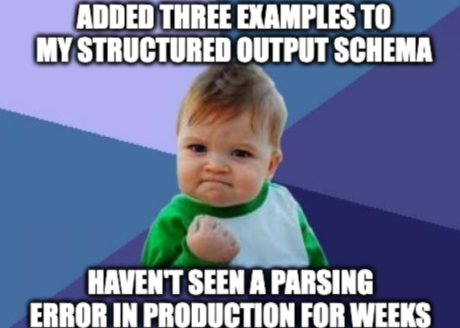

# Lesson 01: Structured Outputs

### Declare the shape, get valid data back

Language models are very good at producing JSON, and they are not always reliable at it. With prompting alone, you end up asking nicely for JSON, stripping code fences, repairing broken brackets and retrying when a field is missing. Every one of those workarounds is code you have to maintain, and each one fails in a slightly different way on the day the model is updated.

Most providers now solve this natively. You attach a schema to the request, and the model's output is constrained to match it. Extracting data from text, classifying a message and producing the arguments for a tool all come down to defining the shape of the data you want. This lesson shows how providers handle it, how to describe a shape, and which checks still belong in your code.

<p align="center">
  
</p>

### Learning Objectives

By the end of this lesson, you will be able to:

- **Explain** why structured output is now a native provider feature and what it guarantees.
- **Describe** one output shape as a typed class and as a JSON Schema.
- **Send** a schema with a request to Azure OpenAI and to Anthropic.
- **List** the checks that still belong around a call.

---

### Lesson Content

#### The schema is the meeting point between the model and your code

You can write a schema by hand, although you usually generate it from something you already have, and all of the common ways end up as the same JSON Schema, the standard vocabulary for describing the shape of JSON data. A typed class (Pydantic in Python) suits application code that also validates the result, a TypedDict suits code that passes plain dictionaries around, a JSON Schema document suits several languages or an existing schema, and a concise string such as `name, age int, bio: a short biography` suits quick extraction in scripts, as the [schemas documentation of the llm command-line tool](https://llm.datasette.io/en/stable/schemas.html) shows. Here is a generic schema with a title, a category from a fixed list, a score and a summary.

```json
{
  "type": "object",
  "properties": {
    "title": {"type": "string", "description": "A short title"},
    "category": {"type": "string", "enum": ["type_a", "type_b", "other"]},
    "score": {"type": "integer", "description": "1 (low) to 5 (high)"},
    "summary": {"type": "string", "description": "One sentence summary"}
  },
  "required": ["title", "category", "score", "summary"],
  "additionalProperties": false
}
```

`type` is the kind of value and `properties` lists the fields, while `required` names the ones that must be present. `enum` restricts a value to a fixed list, which makes it the best tool for classification, and `description` is read by the model as an instruction, so it should be written for the model. `additionalProperties: false` forbids extra fields, and strict modes require it.

#### Sending the schema with a request

Azure OpenAI takes the schema in the request's `response_format` with strict mode turned on, and its Python SDK can also accept a Pydantic class and return a parsed object. The example below sends a short prompt and reads the structured reply, following the Azure [structured outputs guide](https://learn.microsoft.com/en-us/azure/foundry/openai/how-to/structured-outputs?tabs=python-secure%2Cdotnet-entra-id%2Cjavascript-secure&pivots=programming-language-python).

**Example: Azure OpenAI.**

```python
from pydantic import BaseModel
from openai import OpenAI
from azure.identity import DefaultAzureCredential, get_bearer_token_provider

token_provider = get_bearer_token_provider(
    DefaultAzureCredential(), "https://ai.azure.com/.default"
)

client = OpenAI(  
  base_url = "https://YOUR-RESOURCE-NAME.openai.azure.com/openai/v1/",  
  api_key=token_provider,
)

class CalendarEvent(BaseModel):
    name: str
    date: str
    participants: list[str]

completion = client.beta.chat.completions.parse(
    model="MODEL_DEPLOYMENT_NAME", # replace with the model deployment name of your gpt-4o 2024-08-06 deployment
    messages=[
        {"role": "system", "content": "Extract the event information."},
        {"role": "user", "content": "Alice and Bob are going to a science fair on Friday."},
    ],
    response_format=CalendarEvent,
)

event = completion.choices[0].message.parsed

print(event)
print(completion.model_dump_json(indent=2))
```

Anthropic takes the schema in `output_config.format`, and its Python SDK also has a parse helper that accepts a Pydantic class, as described in its [structured outputs documentation](https://platform.claude.com/docs/en/build-with-claude/structured-outputs). The example sends a comparable request and reads the structured reply.

**Example: Anthropic.**

```python
from pydantic import BaseModel
# ...


class ContactInfo(BaseModel):
    name: str
    email: str
    plan_interest: str
    demo_requested: bool


client = Anthropic()

response = client.messages.parse(
    model="claude-opus-5-5",
    max_tokens=1024,
    messages=[
        {
            "role": "user",
            "content": (
                "Extract the key information from this email: "
                "John Smith (john@example.com) is interested in our Enterprise plan "
                "and wants to schedule a demo for next Tuesday at 2pm."
            ),
        }
    ],
    output_format=ContactInfo,
)

print(response.parsed_output)
```

#### What the schema does not guarantee

A schema guarantees the structure of a reply that completes normally. A model can still refuse a request, a reply can be cut off at the output limit and leave broken JSON, and a reply that fits the schema can contain wrong values or break a business rule, such as a score outside 1 to 5. The output of every call is therefore checked in the same order: look at the refusal and truncation signals first, then validate the values with your own rules, and retry a limited number of times if a rule fails.

Providers also support different subsets of JSON Schema, so a schema that works on one platform can be rejected on another. To stay portable, use flat or lightly nested objects, express optional fields as nullable ones, use `enum` for closed sets, describe each field, and keep numeric ranges, patterns and list sizes in your own validation. Some models, including many self-hosted ones, have no native support, and the fallbacks are tool calling with a schema or the older prompt-and-parse approach with validation and repair. The documentation of each provider is the place to check current parameter names, supported schema features and limits.

#### In practice

Use a typed class as the single source of truth, generate the schema from it, and put every rule the schema cannot express into a validator next to the class. Log refusals and truncations as separate events, because they have different causes and different fixes, and cap retries so that a stubborn failure becomes an error you can see and not a loop you pay for. The same schema then serves extraction, classification and tool arguments, which is why this is the first reliability tool to learn.

**Summary:**
- Structured output is a native feature: send a schema with the request and read JSON that follows it.
- A typed class, a TypedDict, a JSON Schema and a concise string all produce the same JSON Schema, and `enum` and clear descriptions matter most.
- The schema guarantees shape only. Check refusals and truncation, validate values, and cap retries.
- Providers support different subsets of JSON Schema, so keep schemas small and portable.

---

### References

- Microsoft, [Structured outputs in Microsoft Foundry](https://learn.microsoft.com/en-us/azure/foundry/openai/how-to/structured-outputs?tabs=python-secure%2Cdotnet-entra-id%2Cjavascript-secure&pivots=programming-language-python). `response_format`, strict mode and the Pydantic helper.
- Anthropic, [Structured outputs](https://platform.claude.com/docs/en/build-with-claude/structured-outputs). `output_config.format` and the parse helper.
- The llm documentation, [Schemas](https://llm.datasette.io/en/stable/schemas.html). Schema notations, including the concise string form.

### Further Reading

- [Lesson 00: LLM Basics](00-llm-foundations.md) - the previous lesson.
- [Lesson 02: Model Selection](02-model-selection.md) - the next lesson.
- [Lecture 2, Lesson 01: Tool Calling](../L2_Agentic_systems_and_tool_calling/01-tool-calling.md) - schemas for tool arguments.
