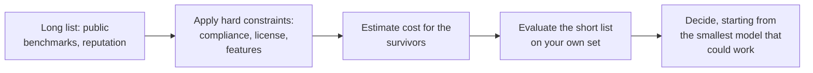
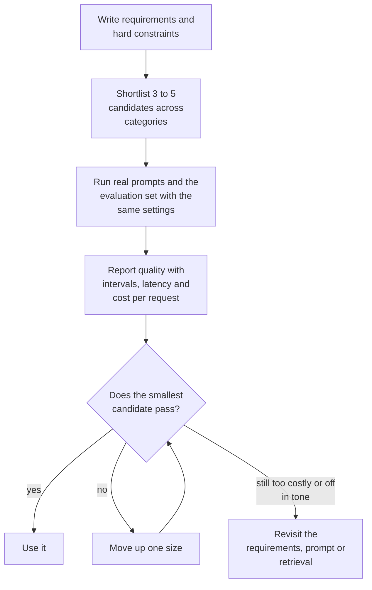

# Lesson 02: Model Selection

### Choosing between proprietary, open-weight and self-hosted models

Most teams choose their first model by reputation: the one everyone talks about, or the one whose API they already have a key for. That works for a prototype and gets expensive later, because the right model depends on things a leaderboard does not show, such as how many requests you will serve, whether customer data may leave your network, how the answer has to sound, and what happens when the provider retires the version you built on. Models also change every few months, so the lasting skill is a method for comparing candidates, and any particular winner will be replaced.

This lesson sets out what separates the options, clears up the vocabulary around "open" models, looks at the cost question with a small calculation, and ends with a routine that keeps the choice reversible. The scenario is the retail FAQ assistant used across the course, which has to quote policy exactly, answer in the brand's voice and survive sale-day peaks.

### Learning Objectives

By the end of this lesson, you will be able to:

- **Distinguish** proprietary, open-weight and open-source models, and the hosting options for each.
- **Weigh** the criteria that decide a model choice for a given workload.
- **Estimate** when self-hosting becomes cheaper than an API, and which costs the estimate leaves out.
- **Run** a selection routine that survives model retirement.

---

### Lesson Content

#### What actually differs between candidates

A comparison on one benchmark number hides most of what decides success in production. In practice eight questions matter: whether the model meets the quality bar on your own evaluation set, how fast it answers at your prompt sizes, what a request costs at your token counts, whether it has the features the design relies on (images, tool calling, structured outputs), where data is processed and kept, how long the version will be supported, whether you can customize it, and what the license allows. A project requirement usually removes some candidates before any quality testing starts. A regulated workload may rule out every model that cannot run inside a given network, and a latency target may rule out the largest ones.

| Question | Axis | How it can remove a candidate |
| :-- | :-- | :-- |
| Does it meet the quality bar on your own evaluation set? | Task quality | Fails on policy questions or the required language |
| How fast does it answer at your prompt sizes? | Latency | Too slow for the target |
| What does a request cost at your token counts? | Cost | Unaffordable at the expected volume |
| Does it have the features the design relies on? | Context and modality | Images, tool calling or structured outputs missing |
| Where is data processed and kept? | Data and compliance | Customer data may not leave a network |
| How long will the version be supported? | Lifecycle | Retired inside the project's lifetime |
| Can you customize it? | Customization | Weights unavailable, or a limited tuning option |
| What does the license allow? | License | Terms forbid the intended use |

That suggests an order of work. Apply the hard constraints first (compliance, license, features), estimate cost for the survivors, and spend evaluation effort only on the short list that remains. Public benchmarks are useful for building the long list and less so for the final decision. The fine-tuning survey by [Parthasarathy et al. (2024)](https://arxiv.org/abs/2408.13296) lists the usual suite (MMLU for broad knowledge, TruthfulQA, HellaSwag, IFEval for instruction following, MATH and GPQA for reasoning, BigCodeBench for code) and advises choosing benchmarks that match the target task. A benchmark measures a task format that may differ from yours, scores are reported by the publisher under settings you may not reproduce, and a model may have seen benchmark items in training, so a high score on multiple-choice knowledge says little about whether a model quotes your return policy exactly.

*Figure 1. Narrowing the field: from a long list, through hard constraints and cost, to an evaluation on your own set.*

#### Proprietary, open-weight and open source are different things

A proprietary model is available only through its provider's service, so you receive outputs and never weights. An open-weight model publishes its trained parameters, which means you can run it on your own hardware, fine-tune it and keep a frozen copy that no vendor can retire. Open source is stricter. The [Open Source AI Definition 1.0](https://opensource.org/ai/open-source-ai-definition) requires the freedoms to use, study, modify and share, and says the preferred form for modification includes sufficiently detailed information about the training data, the complete training and inference code, and the parameters. Publishing weights alone does not meet it, so most models described as open are open-weight, and each license has to be read for what it allows.

| Term | What you receive | What it requires | Example from this lesson |
| :-- | :-- | :-- | :-- |
| Proprietary | Outputs through the provider's service | Nothing is published | Frontier API models |
| Open-weight | The trained parameters | The license decides what you may do | [Llama 3](https://arxiv.org/abs/2407.21783), with a 405B dense model and a 128,000-token context window |
| Open source (OSAID 1.0) | Parameters, the code to train and run the system, and sufficiently detailed data information | The freedoms to use, study, modify and share | Publishing weights alone does not qualify |

For the highest general capability the choice is often still a proprietary frontier model, and for control, fixed cost, offline use cases and customization it is often an open-weight one, so the practical difference is the trade in the table.

| Dimension | Proprietary API | Open-weight, self-hosted | Open-weight, managed hosting |
| :-- | :-- | :-- | :-- |
| Data control | Data goes to the provider under its terms | Data stays in your network | Data goes to the host under its terms |
| Customization | Provider's tuning options, if any | Any method, full access to weights | Methods the host offers |
| Cost structure | Per token, no fixed cost | GPU capacity, fixed unless scaled | Per token or reserved capacity |
| Operations | Provider's concern | Yours: serving, scaling, security | Shared |
| Lifecycle risk | Versions retired on the provider's schedule | You keep the weights you downloaded | Host may retire a hosted model |

Managed hosting sits between the extremes. As of October 2026 the Microsoft Foundry [fine-tuning overview](https://learn.microsoft.com/en-us/azure/foundry/fine-tuning/overview) lists open-weight models such as Llama 3.3 70B Instruct, Qwen3 32B and gpt-oss next to proprietary ones, and offers managed compute that serves a base model together with compatible LoRA adapters. That keeps weight-level customization and removes part of the serving work.

#### In practice

Write the requirements and the hard constraints, shortlist three to five candidates across categories (a frontier API model, a smaller API model), and run the application's real prompts and your evaluation set on all of them with the same settings. Report quality with confidence intervals next to latency and cost per request. Start from the smallest model that could work and move up only on measured failures, because a small model with a good prompt or retrieval is almost always cheaper than a large one. If the cheapest passing model still costs too much or misses the tone, the next lessons describe what to do.

*Figure 2. A selection loop: start from the smallest candidate that could work and move up only when it fails.*

**Summary:**
- Compare models on task quality, latency, cost, features, data handling, lifecycle, customization and license, and apply hard constraints first.
- Open-weight means published parameters, and open source also requires training code and data information. Each license needs reading.
- Self-hosting cost grows in GPU-sized steps, so the crossover with an API depends on volume, burstiness and utilization.
- Pin versions, hide the provider behind one interface and keep the evaluation set, since adapters and tuned models expire with their base.

---

### References

- Parthasarathy et al. (2024), [The Ultimate Guide to Fine-Tuning LLMs](https://arxiv.org/abs/2408.13296). The survey used throughout this lecture, with a benchmark list and deployment advice.
- Open Source Initiative, [The Open Source AI Definition 1.0](https://opensource.org/ai/open-source-ai-definition). What open source requires beyond weights.
- Grattafiori et al. (2024), [The Llama 3 Herd of Models](https://arxiv.org/abs/2407.21783). A large open-weight release.
- Microsoft (accessed October 2026), [Fine-tuning in Microsoft Foundry](https://learn.microsoft.com/en-us/azure/foundry/fine-tuning/overview). Models, methods and deployment options on a managed platform.

### Further Reading

- [Lesson 01: Structured Outputs](01-structured-outputs.md) - the previous lesson.
- [Lecture 4, Lesson 03: Evaluating Retrieval](../L4_Advanced_RAG_and_evaluation/03-evaluating-retrieval.md) - the evaluation set for comparing candidates.
