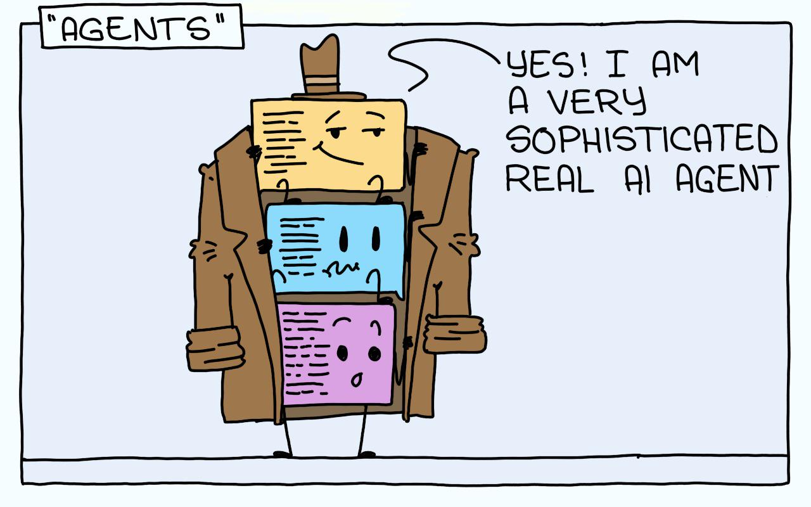
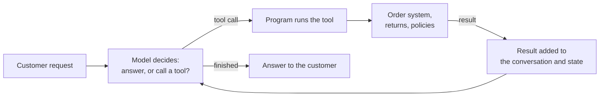
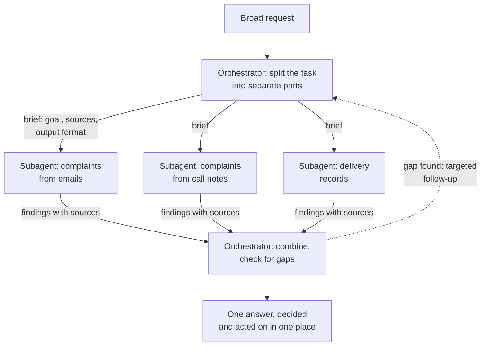

# Lesson 00: Introduction to Agentic Systems

### From a model that writes text to a system that acts

A language model on its own is text in and text out. Ask a retail chain's assistant "where is my order A-10492?" and the model can only guess or apologise: it has no access to the order system, it cannot check today's delivery status, and it cannot start a return. What it can do very well is understand the request and decide what would need to happen to answer it. An **agentic system** closes that gap by placing the model inside a program that lets it act: the model decides what to do next, the program carries it out through **tools** (functions that read or change real systems), and the result goes back to the model, which decides again until the task is done. This lesson introduces the idea, the architecture and the vocabulary, and the rest of the lecture builds each part in turn.

  

### Learning Objectives

By the end of this lesson, you will be able to:

- **Explain** why a language model needs tools and a loop to act, and when that is worth the cost.
- **Describe** the architecture of an agentic system and the role of each building block.
- **Explain** the orchestrator logic: split, brief, run in parallel, combine and decide in one place.
- **Define** the core vocabulary of the lecture and name where agentic systems typically fail.

---

### Lesson Content

#### Why a model needs tools

A model knows only what was in its training data and what is in the current prompt, and it can only produce text. That leaves three gaps for a support assistant: it cannot see live data (the order's status today), it cannot act (create the return), and it cannot check its own claims against a source. Tools close all three, and how much freedom the model gets to use them is a design choice.

| Approach | Who decides the next step | Order-support example | Cost and predictability |
| :-- | :-- | :-- | :-- |
| Single call | Code | Rewrite a reply in a friendlier tone | One call, fully predictable |
| Augmented call | Code, with one lookup or retrieved text | Answer from the returns policy | One lookup plus one call |
| Workflow | Code, step by step | Classify the message, look up the order, fill a reply template | Several calls, fixed path |
| Agent | The model, step by step, until it decides it is done | "My kettle arrived broken, what can I do?" | Unknown number of calls, variable path |

#### The architecture: a model in a loop

*Figure 1. The agentic loop: the model decides, the program acts, and the result returns for the next decision.*

Surveys of agent design converge on the same building blocks ([Weng, 2023](https://lilianweng.github.io/posts/2023-06-23-agent/); [Sumers et al., 2023](https://arxiv.org/abs/2309.02427)): a **model** that decides, **tools** that act, **memory** that keeps what is needed between steps, and a **loop** in your program that keeps the exchange going. For the broken kettle, the loop runs three times: the model asks for the customer's recent orders, then for the kettle's order details, then sees the return is still possible and answers by offering one. It is important to note that the model never runs anything itself; it only asks, and each response carries a **finish signal** that tells the program whether to run a tool and go round again or to stop.

| Building block | What it does | Lesson |
| :-- | :-- | :-- |
| Tools and tool calls | Let the model read and change real systems; descriptions, errors and safety checks decide how well | 01 Tool Calling |
| Architecture | Decides who chooses the next step: fixed patterns, the ReAct loop, or an orchestrator with subagents | 02 Agent Architectures and ReAct |
| State, memory and orchestration | Keep what was found between steps and runs, pause for approval, resume later | 03 Building Agents |
| Connection standard | Lets many applications reuse the same tools through one protocol | 04 Introduction to MCP |

#### Tools: how the model acts

A tool is an ordinary function in your program, such as `orders_get` or `returns_create`, that you describe to the model with a name, a short description of what it does and when to use it, and a schema of the arguments it accepts. The model reads those descriptions and, when it needs one, replies with a structured request instead of an answer; your program runs the function and returns the result. Because the description is all the model sees, it decides whether the right tool is chosen, and because results and errors are all the model learns, they decide whether it recovers well when something goes wrong. Lesson 01 turns this into practice: how to write descriptions that route correctly, how many tools to give one agent, how to report errors, and which rules must be checked in code before a tool runs, such as never refunding without a verified identity.

#### Who decides the next step: workflows, agents and an orchestrator

Once a task needs more than one tool call, someone has to decide what happens after each one, and there are three answers. In a **workflow**, your code decides: classify the message, look up the order, write the reply, always in that order. In an **agent**, the model decides one step at a time in a loop of thinking, acting and observing, known as ReAct, which suits requests like the broken kettle whose path depends on what each lookup returns. When a task is too broad for one agent, such as "summarise every complaint about late deliveries this quarter and what caused them", an **orchestrator** takes the lead.

*Figure 2. The orchestrator logic: split, brief, run in parallel, combine, check for gaps, and answer from one place.*

The orchestrator is itself an agent whose tools are other agents. It works in five steps:
- **Split the task** into parts that do not overlap, and check that together they cover the whole question: a part nobody is given is never researched.
- **Brief each subagent.** A subagent starts with an empty context and sees only its brief, not the orchestrator's conversation, so the brief must state the goal, where to look, what to return and where its part ends.
- **Run the subagents in parallel** when their parts are independent. Each works in its own clean context, which is the main benefit: one agent reading hundreds of emails, call notes and records would lose track, while three focused ones do not.
- **Combine the findings** as they come back, keeping each claim with its source, and check for gaps. If late deliveries in one region are missing, it sends a targeted follow-up instead of rerunning everything.
- **Decide and act in one place.** Subagents read and report; the orchestrator writes the answer and takes any action, so that two agents never act on different partial pictures.

This design pays off for broad research and costs a lot. Anthropic reported that an orchestrator with subagents outperformed a single agent by 90.2% on its internal research evaluation, while using about 15 times the tokens of a chat ([Anthropic, 2025](https://www.anthropic.com/engineering/multi-agent-research-system)). It is therefore the last step after workflows and single agents, not the default. Lesson 02 covers the three answers in turn, and how to brief subagents, handle their errors and trace a gap in the result back to how the task was split.

#### State, memory and people

An agent that runs for several steps needs a place to keep what it has found: the customer's id, the order it identified, the draft reply. Frameworks keep this **state** as typed fields saved after every step, so that a run can pause while a person approves a return and resume an hour later exactly where it stopped. **Memory** extends the same idea across conversations, such as a customer's preferred delivery address. Lesson 03 shows how frameworks organise state, memory and approvals, and covers three practical moments: handing a case over to a person with a note they can act on, answering a message that contains several requests, and resuming work when the data has changed in between.

#### Connecting tools once: MCP

As soon as two applications need the same tools, say the support assistant and an internal analytics chatbot both need the order system, each would write its own integration. The **Model Context Protocol (MCP)** avoids this: the order system is wrapped once as an MCP server, and any application that speaks the protocol can discover its tools and call them. Lesson 04 explains the participants, how tools and errors travel, and the security duties that come with connecting tools written by someone else.

#### The core vocabulary

| Concept | Plain meaning | Order-support example |
| :-- | :-- | :-- |
| Tool and tool call | A function described by a name, a description and an input schema, and the model's structured request to run it | `orders_get(order_id="A-10492")` |
| Finish signal | The field in each model response saying whether it wants tools or has finished | "tool requested" or "finished" |
| ReAct | The loop of thought, action and observation in which the model picks each step | Find the customer, then the order, then check the return |
| Orchestrator and subagents | A lead agent that splits a large task and delegates parts to helper agents | One subagent reads policies, another order history |
| State, memory and approval | The facts kept between steps and across conversations, and pauses where a person confirms an action | The order found; confirming the return before it is created |
| MCP | An open protocol for connecting tools to any agent application | The order system offered as an MCP server |

#### Where agents fail

| Failure | Looks like | Remedy | Lesson |
| :-- | :-- | :-- | :-- |
| Wrong tool or wrong arguments | Customer lookup called for an order question | Better descriptions, fewer and clearer tools | 01 |
| Unsafe action or lost context | A refund without verification; a person handed a case with no summary | Checks and approvals in code; state and handoff notes | 01, 03 |
| Endless loop or runaway cost | The same lookup repeated twenty times | Step and cost budgets, the simplest architecture | 02 |

#### In practice

Start from the simplest approach that handles your real requests, and move towards an agent only when the path genuinely depends on what the tools return. Begin with two or three tools, write the loop by hand once so every step is visible, record every step and its cost, and decide early where a person must approve an action. The most common mistake is building an agent because the demo is impressive, when a workflow would have been cheaper and easier to trust.

**Summary:**
- A model alone cannot see live data or act; tools and a loop in your program let it do both, with the least autonomy that works.
- An orchestrator splits a broad task across subagents with clean contexts, combines their findings and decides in one place; it costs many times the tokens, so it comes after workflows and single agents.
- An agentic system is a model, tools, memory and a loop that stops on the finish signal; the lecture builds it up through tools (01), architectures (02), state and memory (03), and MCP (04).

---

### References

- Anthropic (2025), [How we built our multi-agent research system](https://www.anthropic.com/engineering/multi-agent-research-system); Weng (2023), [LLM Powered Autonomous Agents](https://lilianweng.github.io/posts/2023-06-23-agent/); Sumers et al. (2023), [Cognitive Architectures for Language Agents](https://arxiv.org/abs/2309.02427).

### Further Reading

- [Lesson 01: Tool Calling](01-tool-calling.md) - the first building block: how a model acts through tools.
