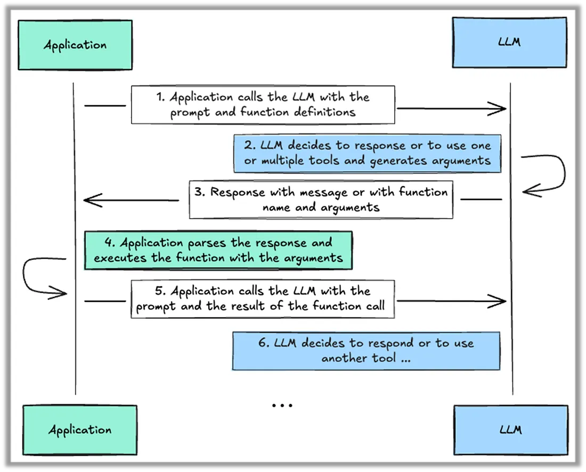
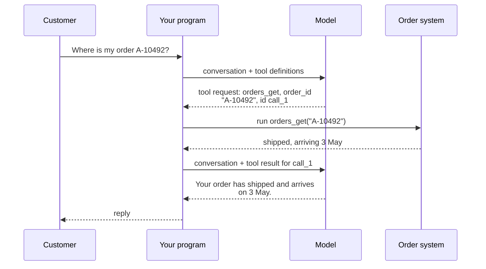

# Lesson 01: Tool Calling

### How a model acts through tools, and the practices that make it pick, use and recover from them well

Tool calling is how a model, which only produces text, gets things done in the real world: it asks your program to run a function, receives the result and continues. It is the building block under every agent in this lecture. Most failures of real agents also start here: the wrong tool is picked, an email address lands where an order number belongs, a search that legitimately found nothing is retried, or a verification step the prompt demanded is skipped. This lesson first explains exactly what tool calling is and how one call travels between the model and your program, and then works through the best practices that prevent those failures, each with a short scenario.

<p align="center">
  
</p>

### Learning Objectives

By the end of this lesson, you will be able to:

- **Explain** what tool calling is, and trace one call from the tool definition to the final answer.
- **Read** a tool definition and the messages a call adds to the conversation.
- **Write** tool descriptions that a model routes to correctly, and fix misrouting.
- **Size** a toolset by splitting, consolidating and constraining tools, and set the tool choice mode.
- **Design** results and errors so the model knows whether to retry, fix, change course or escalate.
- **Decide** which rules belong in code before a tool runs rather than in the prompt.

---

### Lesson Content

#### What tool calling is

A language model cannot open a database, call an API or send an email. All it can do is read text and write text. **Tool calling**, also called function calling, turns that limitation into a protocol: you tell the model which functions exist in your program, and instead of answering in prose the model can reply with a structured request to run one of them with specific arguments. Your program, not the model, executes the function and sends the result back, and the model uses it to continue. The model is in charge of deciding *what* to do; your code stays in charge of *doing* it.

The idea grew out of research showing that models can learn when and how to call external APIs from a few examples ([Schick et al., 2023](https://arxiv.org/abs/2302.04761)), and model providers then trained it into their models and built it into their APIs, so that tool requests come back as structured data rather than text your code has to parse. Today every major provider supports it under similar names: OpenAI and Azure OpenAI call it function calling, Anthropic tool use, and the Model Context Protocol of lesson 04 standardises it across applications.

#### What a tool looks like to the model

You describe each tool with three parts, sent along with the conversation on every request:

| Part | What it is | Example for a shop's order lookup |
| :-- | :-- | :-- |
| Name | A short, unique identifier | `orders_get` |
| Description | Plain language saying what the tool does and when to use it | "Looks up an order by its number and returns its status and delivery date" |
| Input schema | The arguments the tool accepts, in [JSON Schema](https://json-schema.org/overview/what-is-jsonschema): names, types, formats, which are required | `order_id`: a string like "A-10492", required |

```json
{
  "name": "orders_get",
  "description": "Looks up an order by its number (format A-12345). Returns status, items and delivery date. Use it when a customer asks about a specific order.",
  "parameters": {
    "type": "object",
    "properties": { "order_id": { "type": "string", "description": "Order number, e.g. A-10492" } },
    "required": ["order_id"]
  }
}
```

That definition is all the model knows about the tool. It never sees your code, your database or your API documentation, so whether it picks this tool for the right questions, and fills `order_id` with an order number rather than an email address, depends entirely on these few lines. That is why most best practices later in this lesson are about writing them well.

#### One tool call, step by step



*Figure 1. One tool call: the model requests, the program executes, the result returns matched by its identifier, and the model writes the answer.*

Each step adds a message to the conversation, which is how the model keeps track of what happened:

| Message | Written by | Content |
| :-- | :-- | :-- |
| User message | The customer | "Where is my order A-10492?" |
| Assistant message with a tool request | The model | Tool name, arguments as JSON, a call identifier; the response's finish signal says "tool requested" |
| Tool result message | Your program | The function's output, tagged with the same call identifier |
| Assistant message with the answer | The model | The reply to the customer; the finish signal says "finished" |

Three details matter in practice. The model may request **several tools in one response**, for example the order and the customer's address at once; your program runs independent ones in parallel and returns every result. The **arguments are generated text**, so they can be malformed or wrong even when they look plausible, and must be validated like any input from outside. And a **tool choice** setting controls whether calling a tool is optional: `auto` (the default) lets the model decide, `required` forces at least one call, a named tool forces that one, and an allowed-tools list restricts calls to a subset, for instance lookups only until the customer's identity is verified ([OpenAI function calling](https://developers.openai.com/api/docs/guides/function-calling)).

#### How well models use tools, and what the practices fix

Models are now reliable at the mechanics: the Berkeley Function Calling Leaderboard found that current models handle single, well-specified calls well, while memory, dynamic decisions and long multi-step use remain open problems ([Patil et al., 2025](https://proceedings.mlr.press/v267/patil25a.html)). Models also invent API usage less when they are given accurate documentation ([Patil et al., 2023](https://arxiv.org/abs/2305.15334)). In practice, that means most problems with tools come from how they are designed rather than from the model, and they fall into four groups, which the rest of this lesson takes in turn:

| Problem | Example | Best practice |
| :-- | :-- | :-- |
| The model picks the wrong tool or writes wrong arguments | The customer tool is called for a repair question | Write descriptions that route correctly |
| The model has too many or overlapping tools to choose from | 22 near-identical tools | Size and shape the toolset |
| The model cannot tell what went wrong | "Nothing found" and "database down" look the same | Design results and errors |
| The model skips a rule it was told to follow | A refund without identity verification | Enforce critical rules in code |

#### Descriptions decide which tool is called

A bicycle repair shop describes two tools as "Gets customer information" and "Gets repair information". Asked "is my bike ready?", the assistant calls the customer tool, because both descriptions fit. A description that routes reliably reads like a brief that would let a new colleague use the tool, covering five things: **purpose**, accepted **inputs** and formats, **typical requests**, **limits**, and the **boundary** with sibling tools.

```text
repairs_get: Looks up a repair job by job number (R-12345) or the customer's
  phone number. Returns status, work done, price and pick-up date. Use it for
  "is my bike ready?" questions. Does not return contact details: use customers_get.
```

| Symptom | Fix |
| :-- | :-- |
| Two tools both fit and the wrong one is picked | Expand both descriptions, stating the boundary between them |
| One generic tool (`analyze_document`) is used for everything | Split it into purpose-specific tools: extract fields, summarise, verify a claim |
| Look-alike names (`get_info`, `get_details`) | Rename by service and resource: `customers_get`, `repairs_get` |
| Right tool, wrong arguments | Unambiguous parameter names (`user_id`, not `user`), format examples, enumerations |


#### How many tools, and which ones

An analytics agent connected to 22 tools (three queries and nineteen near-identical transformations) keeps picking the wrong transformation. Fewer, distinct tools are chosen more reliably: reducing the tools offered cut execution time by up to 70% with higher success rates ([Paramanayakam et al., 2024](https://arxiv.org/abs/2411.15399)), retrieving only relevant tools raised selection accuracy from 13.62% to 43.13% ([Gan and Sun, 2025](https://arxiv.org/abs/2505.03275)), and OpenAI suggests fewer than 20 functions per turn as a soft guideline, noting that overlap matters more than count ([OpenAI guide](https://cdn.openai.com/business-guides-and-resources/a-practical-guide-to-building-agents.pdf)).

| The tools are | Fix |
| :-- | :-- |
| Variations of one job with one shape | Consolidate into one tool with a parameter: the nineteen transformations become `transform_data(operation=...)`, 22 tools become 4 |
| Different jobs for different roles | Split across agents, a small set each |
| Able to reach more than the role needs | Constrain: `load_document` accepts only document links, unlike `fetch_url` |
| Wrapping raw endpoints | Build around tasks: `schedule_event` instead of `list_users`, `list_events`, `create_event` |


#### What a tool returns, and how it fails

Results become context for every later step, so return readable names rather than opaque identifiers, a concise format by default (about a third of the tokens of the detailed one in Anthropic's example), and pagination with a hint on how to narrow. Failures need more care. A vet clinic's search for a pet owner who never visited returns an empty list, the same as when the database is down, so the assistant retries three times and escalates for nothing.

| Outcome | Retry? | The agent should |
| :-- | :-- | :-- |
| Transient: timeout, rate limit | Yes, a limited number of times | Retry after a wait, then report |
| Validation: wrong format, missing field | After fixing the input | Correct the arguments from the error message |
| Business rule: refund above the limit | No | Explain, or take another path such as approval |
| Permission: no access to the account | No | Stop and escalate |
| Valid empty result: nothing matched | No, it succeeded | Say nothing was found, ask for another detail |


#### Enforce in code what must always hold

An electronics shop's prompt says "always verify identity before a refund", and suppose the logs show 8% of refunds without verification. Better wording lowers the rate but never to zero: in 2024 even the strongest agent solved under 25% of retail tasks consistently across eight trials ([Yao et al., 2024](https://arxiv.org/abs/2406.12045)), and although newer models score much higher, success still falls when the same task must succeed on every repeated run ([Barres et al., 2025](https://arxiv.org/abs/2506.07982)). A **prerequisite gate** fixes it: the refund tool refuses unless identity was verified in this session, and its error tells the model to verify first. The rule: if one failure costs money, security or compliance, enforce it in code (gates, limits, approval above a threshold); style and format stay in the prompt. Frameworks expose these checks as hooks or guardrails. A check **before** the call can block, rewrite or pause it for approval, and is the only place that prevents an action; a step **after** the call normalises results, such as converting three date formats into one. OpenAI recommends rating each tool low, medium or high risk by write access, reversibility and financial impact. Mutating tools also need idempotency keys, and tool output is data, never instructions: [excessive agency](https://genai.owasp.org/llmrisk/llm062025-excessive-agency/) and indirect prompt injection ([Greshake et al., 2023](https://arxiv.org/abs/2302.12173)) are why the gate in code, not the model, decides what runs.

**Practices overview**

| Practice | Why | Evidence |
| :-- | :-- | :-- |
| Describe purpose, inputs, requests, limits and boundaries | The description is all the model has for choosing | [Anthropic](https://www.anthropic.com/engineering/writing-tools-for-agents) |
| Keep toolsets small and distinct; consolidate and constrain | Fewer, distinct choices are selected reliably | [Paramanayakam et al. (2024)](https://arxiv.org/abs/2411.15399) |
| Categorise errors; never return a failure as an empty result | The model chooses its recovery from the result | [MCP tools](https://modelcontextprotocol.io/specification/latest/server/tools) |
| Gate financial, security and compliance rules in code | Prompts never reach zero failures | [Yao et al. (2024)](https://arxiv.org/abs/2406.12045) |

#### In practice

Start with two or three tools built around real questions, write each description as a brief, and read real transcripts before changing anything. Mark every tool read-only or mutating on day one and route all calls through one function that holds the gates. The most common mistakes are wrapping every endpoint, returning everything the API returns, and writing a prompt sentence where a check in code was needed.

**Summary:**
- Tool calling lets the model request a function by name with JSON arguments; your program runs it and returns the result, and the definition (name, description, schema) is all the model knows.
- Descriptions decide routing; fix misrouting by expanding, splitting or renaming before adding examples.
- Keep toolsets small and distinct, and use tool choice for fixed steps.
- Categorise failures, keep empty results distinct from errors, and enforce costly rules in code before the call.

---

### References

- Schick et al. (2023), [Toolformer](https://arxiv.org/abs/2302.04761); Patil et al. (2023), [Gorilla](https://arxiv.org/abs/2305.15334); JSON Schema, [What is JSON Schema?](https://json-schema.org/overview/what-is-jsonschema).
- Patil et al. (2025), [BFCL](https://proceedings.mlr.press/v267/patil25a.html); Paramanayakam et al. (2024), [Less is More](https://arxiv.org/abs/2411.15399); Gan and Sun (2025), [RAG-MCP](https://arxiv.org/abs/2505.03275); Yao et al. (2024), [τ-bench](https://arxiv.org/abs/2406.12045); Barres et al. (2025), [τ²-Bench](https://arxiv.org/abs/2506.07982); Greshake et al. (2023), [Indirect Prompt Injection](https://arxiv.org/abs/2302.12173); Anthropic (2025), [Writing effective tools for agents](https://www.anthropic.com/engineering/writing-tools-for-agents); OpenAI, [Function calling](https://developers.openai.com/api/docs/guides/function-calling) and [A practical guide to building agents](https://cdn.openai.com/business-guides-and-resources/a-practical-guide-to-building-agents.pdf); [MCP tools specification](https://modelcontextprotocol.io/specification/latest/server/tools); OWASP (2025), [LLM06 Excessive Agency](https://genai.owasp.org/llmrisk/llm062025-excessive-agency/).

### Further Reading

- [Lesson 02: Agent Architectures and ReAct](02-agent-architectures-and-react.md) - the loops and the orchestrator that decide which tools to call.
