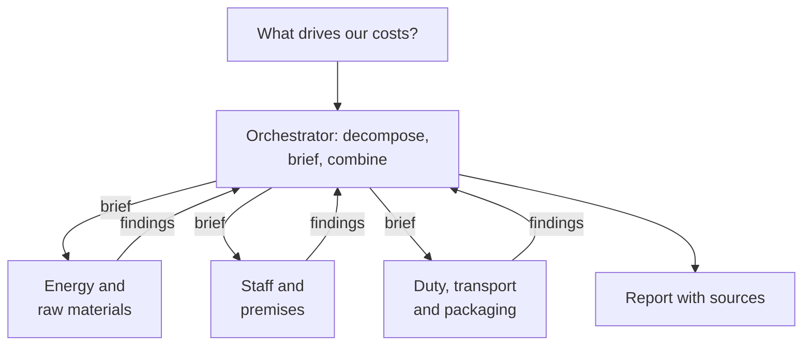

# Lesson 02: Agent Architectures and ReAct

### Who decides the next step: fixed patterns, the ReAct loop, and an orchestrator with subagents

When the steps of a task are known, code should decide them. When the next step depends on what a tool returned, the model decides, in the ReAct loop. When the work is too broad for one context, an **orchestrator** splits it across **subagents** and combines what they find. This lesson covers all three, with most space on the orchestrator, where the easy-to-miss decisions are how the work is split, what each subagent is told, and how results and errors come back.

  

### Learning Objectives

By the end of this lesson, you will be able to:

- **Choose** between a fixed pipeline, ReAct and an orchestrator with subagents.
- **Design** an orchestrator: decomposition, briefs, parallel subagents, result formats and error propagation.
- **Diagnose** multi-agent failures by tracing them to their origin, and fix attention dilution.

---

### Lesson Content

#### Fixed patterns and ReAct

A bookshop checks 40 new catalogue listings every week with the same steps, so a **fixed pipeline** (a chain, a router or parallel calls) runs them in order: consistent, cheap and easy to debug. A bakery asking "why do the website's stock figures disagree with the shop's?" cannot write the steps in advance, so the agent must decide each step from the last result. ReAct ([Yao et al., 2022](https://arxiv.org/abs/2210.03629)) does this by interleaving a **thought**, an **action** (a tool call) and an **observation** (the result) until the model can answer, which reduced hallucination compared with reasoning alone. Native tool calling implements the same loop, which ends on the finish signal of lesson 00 and needs step and cost budgets enforced in code. Anthropic's guide to [building effective agents](https://www.anthropic.com/engineering/building-effective-agents) recommends starting with fixed workflows and moving to agents only when the steps genuinely cannot be fixed.

#### The orchestrator and its subagents

A brewery asks for a report on what drives its costs. One agent would fill its context with dozens of pages; an orchestrator instead splits the question, starts a subagent with a clean context for each part, and combines the findings. In Anthropic's [multi-agent research system](https://www.anthropic.com/engineering/multi-agent-research-system), this design beat a single agent by 90.2% on an internal research evaluation, while using about 15 times the tokens of a chat.

*Figure 1. Hub and spoke: every brief and result passes through the orchestrator; subagents never talk to each other.*

Routing everything through the hub gives one place to log, one error policy and control over what each subagent sees. The orchestrator has four duties: **select** only the subagents a request needs (opening hours need one search, not a research run), **partition** the scope so no two subagents do the same work, **refine** by checking the draft for gaps and sending targeted follow-ups, and **route** every message. Effort should follow the request: Anthropic's early versions spawned 50 subagents for simple queries, and the fix was 1 agent for simple fact-finding, 2 to 4 subagents for comparisons, and more than 10 only for complex research.

**A gap in the report is usually the orchestrator's fault.** If the brewery's orchestrator assigns only energy and raw materials, each subagent does thorough work and the report still says nothing about staff or excise duty. When every subagent did its job and whole categories are missing, fix the decomposition; better searches or a stronger writer cannot.

#### Briefing subagents and bringing results back

A subagent starts with only what its brief contains: not the orchestrator's conversation, not other subagents' results. Anthropic found vague briefs caused gaps and duplicated work, and that each brief needs an objective, an output format, guidance on tools and sources, and boundaries. Give the goal and quality criteria rather than a fixed procedure, pass complete findings, and give each subagent only the tools its role needs.

An architecture firm's proposal shows why findings must travel as structured records. The search subagent returned links and the document subagent page numbers, but the orchestrator passed only the text, so the proposal cites nothing. The fix is in the hand-over: each finding keeps its claim and its source in separate fields, as in `{"claim": "...", "source": "Supplier case study 2025", "page": 14}`.

Independent subagents should be requested in the same turn so they run in parallel; Anthropic reports research time cut by up to 90% this way. Errors follow the hub too. A florist's subagent comparing five wholesalers sees two time out: it retries those itself, then reports three prices, which two failed and why. Returning an empty result as success, or aborting the whole task on one failure, both leave the orchestrator deciding blind.

OpenAI's [guide to building agents](https://cdn.openai.com/business-guides-and-resources/a-practical-guide-to-building-agents.pdf) calls this the **manager pattern**, where a central agent calls specialists as tools and keeps the conversation, and contrasts it with the **decentralised pattern**, where one agent hands the conversation to another, as a support desk transfers a caller to billing.

#### Attention dilution and multi-pass review

Given all 40 listings at once, the bookshop's reviewer comments in detail on the first few, flags a missing author in listing 3 but not in listing 31, and misses a wrong price in listing 35. Attention spreads unevenly over long inputs ([Liu et al., 2023](https://arxiv.org/abs/2307.03172)), and a bigger context window does not change that. Give each item its own pass, which can run in parallel, then run one **integration pass** that only compares items, such as inconsistent judgements and duplicates.

#### Failures and how to choose

[Cemri et al. (2025)](https://arxiv.org/abs/2503.13657) catalogued 14 multi-agent failure modes across system design, misalignment between agents and task verification, and [Cognition](https://cognition.com/blog/dont-build-multi-agents) warns that parallel agents deciding on partial context produce conflicting work. Both point to one rule: split reading and research across agents, and keep decisions and actions with side effects in one place. Agents are also inconsistent across runs: in 2024 the best agent solved under 25% of retail tasks in all of eight trials ([Yao et al., 2024](https://arxiv.org/abs/2406.12045)), and newer models, though much stronger, still lose accuracy when a task must succeed on every repeated run ([Barres et al., 2025](https://arxiv.org/abs/2506.07982)), so test each task several times.

| Task | Architecture |
| :-- | :-- |
| Steps known in advance | Fixed pipeline: chain, router or parallel |
| Path depends on results, fits one context | ReAct with step and cost budgets |
| Broad and separable research | Orchestrator with subagents; one place decides and acts |
| Many items to review | Per-item passes plus an integration pass |

#### In practice

Default to a fixed pipeline and move to ReAct only when real requests show the path cannot be fixed. With an orchestrator, spend the design effort on the decomposition and the briefs: check the subtopics against the question's full breadth, pass structured findings with sources, log every brief and result, and when a result is incomplete, read the briefs before changing the subagents.

**Summary:**
- Fixed pipelines for known steps, ReAct when the path depends on results, an orchestrator when the work is broad.
- The orchestrator selects, partitions, refines and routes; gaps usually trace back to its decomposition.
- Subagents start with nothing: brief them with goals, boundaries and structured findings, and have them report partial results and failures.
- Review many items with per-item passes plus an integration pass.

---

### References

- Yao et al. (2022), [ReAct](https://arxiv.org/abs/2210.03629); Liu et al. (2023), [Lost in the Middle](https://arxiv.org/abs/2307.03172); Cemri et al. (2025), [Why Do Multi-Agent LLM Systems Fail?](https://arxiv.org/abs/2503.13657); Yao et al. (2024), [τ-bench](https://arxiv.org/abs/2406.12045); Barres et al. (2025), [τ²-Bench](https://arxiv.org/abs/2506.07982).
- Anthropic (2024), [Building effective agents](https://www.anthropic.com/engineering/building-effective-agents), and (2025), [How we built our multi-agent research system](https://www.anthropic.com/engineering/multi-agent-research-system); OpenAI, [A practical guide to building agents](https://cdn.openai.com/business-guides-and-resources/a-practical-guide-to-building-agents.pdf); Cognition (2025), [Don't Build Multi-Agents](https://cognition.com/blog/dont-build-multi-agents).

### Further Reading

- [Lesson 01: Tool Calling](01-tool-calling.md) - the calls these architectures are built from.
- [Lesson 03: Building Agents: Orchestration, State and Memory](03-building-agents-orchestration-and-memory.md) - frameworks, handoffs to people and resuming work.
