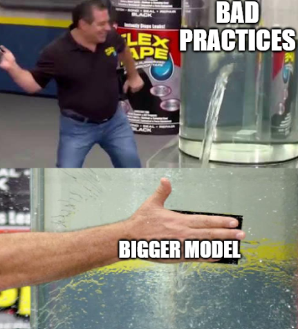
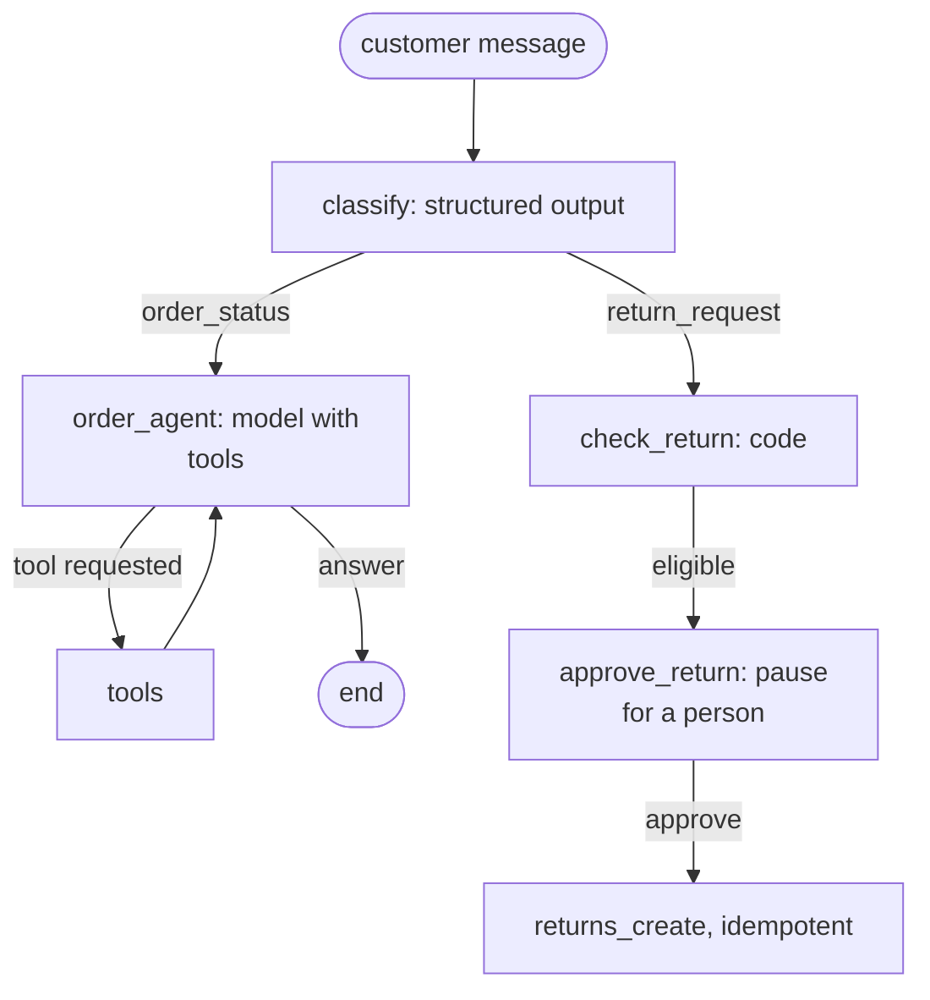

# Lesson 03: Building Agents: Orchestration, State and Memory

### How agent patterns become a running program, and how it hands over and resumes work

Turning an agent pattern into a program raises questions the pattern leaves open: where the conversation lives between steps, how a run pauses for a person and resumes an hour later, what the agent remembers tomorrow, and what a person receives when the agent hands a case over. Most frameworks answer with the same **orchestration model**: typed state, steps that update it, edges that decide what runs next, and a store that saves the state after every step. This lesson presents that model, the kinds of memory, three framework styles, the companion notebook, and three practical patterns for handoffs, multi-part requests and resumed work.

  

### Learning Objectives

By the end of this lesson, you will be able to:

- **Describe** the orchestration model, and choose where each fact belongs in memory.
- **Compare** graph-based, code-loop and event-driven frameworks, and trace the companion notebook.
- **Apply** patterns for handing over to a person, handling several requests at once, and resuming work.

---

### Lesson Content

#### The orchestration model and memory

The **state** is a typed record shared by all steps, so nothing is passed implicitly. **Nodes** are functions that read the state and return an update (`classify`, `order_agent`, `check_return`); **edges** are fixed transitions or conditional ones that name the next node, such as a router by category; a **loop** is an edge back to an earlier node, as in ReAct between the model and its tools, bounded by a step budget. A **checkpoint** saves the state after each step, so a run can resume after a failure, and an **interrupt** pauses a run until a person answers, such as an approval.

| Kind of memory | Lives in | Good for |
| :-- | :-- | :-- |
| Working memory | The messages in the context window | The current reasoning; keep it short, since long contexts are used unevenly ([Liu et al., 2023](https://arxiv.org/abs/2307.03172)) |
| Structured state | Typed fields, saved by checkpoints | Facts the program relies on: ids, decisions, flags ([Sumers et al., 2023](https://arxiv.org/abs/2309.02427)) |
| Checkpoints | A store keyed by conversation thread | Pausing, resuming, replaying and debugging |
| Long-term memory | An external store, retrieved when relevant | Preferences and past cases, in tiers as in MemGPT ([Packer et al., 2023](https://arxiv.org/abs/2310.08560)) |

#### Frameworks and the worked notebook

A framework is not required, and the Hugging Face [Agents Course](https://huggingface.co/learn/agents-course/unit2/introduction) notes that a fixed sequence of prompts can be plain code. When one is adopted, its style matters more than its feature list: [LangGraph](https://docs.langchain.com/oss/python/langgraph/overview) models a state graph with persistence and interrupts, suited to workflows with branches and approvals; [smolagents](https://huggingface.co/docs/smolagents/index) is a minimal code loop in which agents can write actions as code; and [LlamaIndex Workflows](https://developers.llamaindex.ai/python/framework/module_guides/workflow/) chain steps through typed events, suited to retrieval-heavy pipelines. Whichever you choose, check that you can see every prompt, that runs can resume, that approvals are enforced in code, and that traces use an open format.

The companion notebook [code/order_support_agent.ipynb](code/order_support_agent.ipynb) builds an order-support assistant in the graph style, adapted from the course's email-sorting notebook. It runs on Azure OpenAI, or offline with a scripted model.

*Figure 1. The notebook's graph: a router, a ReAct loop, a deterministic check and an approval interrupt. The customer identity comes from state, never from the model, and only the approval node can call the mutating tool.*

#### Handing over, several requests at once, and resuming work

**Handing over to a person.** A plumbing company's assistant cannot settle a disputed invoice. The staff member reads the handoff note, not the transcript, so the note must stand on its own: the customer identifier (account 48213, verified), what was asked and tried (disputed call-out charge; invoice and visit log checked), the assessed cause (the visit logged twice), the exact amount (85.00 EUR) and a recommended action (refund and merge the records). OpenAI's [guide to building agents](https://cdn.openai.com/business-guides-and-resources/a-practical-guide-to-building-agents.pdf) names two triggers for such a handover, exceeding a failure threshold and high-risk actions such as large refunds, and both are best detected in code.

**Several requests in one message.** "Return the sofa, change my delivery address, and how many loyalty points do I have?" holds three tasks. Split the message into its items, investigate each (in parallel where independent) using the context they share, the customer's account, and send one reply covering all three. Answering only the first, or in three separate exchanges, loses requests.

**Resuming work later.** An accounting firm's agent finds three spreadsheet errors; overnight the client fixes them.

| Option | Use when |
| :-- | :-- |
| Resume the saved thread with its full history | Nothing relevant has changed |
| Fork from a checkpoint into an independent branch, as in LangGraph's [time travel](https://docs.langchain.com/oss/python/langgraph/use-time-travel) | Comparing two approaches from the same analysis |
| Start fresh with a structured summary of findings and of what changed | Earlier tool results are stale, or the history is cluttered |

Resuming here would be a mistake: the old spreadsheet contents remain in the history as tool results, so the agent recommends fixes already made or answers inconsistently. A fresh run that starts from "three errors found in these three files, now reportedly fixed; re-check only these files" keeps what was learned and drops what is stale.

**Practices overview**

| Practice | Why | Evidence |
| :-- | :-- | :-- |
| Put facts the program relies on in typed state | Code can check a field, not a conversation | [Sumers et al. (2023)](https://arxiv.org/abs/2309.02427) |
| Checkpoint runs that pause or fail; enforce approval with an interrupt | Resume instead of restart; approval in code | [LangGraph](https://docs.langchain.com/oss/python/langgraph/overview) |
| Hand over with a self-contained note, triggered in code | People do not read transcripts | [OpenAI guide](https://cdn.openai.com/business-guides-and-resources/a-practical-guide-to-building-agents.pdf) |

#### In practice

Model the state first, keep deterministic steps as code nodes, checkpoint runs that can pause, and give every run a step budget. Write one small agent by hand before adopting a framework. Design the handoff note and the resume policy before launch, because both are needed on the first difficult day.

**Summary:**
- Frameworks share an orchestration model: typed state, nodes, edges, loops, checkpoints and interrupts.
- Memory comes in tiers, from working memory in the prompt to long-term stores retrieved on demand.
- Handoff notes stand alone; multi-part requests get one reply; stale runs restart from a summary.

---

### References

- Sumers et al. (2023), [CoALA](https://arxiv.org/abs/2309.02427); Packer et al. (2023), [MemGPT](https://arxiv.org/abs/2310.08560); Liu et al. (2023), [Lost in the Middle](https://arxiv.org/abs/2307.03172).
- Hugging Face, [Agents Course, Unit 2](https://huggingface.co/learn/agents-course/unit2/introduction); [LangGraph](https://docs.langchain.com/oss/python/langgraph/overview) and [time travel](https://docs.langchain.com/oss/python/langgraph/use-time-travel); [smolagents](https://huggingface.co/docs/smolagents/index); [LlamaIndex Workflows](https://developers.llamaindex.ai/python/framework/module_guides/workflow/) (accessed October 2026); OpenAI, [A practical guide to building agents](https://cdn.openai.com/business-guides-and-resources/a-practical-guide-to-building-agents.pdf).

### Further Reading

- [Lesson 04: Introduction to MCP](04-introduction-to-mcp.md) - connecting agents to tools through a standard protocol.
