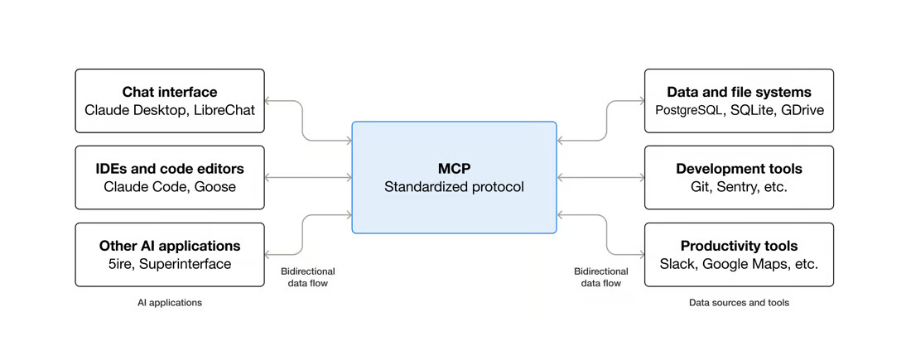
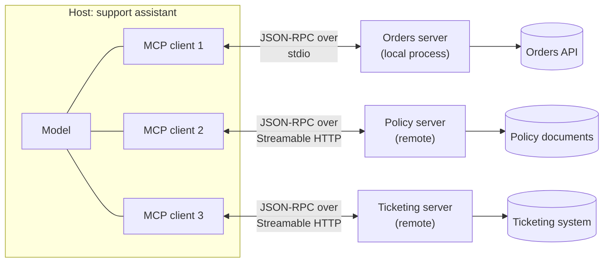
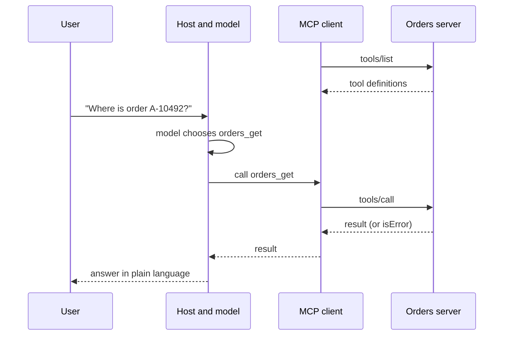

# Lesson 04: Introduction to MCP

### One open protocol for connecting agents to tools and data

Every agent so far had tools written for one application. When several applications need the same services, each writes its own integration with its own definitions, errors and security checks, and the number of integrations grows as applications times services. The Model Context Protocol (MCP) replaces that grid: a service is wrapped once as an MCP server, and any application that speaks the protocol can discover and use it. This lesson covers what MCP aims to do, how it works, and how an application connects to an MCP server. *Details follow specification version 2026-07-28 and the official Python SDK 2.*

<p align="center">
  
</p>

### Learning Objectives

By the end of this lesson, you will be able to:

- **Explain** the aim of MCP and the roles of hosts, clients and servers.
- **Trace** how a client discovers and calls tools, over a local or remote transport.
- **Connect** an MCP server to an existing host through its configuration.
- **Build** a minimal client loop that gives your own agent the tools of an MCP server.
- **Apply** the security duties of hosts, clients and servers.

---

### Lesson Content

#### What MCP is and what it aims to do

The project's [introduction](https://modelcontextprotocol.io/docs/getting-started/intro) compares MCP to a USB-C port for AI applications, and the [specification](https://modelcontextprotocol.io/specification/latest) takes inspiration from the Language Server Protocol, which let one language server work across many editors. The aim is the same: describe a capability once, in a standard way, so that any application can plug it in without custom code.

Take a retailer whose support assistant and analytics chatbot both need the order system and the policy store. Without a protocol that is four integrations, each with its own tool definitions and error handling; with MCP it is two servers that both applications reuse, and a third application costs no new integration at all.

<p align="center">
  
</p>

*Figure 1. MCP turns integrations per pair of application and service into one server per service.*

MCP standardises how capabilities are described and exchanged, not how the model uses them: the model still chooses tools exactly as in lesson 01, and the tool still runs your code. What changes is who writes the glue, and how often.

#### How it works

An application that uses MCP is a **host**, such as a chat assistant, an IDE or your own agent. For every server it connects to, the host creates one **client**, which holds the connection to that **server**. The server is a program that offers capabilities; messages between client and server are JSON-RPC 2.0.



*Figure 2. The host creates one client per server; messages are JSON-RPC 2.0, [a stateless, light-weight remote procedure call protocol](https://www.jsonrpc.org/specification).*

| Feature | Offered by | For | Example |
| :-- | :-- | :-- | :-- |
| Tools | Server | The model to execute | `orders_get`, `returns_create` |
| Resources | Server | Context for the user or the model | The returns policy, a customer record |
| Prompts | Server | The user, as templated workflows | A refund conversation template |
| Elicitation | Client | Servers asking the user for input or confirmation | "Confirm the return for order A-10492" |

Messages travel over a **transport**. With **stdio**, the host launches the server as a local subprocess and they talk through its standard input and output, which suits tools on one machine. With **Streamable HTTP**, the server runs as a remote service that many hosts share, behind normal web authentication, which suits a company's internal APIs.

When the client connects, it agrees a protocol version with the server; after that, requests are stateless, each carrying the version and capabilities in a `_meta` field. The client asks for the server's tools with `tools/list`, puts their definitions in the model's context, and calls the one the model chooses with `tools/call`; servers can notify clients when the list changes. One question then flows like this:



*Figure 3. Discovery once, then one call per tool the model chooses; the model never talks to the server directly.*

Each tool has a `name` (unique within its server), a `description` the model reads, an `inputSchema` in JSON Schema, and optionally an `outputSchema` and behaviour `annotations`, which are untrusted unless the server is. The tool list may depend on the caller's credentials, so each user sees only what they may use. The [tools specification](https://modelcontextprotocol.io/specification/latest/server/tools) separates two kinds of failure: an unknown tool, a malformed request or a server fault is a JSON-RPC **protocol error**, which the model can rarely fix; a failed API call, an input validation error or a broken business rule is a **tool execution error**, a normal result with `isError: true` and a message the model can act on.

#### In practice: connecting to an MCP server

Most of the time the server already exists: a vendor publishes one for its product, or another team wraps an internal API such as the retailer's order system. The work on the application side is to connect to it, and there are two ways, depending on whether the host is an existing application or your own agent. The snippets below follow the official [build-client](https://modelcontextprotocol.io/docs/2026-07-28/develop/build-client) tutorial, applied to the retailer's orders server.

**Option 1: register the server in an existing host.** Desktop assistants, IDEs and chat platforms read a configuration that lists servers. A local server is described by the command that starts it; a remote one by its URL. The common shape is an `mcpServers` entry:

```json
{
  "mcpServers": {
    "orders": {
      "command": "uv",
      "args": ["--directory", "C:/projects/orders-mcp", "run", "server.py"]
    },
    "policies": {
      "url": "https://mcp.internal.example.com/policies"
    }
  }
}
```

With no further code, the host starts or reaches each server, lists its tools and offers them to the model. For a local server, use an absolute path (on Windows, forward slashes or doubled backslashes). For a remote one, the host also needs credentials, usually a sign-in the host handles or a token from a secret store, never written into the file. The exact key names vary slightly between hosts, so check each host's documentation.

**Option 2: connect from your own agent.** When the host is your own code, the SDK's `Client` holds the connection, and the loop around it is the tool-calling loop of lesson 01 with `list_tools` and `call_tool` in place of local functions. The model call here uses Azure OpenAI, with endpoint, key and API version read from environment variables.

```python
import json
from mcp import Client, StdioServerParameters
from mcp.client.stdio import stdio_client
from mcp_types import TextContent
from openai import AzureOpenAI

llm = AzureOpenAI()
server = StdioServerParameters(command="uv", args=["run", "server.py"])

async def ask(client: Client, question: str) -> str:
    tools = [{"type": "function", "function": {
                 "name": t.name, "description": t.description,
                 "parameters": t.input_schema}}
             for t in (await client.list_tools()).tools]
    messages = [{"role": "user", "content": question}]
    for _ in range(5):  # cap the number of model turns
        reply = llm.chat.completions.create(
            model="gpt-4.1-mini", messages=messages, tools=tools).choices[0].message
        if not reply.tool_calls:
            return reply.content
        messages.append(reply)
        for call in reply.tool_calls:
            result = await client.call_tool(call.function.name, json.loads(call.function.arguments))
            text = "\n".join(b.text for b in result.content if isinstance(b, TextContent))
            messages.append({"role": "tool", "tool_call_id": call.id,
                             "content": f"ERROR: {text}" if result.is_error else text})
    return "I could not complete this request."

async def main() -> None:
    async with Client(stdio_client(server)) as client:
        print(await ask(client, "Where is order A-10492?"))
```

Entering the `async with` block starts the server and agrees the protocol version; leaving it shuts the server down, so the connection should stay open for the whole session rather than per question. For a remote server, only the transport changes: the SDK's Streamable HTTP client takes the server's URL in place of the command, and the rest of the loop stays the same. Two details carry over from lesson 01: a failed tool comes back with `is_error` set rather than as an exception, so the loop passes the error to the model as text it can act on; and the loop has a cap, so a confused model cannot call tools forever.

When connecting servers, teams usually:

| Practice | Why |
| :-- | :-- |
| Look for a maintained server (databases, ticketing, file stores) before asking for a new one | Many common systems already have one |
| Keep a list of approved servers, with owners and versions | A server is code that reaches your data; it needs review like a dependency |
| Read each server's tool list and descriptions before enabling it | Descriptions go straight into the model's context |
| Enable only the tools the application needs, and count tools across all servers | The host passes every tool from every server as one flat list to the model |
| Give each connection the narrowest credentials | The server acts with whatever access the client hands it |
| Trace every tool call like any other | Debugging and cost need the same telemetry as local tools ([Lecture 5, Lesson 01](../L5_LLMOps/01-observability-and-telemetry.md)) |

#### Security duties

Connecting a server lets text and code written by someone else into the agent's loop. The specification's principles are that users consent to all data access and operations, and that tools represent arbitrary code execution, so their descriptions are untrusted unless they come from a trusted server.

| Side | Duties (specification) |
| :-- | :-- |
| Host | Obtain consent before exposing data or invoking tools; make clear what is shared and done |
| Client | Confirm sensitive operations, show inputs before calling, validate results, time out calls, log usage |
| Server | Validate all inputs, enforce access control, rate limit, sanitise outputs |

Research shows why these duties matter: [Hou et al. (2025)](https://arxiv.org/abs/2503.23278) mapped 16 threat scenarios across the server lifecycle, and [Radosevich and Halloran (2025)](https://arxiv.org/abs/2504.03767) showed leading models could be coerced through MCP tools into malicious code execution, remote access control and credential theft.

**Practices overview**

| Practice | Why | Evidence |
| :-- | :-- | :-- |
| Use MCP when several applications share tools | The protocol pays off with reuse | [MCP specification](https://modelcontextprotocol.io/specification/latest) |
| Keep one connection open per session | Connecting starts the server and negotiates the version | [Build an MCP client](https://modelcontextprotocol.io/docs/2026-07-28/develop/build-client) |
| Check `is_error` and pass the message to the model | Failed tools return results, not exceptions | [Build an MCP client](https://modelcontextprotocol.io/docs/2026-07-28/develop/build-client) |
| Read a third-party server's descriptions before connecting | Descriptions reach the model and can carry injected instructions | [Hou et al. (2025)](https://arxiv.org/abs/2503.23278) |
| Grant the narrowest credentials and keep approvals in your own client | Limits what a coerced model can reach | [Radosevich and Halloran (2025)](https://arxiv.org/abs/2504.03767) |

#### In practice

Start by registering an existing server in a host to see discovery and calls at work, then connect the same server from your own agent with the SDK client, first locally over stdio and then remotely over Streamable HTTP with proper credentials. Read and restrict every third-party server, confirm anything that changes data, and log every call like any other tool call. The most common mistake is to trust a server because it was easy to install.

**Summary:**
- MCP aims to replace an integration per pair of application and service with one server per service that any host can use.
- Hosts create one client per server; they speak JSON-RPC over stdio for local servers or Streamable HTTP for shared ones.
- Clients discover tools with `tools/list` and call them with `tools/call`; protocol errors are for the client, execution errors return as results the model can act on.
- In practice: connect to a server by registering it in a host's `mcpServers` configuration, or by opening a `Client` in your own agent's loop.
- Tools are arbitrary code execution: hosts get consent, clients confirm and validate, servers validate and restrict.

---

### References

- Model Context Protocol, [What is MCP?](https://modelcontextprotocol.io/docs/getting-started/intro), [Specification](https://modelcontextprotocol.io/specification/latest) and [Tools specification](https://modelcontextprotocol.io/specification/latest/server/tools) (version 2026-07-28); [JSON-RPC 2.0 Specification](https://www.jsonrpc.org/specification).
- Model Context Protocol, [Build an MCP client](https://modelcontextprotocol.io/docs/2026-07-28/develop/build-client), with code in [quickstart-resources](https://github.com/modelcontextprotocol/quickstart-resources) (accessed October 2026).
- Hou et al. (2025), [MCP: Landscape, Security Threats, and Future Research Directions](https://arxiv.org/abs/2503.23278); Radosevich and Halloran (2025), [MCP Safety Audit](https://arxiv.org/abs/2504.03767).

### Further Reading

- [Lesson 01: Tool Calling](01-tool-calling.md) - the definitions, errors and checks MCP standardises.
