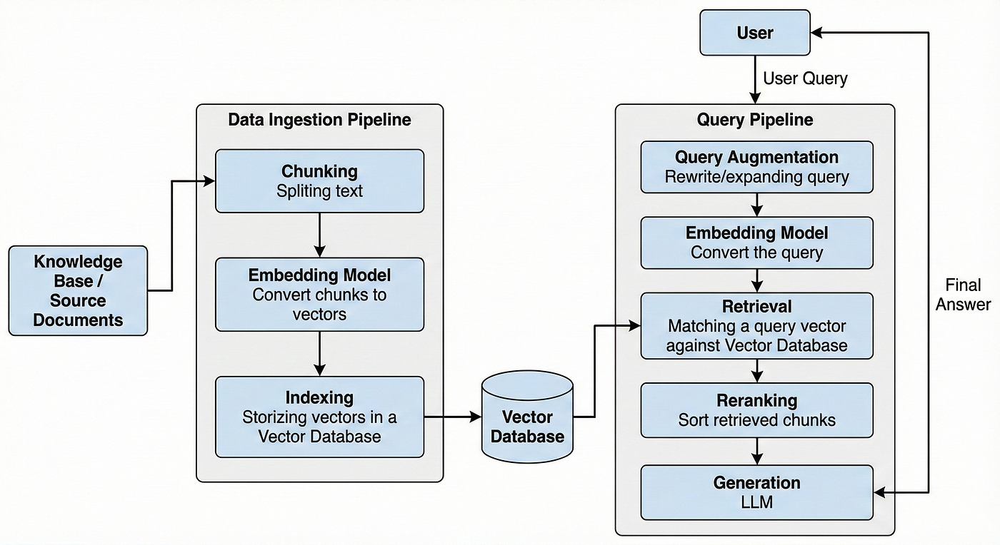
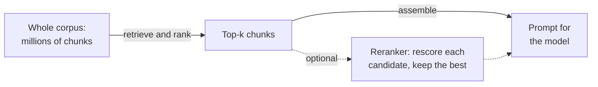
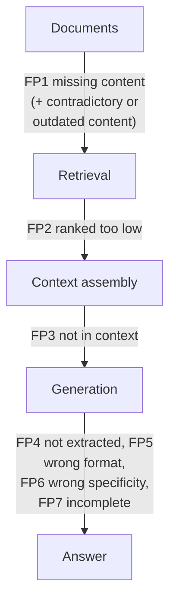

# Lesson 00: Introduction to RAG

### Answering from your documents, and the architecture that makes it work

A language model answers from what it absorbed during training. That knowledge stops at a cutoff date, it never included your company's private documents, and when the answer is missing the model may still produce a fluent, confident and wrong one. A retail chain's FAQ assistant shows the problem plainly: the returns window, the delivery fees and this month's promotion live in the chain's own pages, change every few weeks, and are exactly what customers ask about.

Retrieval-augmented generation (RAG) addresses this by searching your documents at question time and placing the relevant passages in the prompt, so that the model answers from evidence it can see instead of from memory. The idea is simple to state and has many moving parts in practice: documents must be prepared and split, turned into searchable representations, stored in an index, retrieved, and finally handed to the model in a form it can use. This lesson introduces the idea, the architecture and the vocabulary, and the rest of the lecture takes the stages one at a time.

  

### Learning Objectives

By the end of this lesson, you will be able to:

- **Explain** why a language model needs retrieval, and when RAG fits better than fine-tuning or a long prompt.
- **Describe** the indexing and query pipelines of a RAG system and the role of each stage.
- **Define** the core concepts: chunk, embedding, sparse and dense retrieval, index, top-k, reranking and grounding.
- **Identify** where a RAG system can fail along the pipeline.
- **Place** naive, advanced and modular RAG on a map of the techniques the course covers next.

---

### Lesson Content

#### Why a model needs retrieval

Three limits of a model on its own motivate retrieval. Its knowledge is frozen at training time, so anything that changed afterwards is missing. Its knowledge covers what was public and frequent in the training data, so private and niche facts are missing too. And when it does not know, it does not reliably say so, which is how fluent but invented answers reach users. The survey of [Gao et al. (2023)](https://arxiv.org/abs/2312.10997) names the same problems, hallucination, outdated knowledge and reasoning that cannot be traced, as the reasons RAG emerged.

The paper that named RAG, [Lewis et al. (2020)](https://arxiv.org/abs/2005.11401), describes this as combining two kinds of memory. **Parametric memory** is what the model learned during training and stores in its parameters, its weights; it is fixed until the model is trained again. **Non-parametric memory** is an external index of documents that is searched at question time; it can be updated, inspected and cited without touching the model. Ideally, RAG keeps the model's parametric memory for language and reasoning and takes the facts from the non-parametric one. In practice the two mix: a model may answer from what it learned in training even when the right passage is in the prompt, or blend both, and it is hard to tell from the answer alone which memory it used.

Retrieval is not the only way to give a model new knowledge, so it helps to compare it with the alternatives. Fine-tuning changes the model's weights by training on your documents. [Ovadia et al. (2023)](https://arxiv.org/abs/2312.05934) compared unsupervised fine-tuning with RAG for injecting knowledge and found that RAG consistently outperformed it, both for knowledge seen during training and for entirely new knowledge, and that models struggle to learn new facts through unsupervised fine-tuning. Long-context prompting puts whole documents in the prompt. [Li et al. (2024)](https://arxiv.org/abs/2407.16833) compared the two and found that, with enough resources, long-context models outperform RAG on average, while RAG remains far cheaper, and they proposed routing each query to one or the other. Their setting matters, though: each question came with its own long document, such as a full book or report, which had to be read to answer it. That is a fair comparison when a system answers questions about one long document or a few, but it is rarely an alternative for a company's knowledge base, which is usually far larger than any context window and changes every week.

| Approach | How knowledge reaches the model | Strength | Weakness |
| :-- | :-- | :-- | :-- |
| Model alone | Training data (parametric memory) | No infrastructure | Outdated, no private data, may invent |
| Fine-tuning | Changed weights (parametric memory) | Style, format and domain behaviour | Poor at adding new facts, retraining to update |
| Long-context prompt | Whole documents in every prompt | Simple, strong when the source is one long document or a few | Cost per question; impossible once the corpus exceeds the window |
| RAG | Relevant passages retrieved per question (non-parametric memory) | Current, private, cheap, citable | Many stages, each of which can fail |

For a corpus that changes often, is too large for a prompt and must be cited, as with the FAQ assistant, RAG is usually the right default, and fine-tuning remains useful for teaching tone or format rather than facts.

#### The architecture: two pipelines

A RAG system has two pipelines that run at different times. The **indexing pipeline** runs offline, whenever documents change: it collects the sources, parses and cleans them, splits them into chunks, turns each chunk into a searchable representation and stores it in an index. The **query pipeline** runs for every question: it searches the index for the best-matching chunks, assembles a prompt from them and asks the model to answer from them.

> An answer that is supported by the retrieved passages is called **grounded**, and showing which passage supports each claim, a **citation**, lets a reader check it.

  

*Figure 1. The two pipelines of a RAG system and the vector database that connects them.*

Most stages have a lesson in this lecture, and each one passes its mistakes downstream, so a problem created early cannot be repaired later.

| Stage | What it does |
| :-- | :-- |
| Data preparation | Turns raw pages and files into clean, labelled records, and keeps them in sync |
| Chunking | Splits records into passages small enough to match and large enough to mean something |
| Embedding | Turns each passage and each question into a vector that captures meaning |
| Indexing | Stores vectors, and for keyword search the terms, so matches can be found quickly at scale |
| Retrieval | Finds the chunks that best match the question: by keywords (sparse), by embedding similarity (dense), or both (hybrid) |
| Generation | Answers from the assembled passages, with citations |

> Everything before generation exists to rank passages by how likely each is to answer the question. The last step then builds a new prompt and sends it to the model: the few best passages, pasted in as text, followed by the user's question and an instruction to answer only from those passages. The model is not retrained and does not search anything itself; it simply reads the passages we sent alongside the question and writes its answer from them, so the quality of the answer depends mostly on which passages we chose to send.

#### The core vocabulary

A few concepts recur throughout the lecture, and they are easier to learn together because each depends on the others.

| Concept | Plain meaning | FAQ assistant example |
| :-- | :-- | :-- |
| Document | A source as it exists: a page, a PDF, a table | The returns policy page |
| Chunk | A passage cut from a document, the unit that is retrieved | The paragraph on the 30-day window |
| Metadata | Labels stored with each chunk | Category "returns", country, last updated |
| Embedding | A list of numbers that represents the meaning of a text, so that similar texts get nearby vectors | The question "can I send back shoes" lands near the returns paragraph |
| Sparse retrieval | Keyword search that scores chunks by the words they share with the question, such as BM25 | Finds the promotion code "SPRING25" exactly |
| Dense retrieval | Search by embedding similarity, matching meaning | Finds "send back" when the page says "return" |
| Hybrid retrieval | Both combined, so each covers the other's blind spots | Codes and paraphrases both found |
| Index | The data structure that stores vectors or terms for fast search | Millions of chunks searched in milliseconds |
| Top-k | The number of chunks kept from a search, already in ranked order | The 5 best chunks |
| Reranking (optional) | A second model scores each question and chunk pair and reorders the candidates; fast per pair, but run once per candidate | Rescoring 50 candidates to keep the 5 that answer the question |
| Context window | How much text the model can read in one prompt | The budget for passages, instructions and the question |

Two ideas connect these. Search works by **scoring relevance**, and each method scores differently: dense retrieval represents the question and the chunks as embeddings and takes the closest vectors, sparse retrieval counts the words a chunk shares with the question and weights rare words more, and hybrid retrieval combines the two rankings. Every method returns its results already ordered, so the top-k are simply the first k. And every stage trades **recall**, finding all the relevant passages, against **precision**, keeping out the irrelevant ones: a larger k finds more but lets in more noise.

*Figure 2. The retrieval funnel. Retrieval already returns a ranked list; reranking is an optional refinement.*

Reranking is not required for a working RAG system, and it is left out of the basic pipeline above. Advanced systems add it when evaluation shows that the right passage is retrieved but ranked too low: the retriever returns a larger candidate list in one pass, and the reranker scores each question and candidate pair to reorder it. Each pair costs one scoring call, so reranking 50 candidates means 50 calls, while asking the retriever for 100 results instead of 50 costs little more. Reranking is covered in Lecture 4.

#### From naive to modular RAG

The survey of [Gao et al. (2023)](https://arxiv.org/abs/2312.10997) groups RAG systems into three paradigms, which also map the rest of the course.

| Paradigm | What it adds | Where in the course |
| :-- | :-- | :-- |
| Naive RAG | Index, retrieve, generate: the basic pipeline of Figure 1 | This lecture |
| Advanced RAG | Optimisations before retrieval, such as query rewriting and better indexing, and after it, such as reranking and context compression | Lecture 4: advanced retrieval, re-ranking, evaluation |
| Modular RAG | Interchangeable modules and flows, such as routing, repeated or adaptive retrieval, and retrieval as a tool an agent decides to call | Lecture 2 (agents and tools) and the routing techniques of Lecture 4 |

#### Where RAG fails

Every stage can fail, and the failure usually shows up only in the final answer, which makes it hard to trace. [Barnett et al. (2024)](https://arxiv.org/abs/2401.05856) drew on three case studies to name seven failure points: missing content (the answer is not in the documents), missed top-ranked documents (the answer exists but ranks too low to be returned), not in context (it was retrieved but did not make it into the prompt), not extracted (it was in the prompt but the model did not use it), wrong format, incorrect specificity, and incomplete answers. They also concluded that validating a RAG system is only feasible during operation, and that its robustness evolves over time rather than being designed in at the start. One more failure at the first stage is common in practice: **contradictory or outdated content**. Organisations keep adding documents and rarely remove old ones, so the index may hold last year's returns policy next to this year's, and retrieval can return either, or both, leaving the model to pick. Lesson 01 covers the metadata and sync practices that keep superseded versions out.

*Figure 3. The seven failure points of Barnett et al. placed along the pipeline, plus contradictory or outdated content, which the paper does not list.*

#### In practice

Start with a plain pipeline on a small, real corpus and a set of real questions, and measure retrieval before tuning generation, since most bad answers trace back to a passage that was never retrieved or never reached the prompt. Keep the indexing pipeline repeatable so that a change in documents is a re-run and not a manual fix, and store enough metadata to filter and to cite. Add advanced techniques, such as hybrid search or reranking, one at a time and keep each only if the measurement improves. The most common mistakes are judging a RAG system by a handful of demo questions, blaming the model for answers the retriever made impossible, and stuffing the prompt with passages in the hope that more context helps.

**Summary:**
- A model alone is outdated, lacks private data and may invent answers; RAG retrieves evidence at question time and lets the model answer from it.
- RAG pairs parametric memory, what the model learned in its weights during training, with non-parametric memory, an index searched at question time; it usually beats fine-tuning for new facts, while long prompts can be stronger but cost far more.
- The indexing pipeline prepares, chunks, embeds and indexes documents; the query pipeline retrieves, assembles and generates.
- Retrieval returns a ranked list and trades recall against precision; reranking is an optional refinement for when the right passage ranks too low.
- Naive, advanced and modular RAG map the course: the basic pipeline here, optimisations in Lecture 4, and agents and routing in Lectures 2 and 4.
- Failures can occur at every stage, from missing content to answers that ignore the right passage.

---

### References

- Lewis et al. (2020), [Retrieval-Augmented Generation for Knowledge-Intensive NLP Tasks](https://arxiv.org/abs/2005.11401). Parametric and non-parametric memory.
- Gao et al. (2023), [Retrieval-Augmented Generation for Large Language Models: A Survey](https://arxiv.org/abs/2312.10997). Naive, advanced and modular RAG.
- Ovadia et al. (2023), [Fine-Tuning or Retrieval? Comparing Knowledge Injection in LLMs](https://arxiv.org/abs/2312.05934). RAG versus unsupervised fine-tuning.
- Li et al. (2024), [Retrieval Augmented Generation or Long-Context LLMs? A Comprehensive Study and Hybrid Approach](https://arxiv.org/abs/2407.16833). RAG versus long context, and routing between them.
- Barnett et al. (2024), [Seven Failure Points When Engineering a Retrieval Augmented Generation System](https://arxiv.org/abs/2401.05856). Failure points from three case studies.

### Further Reading

- [code/simple_rag.ipynb](code/simple_rag.ipynb) - the two pipelines of this lesson in a few lines of Python, with commentary.
- [Lesson 01: Data Preparation, Ingestion and Indexing](01-data-preparation.md) - the first stage of the indexing pipeline.
- [Lecture 4: Advanced RAG and Evaluation](../L4_Advanced_RAG_and_evaluation/README.md) - advanced retrieval, re-ranking, groundedness and faithfulness.
- [Lecture 2, Lesson 02: Agent Architectures and ReAct](../L2_Agentic_systems_and_tool_calling/02-agent-architectures-and-react.md) - the loops in which retrieval becomes a tool.
