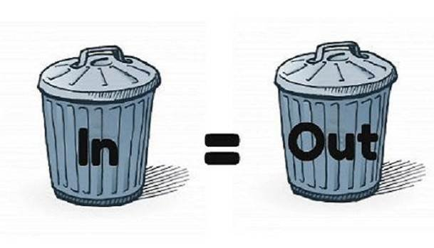

# Lesson 01: Data Preparation, Ingestion and Indexing

### Turning raw documents into clean, labelled, searchable records

A RAG system can only answer from what its index contains, and everything in the index was put there by the indexing pipeline. Before any passage can be chunked, embedded or retrieved, the source documents have to be fetched, parsed, cleaned, labelled and kept in step with the originals. A table flattened into a stream of numbers, a policy page buried under cookie banners, or last year's price list left next to this year's cannot be repaired by a better embedding model or a smarter prompt later on. This is the classic *garbage in, garbage out* problem, and it is why data preparation is arguably the most important part of the pipeline, even though it is the least visible one.

The difficulty is that real knowledge is scattered and messy: web pages, PDFs, Word documents, spreadsheets and slide decks, spread across a CMS, a file share, a wiki and a database, each changing on its own schedule. This lesson follows a document from where it lives to the index and answers four questions in turn: how each source is fetched, how each format becomes clean text, why numeric data needs its own treatment, and how metadata and incremental sync keep the index correct over time.

  

### Learning Objectives

By the end of this lesson, you will be able to:

- **Plan** how each data source is fetched: scheduled pulls, push notifications and the practices that make runs safe to repeat.
- **Choose** a parsing technique and tool for HTML, PDF, Office, scanned and chart-heavy documents.
- **Explain** why numeric data retrieves poorly with embeddings and keyword search, and when to use a query tool instead.
- **Design** the metadata and privacy controls that keep an index filterable, citable and safe.

---

### Lesson Content
#### Where the data lives, and how it is consumed

Knowledge sits in many systems at once, and each one is reached in its own way. Ingestion starts by connecting to every source the way that system allows, on a schedule that follows how often the source changes and how fresh answers must be.

| Source | Examples | How it is fetched |
| :-- | :-- | :-- | 
| APIs | Internal, product or partner APIs | Call the endpoints with pagination and an "updated since" filter, within rate limits |
| Internal systems | Jira, Confluence, ServiceNow, SAP | The system's API or an official connector, filtered by updated date; respect each system's permissions | 
| Databases | PostgreSQL, SQL Server, Oracle | Change data capture, or a query for rows updated since the last run |
| File shares | SharePoint, Google Drive, network drives | List files through the platform API filtered by last-modified time; export Google files first | 
| Buckets (cloud storage) | Amazon S3, Azure Blob Storage, Google Cloud Storage | List objects by prefix and last-modified time, or subscribe to object-created and object-deleted events |

The most common practice is a **scheduled pull**: a cron job, or a scheduler such as Airflow or a cloud scheduler, runs the ingestion every night or every hour and asks each source only for what changed since the last successful run. Sources that can notify you through webhooks or a change feed are better read on **push**, so a corrected price reaches the index in minutes. Whatever the mechanism, store a **cursor** (the timestamp or token of the last successful run) so the next run knows where to start, make every run **idempotent** so a rerun after a crash upserts the same records instead of duplicating them, retry failed calls with backoff, and align schedules so that no two syncs leave the index answering from mismatched versions.

#### Turning each format into clean text

Once fetched, each item has to become clean text plus its structure, and how hard that is depends on the format.

| Format | Typical problem | Technique |
| :-- | :-- | :-- |
| HTML pages | Navigation, footers and cookie banners drown the content | Strip boilerplate, keep headings, lists and tables |
| Born-digital PDF | Two columns, repeated headers, tables flattened into lines | Layout-aware conversion to Markdown or JSON |
| Scanned PDF or image | No text layer | OCR, then check quality, because errors silently poison retrieval |
| Word and Google Docs (`.docx`) | Headings, tables, comments and tracked changes | Convert to Markdown keeping the heading structure; handle tracked changes deliberately |
| PowerPoint and Google Slides (`.pptx`) | Short fragments, meaning carried by layout and speaker notes | Convert per slide, keeping the slide title and notes |
| Pages with charts, diagrams or forms | Text extraction loses the visual content | Describe each page with a vision LLM |

Google Docs, Sheets and Slides are stored in Google's own format and read through the Google Drive API, which [exports](https://developers.google.com/workspace/drive/api/guides/ref-export-formats) them to `.docx`, `.xlsx` (or CSV, first sheet only) and `.pptx`, so exporting first lets one parser handle both families. A few tools cover most of the rest:
- [PyMuPDF](https://pymupdf.readthedocs.io/en/latest/) is a fast, widely used library for extracting text, images and page layout from PDFs, and a good default for born-digital PDFs.
- [pdfplumber](https://github.com/jsvine/pdfplumber) gives detailed access to every character, line and rectangle on a PDF page, with table extraction and visual debugging; it works best on machine-generated PDFs and is the usual choice when tables need careful extraction.
- [Docling](https://docling-project.github.io/docling/) uses layout-analysis and table-structure models to turn PDFs, Office files and images into structured Markdown or JSON, so headings and tables survive instead of becoming a stream of lines.
- For pages whose meaning is in charts, diagrams or forms, a **vision LLM**, a multimodal model that accepts images, can do the parsing: each page is sent as an image with an instruction, and the description is chunked and indexed like any other text.

> **A note on storing tables and numbers.** Documents mix prose with tables and figures: a fee table halfway down a returns policy, prices and dimensions on a product sheet, figures in a report. Chunked together with the text, those values blend into the gist of the chunk, a long table is scattered across chunks that lose their column headers, and the exact number a question needs ranks below prose that repeats its words. Small tables inside documents can stay in the index if each row keeps its column names and context. Numerical spreadsheets and data tables are a different case: they carry little information for an embedding to capture, and answering from them usually means filtering, grouping or calculating across many rows ("how did sales in Lisbon evolve over six months?"), which retrieval cannot do. For these, evaluate storing them outside the RAG pipeline, in a database or a dataframe, and giving the model access through tool calling: the model writes a query, or fills in a predefined function such as `get_sales(region, months)`, and the program runs it against the data and returns the exact result. Retrieval then handles the documents and the tool handles the numbers.

#### Metadata and privacy

Cleaning removes what should never be searched: boilerplate, exact duplicates (the same page reachable from two URLs) and stale versions. Each record also needs **metadata**, labels stored beside the text, because retrieval uses them to filter (only documents for this store, language or year), to cite ("Returns policy, updated 1 September") and to control access. Settings that apply to every record, such as the embedding model and the chunker version, belong to the index itself: all records in one index must share them, so changing either means building a new index and switching to it once it is complete.

| Field | Why the record needs it |
| :-- | :-- |
| `source`, `section`, `page` | Citations, and debugging when an answer is wrong |
| `updated` | Freshness, and keeping superseded versions out |
| `language`, `region`, numeric fields such as `price` | Filters that keep answers relevant |
| Access control list | Enforced in the retrieval layer, never in the prompt |
| `hash` | Detects changes without comparing full text |

Privacy belongs in ingestion and cannot wait until answer time, because anything embedded and indexed can be retrieved and quoted, and deleting it later means finding every chunk and vector that contains it. Scrub or tokenize personal data (emails, phone numbers, account numbers) before chunking, and leave out sources that should never be searchable, such as raw support tickets, unless the use case demands them and permissions are enforced.

#### In practice

The cheapest improvements usually come from reading the data. Open twenty parsed documents, find the ones where a table or a heading is wrong, and fix the parser before touching embeddings. Decide per source how it is fetched and how often, put metadata in from the first version, since adding it later means re-ingesting everything, and keep personal data out at the door. Route large numeric data to a query tool from the start instead of trying to make it retrievable.

**Summary:**
- Each source is fetched in its own way, usually by a scheduled pull or a push notification, with a cursor, idempotent runs and aligned schedules.
- Format decides the parsing technique and tool; vision LLMs handle chart-heavy pages, and tables keep their captions, column names and units.
- Numeric data retrieves poorly with both embeddings and BM25: normalise formats, filter numbers through metadata, and send large tables to a query tool.
- Attach metadata for filtering, citation, freshness and permissions, scrub personal data before embedding

---

### References

- Docling, [documentation](https://docling-project.github.io/docling/) and [GitHub repository](https://github.com/docling-project/docling) (accessed October 2026). Layout-aware conversion of PDF and Office documents.
- PyMuPDF, [documentation](https://pymupdf.readthedocs.io/en/latest/) and [GitHub repository](https://github.com/pymupdf/PyMuPDF) (accessed October 2026). PDF text and layout extraction.
- pdfplumber, [GitHub repository](https://github.com/jsvine/pdfplumber) (accessed October 2026). Character-level PDF extraction and tables.
- Google, [Drive API export formats](https://developers.google.com/workspace/drive/api/guides/ref-export-formats) (accessed October 2026).

### Further Reading

- [Lesson 00: Introduction to RAG](00-introduction-to-rag.md) - the previous lesson.
- [Lesson 02: Chunking Strategies](02-chunking-strategies.md) - the next lesson.
- [Lecture 4, Lesson 03: Evaluating Retrieval](../L4_Advanced_RAG_and_evaluation/03-evaluating-retrieval.md) - the harness for judging data changes.
