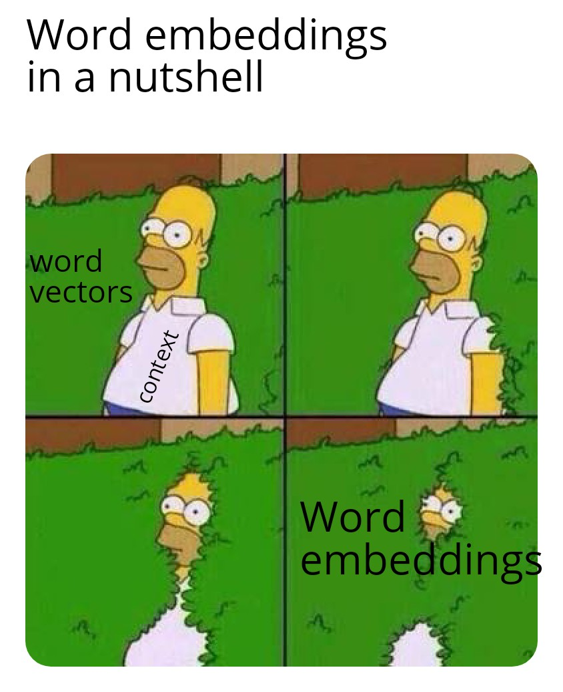
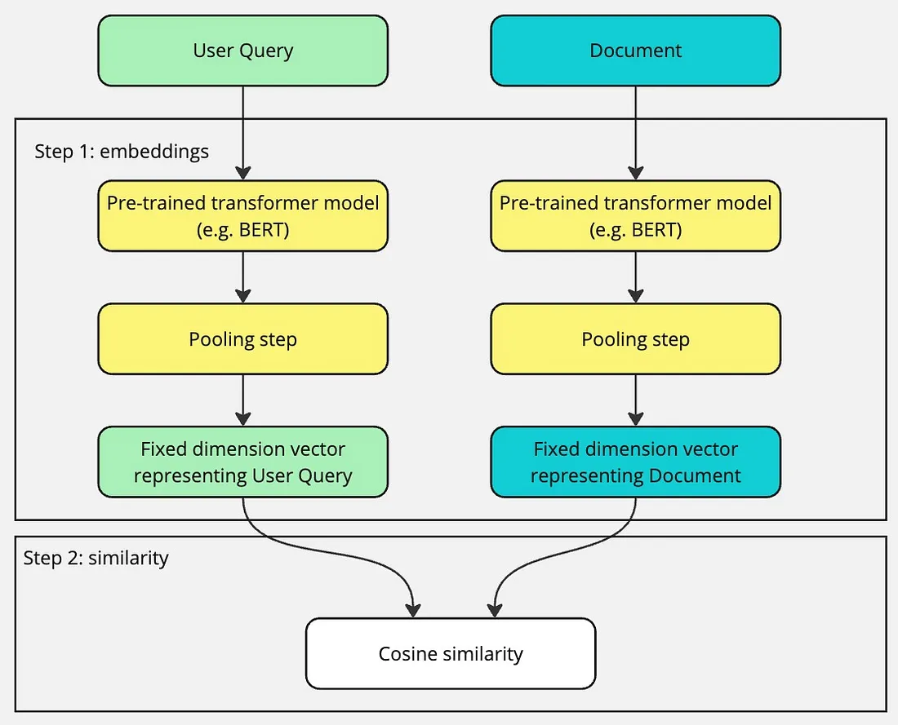
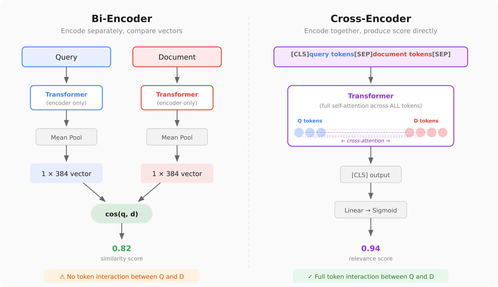
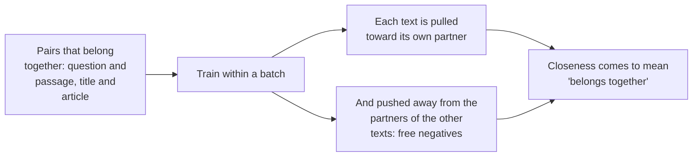

# Lesson 03: Embedding Models

### Turning text into vectors that capture meaning

A customer asks "is a voucher refundable?" and the policy says "gift cards cannot be returned". Keyword search cannot connect the two, because they share no words, although a person sees the same topic at once. Embedding models make that connection by turning each piece of text into a list of numbers, so that texts about the same thing land close together and a retrieval system can match meaning instead of spelling.

This lesson is about **bi-encoders**, the kind of embedding model that every major embedding API offers and therefore the kind enterprises use in practice. It explains what an embedding is and what semantic information it carries, how a bi-encoder is used at indexing and at question time, how it is trained, how to choose one, and which models are on the market today. The scenario is still the retail FAQ assistant.

  

### Learning Objectives

By the end of this lesson, you will be able to:

- **Explain** what an embedding is and how it captures the meaning of a text as a vector.
- **Describe** how a bi-encoder embeds chunks at indexing time and questions at query time, and why retrieval depends on that split.
- **Outline** how bi-encoders are trained, and the practical rules that follow.
- **Choose** an embedding model using quality on your own questions, dimensions, context length, languages, cost and stability.
- **Compare** the main bi-encoder models that enterprises use today through APIs.

---

### Lesson Content

#### What an embedding is

An embedding is a dense vector of fixed dimension *d* (typically 256 to 4,096 floating-point values) that an encoder model computes from a text to represent its semantic content. The text is first split into tokens, and a transformer turns each token into a contextual vector, one that depends on the surrounding tokens, so that "return" in "return policy" and in "return to the menu" are represented differently. A pooling step (the mean of the token vectors, or the vector of a special or final token) then reduces this variable-length sequence to a single vector of *d* values, so a five-word question and a 500-word chunk map to points in the same *d*-dimensional space. The representation is distributed: no individual dimension stands for a readable feature such as topic or language; the meaning is encoded in the position of the vector as a whole, and training shapes that space so that texts with the same meaning, such as "is a voucher refundable?" and "gift cards cannot be returned", are mapped to nearby points even when they share no tokens, while unrelated texts are mapped far apart. Producing these vectors is the scope of this lesson; the way they are compared at question time is covered in the next lesson, on retrieval.

The model that produces the embeddings comes in two kinds. **Closed models** are reached through a provider's API: you send text, pay per token and get vectors back, with nothing to run yourself. **Open-weight models** publish their trained weights under a licence such as Apache 2.0 or MIT, so you download them and run them on your own servers: there are no per-token fees and the text never leaves your network, but you provide the hardware, serving and updates. This lesson focuses on closed models, which most enterprise use cases rely on.

#### Bi-encoders: how embedding models are used in practice

An embedding model used for retrieval is a **bi-encoder**: it encodes one text at a time, and the same model is used on both sides of the search ([Reimers and Gurevych, 2019](https://arxiv.org/abs/1908.10084)). It works in two moments:

- **At indexing time**, every chunk is sent to the model once, and the resulting vector is stored next to the chunk in the index.
- **At question time**, only the question is sent to the model, and its vector is compared with the stored chunk vectors.

Because a chunk's vector does not depend on any question, the expensive part is done once, ahead of time, and answering a question costs one embedding call plus a fast vector comparison, even over millions of chunks. This split is what makes retrieval at scale possible, and it is why every embedding API takes a single text and returns a single vector.

  

The alternative design, a **cross-encoder**, reads the question and a chunk together and outputs a relevance score. It is more accurate because it sees both texts at once, but nothing can be computed ahead of time, so it must run once per candidate at question time. That makes it unusable for searching a whole corpus and useful only for reordering a short list of candidates the bi-encoder already found, which is reranking ([Lecture 4, Lesson 02](../L4_Advanced_RAG_and_evaluation/02-re-ranking.md)). Keyword search still wins on exact names and codes, which is why production systems often combine it with the bi-encoder. 

  

*Figure 1. Bi-encoders embed questions and chunks separately for fast retrieval, the subject of this lesson; cross-encoders read them together for precise reranking.*

| | Bi-encoder | Cross-encoder |
| :-- | :-- | :-- |
| Reads | Question and chunk separately | Question and chunk together |
| Document side | Embedded ahead of time, independent of any question | Cannot be precomputed |
| Cost | Fast over millions of chunks | One pass per candidate |
| Role | Retrieval | Reranking |

> #### How bi-encoders are trained
>
> The training idea is contrastive learning. Contrastive learning is a machine learning technique that trains models to understand similarities and differences by pulling related data points closer together in an embedding space while pushing unrelated ones apart. Take a large collection of text pairs that belong together, such as a question and its answering passage, and train the model so that each text ends up close to its own partner and far from the other texts in the batch. Repeated over millions of pairs, this teaches the model that closeness means "belongs together". Recent embedders start from large language models instead of small encoders, which is part of why they handle long inputs and many languages ([Zhang et al., 2025](https://arxiv.org/abs/2506.05176)).

*Figure 2. Contrastive training: texts that belong together are pulled close, and the other texts in the batch serve as free negatives.*

Three practical consequences follow. Many recent models expect a short instruction or a query-or-document prefix, so the model card should be followed for everything you index and query. Queries and documents must be embedded by the same model, since vectors from two models live in unrelated spaces. And an embedding reflects its training data, so vocabulary it rarely saw, such as product codes or internal jargon, is blurred, which is one reason hybrid retrieval exists.

#### Choosing a model

No single model is best at everything (there is no free lunch). The MTEB benchmark ([Muennighoff et al., 2022](https://arxiv.org/abs/2210.07316)) compared 33 models on 8 task types, 58 datasets and 112 languages and found no method that led on all tasks, so public leaderboards are good for building a shortlist and unreliable for the final decision, particularly because rankings change fast. Beyond quality on your own questions, check dimensions (more can mean better quality, and always mean a larger index and slower search), context length (a chunk must fit; on Azure OpenAI ([Microsoft](https://learn.microsoft.com/en-us/azure/foundry/openai/how-to/embeddings)) each input is limited to 8,192 tokens, with at most 2,048 inputs and 300,000 tokens per request as of the documentation consulted), languages, hosting and cost, and stability, since changing the model means re-embedding the whole corpus.

| Criterion | What to check |
| :-- | :-- |
| Quality on your task | Recall@k and MRR on your own questions |
| Dimensions | More can mean better quality, and always mean a larger index and slower search |
| Context length | A chunk must fit (Azure OpenAI: 8,192 tokens per input, 2,048 inputs and 300,000 tokens per request, as consulted) |
| Languages | Multilingual coverage if customers write in several languages |
| Cost and terms | Price per million tokens, regions where the API runs, and how the provider treats the text you send |
| Stability | Changing the model means re-embedding the whole corpus |

#### The main models today

The model landscape changes every few months, so the table below is a snapshot, taken from a [September 2026 comparison](https://www.cognee.ai/best-embedding-models) that collects each provider's published figures, limited here to the closed models reached through an API.

| Model | Provider | Encoder type | Dimensions | Max input (tokens) | Notes |
| :-- | :-- | :-- | :-- | :-- | :-- |
| `text-embedding-3-small` | OpenAI (also on Azure OpenAI) | Bi-encoder | Up to 1,536 | 8K | Cheapest of the major APIs (0.02 USD per million tokens); some quality traded for cost |
| `text-embedding-3-large` | OpenAI (also on Azure OpenAI) | Bi-encoder | Up to 3,072 | 8K | OpenAI's stronger model (0.13 USD per million tokens), with dimension reduction |
| Gemini Embedding 2 | Google | Bi-encoder | 128 to 3,072 | 8,192 | Multimodal: text, images, audio, video and PDF in one space |
| Voyage 4 family | Voyage | Bi-encoder | 256 to 2,048 | 32K | Compatible vectors across sizes, so a large model can index and a cheap one embed queries; a code-specific variant |
| Cohere Embed 4 | Cohere (API or private deployment) | Bi-encoder | 256 to 1,536 | 128K | Longest input; 100+ languages; text and images |

*Figures as published by each provider and collected by Cognee in September 2026.*

Every model in the table is a bi-encoder, and these are the models enterprises end up using for retrieval in practice. That follows from how an embedding API works: you send one text and get one vector back, without the API ever seeing the question that text will later be compared with, which is exactly the indexing and question-time split described above. When the same providers offer cross-encoders, they sell them separately as rerank APIs, which return scores rather than vectors and belong to lecture 4.

#### In practice

Shortlist two or three embedders from a benchmark, index the same corpus with each and test them on your own questions, and pick on recall@k and MRR together with cost and index size. Version everything you embed and keep the ability to rebuild, because the embedder is the component most likely to change under you. As of October 2026 the closed embedders increasingly share a backbone with large language models, support long inputs, many languages and images, and let you choose the output size, and all of them remain bi-encoders.

**Summary:**
- An embedding is a fixed-length vector that encodes the meaning of a text, so texts that say the same thing in different words land in the same region; comparing vectors is the job of retrieval.
- Retrieval uses bi-encoders: chunks are embedded once at indexing time, questions at query time, with the same model; cross-encoders only rerank a short list.
- Bi-encoders are trained contrastively, and queries and documents must use the same model and conventions.
- No model wins everywhere, so shortlist from benchmarks and decide with recall@k and MRR on your data.
- The models enterprises use through APIs (OpenAI, Google, Voyage, Cohere) are all bi-encoders.

---

### References

- Reimers and Gurevych (2019), [Sentence-BERT](https://arxiv.org/abs/1908.10084). Bi-encoders for sentences.
- Zhang et al. (2025), [Qwen3 Embedding](https://arxiv.org/abs/2506.05176). Embedders built on language models.
- Muennighoff et al. (2022), [MTEB](https://arxiv.org/abs/2210.07316). How embedders are compared.
- Cognee (2026), [Best Embedding Models in 2026: OpenAI vs Open Source by MTEB](https://www.cognee.ai/best-embedding-models). A comparison of current embedding models from published figures.
- Microsoft (accessed October 2026), [Generate embeddings with Azure OpenAI](https://learn.microsoft.com/en-us/azure/foundry/openai/how-to/embeddings). Limits and the `dimensions` parameter.

### Further Reading

- [Lesson 02: Chunking Strategies](02-chunking-strategies.md) - the previous lesson.
- [Lesson 04: Dense Retrieval with Cosine Similarity](04-retrieval-with-cosine-similarity.md) - the next lesson.
- [Lecture 4, Lesson 01: Vector Databases for RAG](../L4_Advanced_RAG_and_evaluation/01-vector-databases-and-indexes.md) - choosing where the vectors live, at scale.
