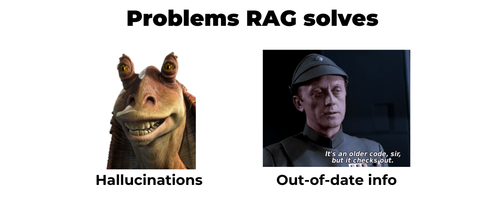
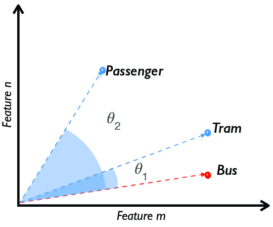
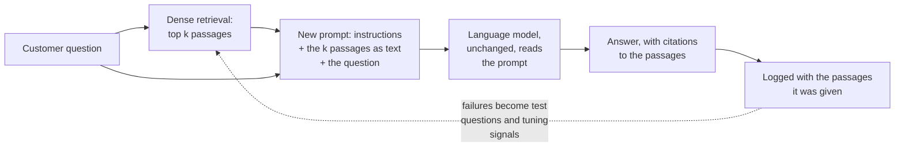

# Lesson 04: Dense Retrieval with Cosine Similarity

### Choosing which passages the language model will read, and handing them to it

Data preparation, chunking, embeddings and an index prepare the ground with clean records, sensible chunks, a vector for every chunk and an index to store them, and retrieval is the step where all of that preparation finally pays off. When a customer asks a question, the system has a few milliseconds to decide which handful of passages, out of thousands or millions, the language model will be given to read. The language model cannot search your documents by itself, so whatever retrieval leaves out is not available to it, and whatever retrieval lets in becomes the main material the answer is built from.

This lesson covers **dense retrieval**: the question and every chunk are represented by the dense vectors of an embedding model, and passages are ranked by how close their vectors are to the question's, measured with cosine similarity. It is the baseline method of a RAG system, as opposed to keyword (sparse) retrieval, which matches exact terms, and to the hybrid and re-ranking techniques of lecture 4. The lesson follows the method through: why retrieval shapes the answer so strongly, how cosine similarity ranks the chunks, how the chosen passages are handed to the language model inside a new prompt, and where dense retrieval tends to go wrong.

  

### Learning Objectives

By the end of this lesson, you will be able to:

- **Explain** why retrieval bounds the quality of a RAG answer, and why an instruction to answer only from the passages is no guarantee.
- **Describe** dense retrieval with cosine similarity, and how the top passages are handed to the language model.
- **Recognise** where dense retrieval fails, and which later technique (hybrid retrieval, re-ranking, query rewriting) addresses each failure.

---

### Lesson Content

#### Why retrieval decides the answer

In a RAG system the prompt sent to the language model holds the instructions, the question and the passages that retrieval chose. The passages are the only part that carries your documents, so a good passage near the top gives the language model the facts it needs, while a missing or buried one leaves it to fill the gap from what it learned in training, usually with full confidence. Barnett et al. ([2024](https://arxiv.org/abs/2401.05856)) found the same pattern in three production RAG systems: two of their seven failure points are retrieval failures, the answer being absent from the corpus ("missing content") or present but ranked too low to be returned ("missed the top ranked documents").

| Retrieval outcome | What the language model does | What the customer sees |
| :-- | :-- | :-- |
| The right passage, near the top | Usually answers from it | A correct, grounded answer |
| The right passage missing | Answers from the other passages or from its training data | A wrong or invented answer, delivered confidently |
| Only irrelevant passages | Tries to use them anyway, unless told to abstain | An answer about the wrong topic |
| The right passage buried among many | May overlook it, since language models use the middle of long inputs worst ([Liu et al., 2023](https://arxiv.org/abs/2307.03172)) | An incomplete answer |

There is a caveat to "the language model answers from the passages". Telling a language model to answer only from the provided passages does not make it do so, and there is no reliable way to tell from the answer alone whether a sentence came from the passages (non-parametric knowledge), from the model's training (parametric knowledge) or from a mix of both. Studies of knowledge conflicts show how unpredictable the mix is. Xie et al. ([2023](https://arxiv.org/abs/2305.13300)) found that language models readily accept coherent external evidence that contradicts what they learned, yet favour the parts that agree with their prior when the evidence is mixed. Wu, Wu and Zou ([2024](https://arxiv.org/abs/2404.10198)) found that models adopted incorrect retrieved content over their own correct prior knowledge more than 60% of the time, and were less likely to do so the more implausible the content was or the more confident the model was in its own answer. Grounding therefore has to be measured, not assumed, which is the subject of the groundedness lesson in lecture 4.

When an answer goes wrong, the most useful first question is still not what the language model said but which passages it was given.

#### How dense retrieval works

Dense retrieval treats every embedding as an arrow pointing in some direction in a space with hundreds of dimensions, so that texts about returns point roughly the same way while texts about delivery fees point somewhere else. **Cosine similarity** measures the angle between two such arrows, giving 1 when they point the same way and a value close to 0 when they are unrelated, and it deliberately ignores their length.

  

The information-retrieval textbook of [Manning, Raghavan and Schütze (2008, section 6.3)](Support_Material/Manning-et-al-Introduction-to-Information-Retrieval.pdf) explains why this became the standard way to compare documents: normalising away length means a long text does not look different from a short one just because it is long. Sentence-BERT ([Reimers and Gurevych, 2019](https://arxiv.org/abs/1908.10084)) later made the same comparison practical for modern sentence embeddings. At question time the system embeds the question with the same embedding model used for the chunks, scores it against them, and keeps the best few, as the illustrative scores below show.

| Chunk | Illustrative cosine score for "can I bring back shoes?" | Kept (k = 2) |
| :-- | :-- | :-- |
| "Items can be returned within 30 days with proof of purchase." | 0.82 | Yes |
| "Gift cards cannot be returned or exchanged." | 0.41 | Yes |
| "Delivery is free for orders over 40 euros." | 0.08 | No |

Real scores depend on the embedding model and cannot be compared across models, so the number of passages to keep (a small k, often 3 to 5 to start) and the score below which the system should admit that the documents do not cover the question are both set by measurement rather than by intuition. The threshold matters more than it seems, because retrieval always returns k passages, even for a question that has nothing to do with your documents.

#### Handing the passages to the language model

Retrieval on its own answers nothing; what turns a search into a RAG system is the hand-over that follows, in which the selected passages are pasted as text into a new prompt, next to the question and an instruction to answer from them, and sent to the language model.

*Figure 1. The retrieved passages travel to the language model inside a new prompt, and the logged results travel back to retrieval as material for improving it.*

The language model is neither retrained nor given the ability to search; it reads the passages in exactly the way it reads the question, which is what makes the hand-over so simple and also so decisive. Two feedback loops grow out of it. Within a single request, the passages are the evidence the answer is expected to stay within, and because the instruction alone does not guarantee that, how far it does is measured as groundedness. Across many requests, recording which passages were retrieved for which answers turns every wrong answer into a test case, so that retrieval improves from the very failures it causes.

#### Where dense retrieval goes wrong

Because dense retrieval rewards passages whose meaning sounds like the question, it struggles whenever relevance depends on something other than sounding alike, such as an exact code, a negation or the structure of a document.

| Failure | Example | Fix |
| :-- | :-- | :-- |
| Exact codes and names are blurred | "SPRING25" matches any promotion text | Hybrid retrieval |
| Similar is not relevant | A related but wrong passage ranks first | Re-ranking |
| Vague or conversational questions | "and for express?" | Query rewriting |
| Negation and numbers | "cannot be returned" scores close to "can be returned" | Re-ranking, hybrid retrieval |

**Practices overview**

| Practice | Why | Evidence |
| :-- | :-- | :-- |
| Inspect the retrieved passages before the answer | Many bad answers start with a passage that was missing or ranked too low | [Barnett et al. (2024)](https://arxiv.org/abs/2401.05856) |
| Keep k small and measure recall at several values | Language models use the middle of long inputs poorly | [Liu et al. (2023)](https://arxiv.org/abs/2307.03172) |
| Abstain below a score threshold | Retrieval always returns something | [Barnett et al. (2024)](https://arxiv.org/abs/2401.05856), "missing content" |
| Measure groundedness instead of trusting the instruction | Language models mix retrieved and learned knowledge unpredictably | [Wu, Wu and Zou (2024)](https://arxiv.org/abs/2404.10198) |
| Combine dense retrieval with keyword search | Keyword search stayed a robust baseline across 18 datasets | [Thakur et al. (2021)](https://arxiv.org/abs/2104.08663) |

#### In practice

Make it a habit to print the retrieved passages and their scores for every test question before reading the language model's answer, because the answer can only be as good as what it was given. The companion notebook [code/simple_rag.ipynb](code/simple_rag.ipynb) does exactly this and shows both classic failures side by side: a relevant fact that dense retrieval misses, and an off-topic question that still receives three passages of "evidence".

**Summary:**
- The passages retrieval hands to the language model are its only access to your documents, so retrieval bounds every answer.
- An instruction to answer only from the passages is not a guarantee; answers can mix retrieved and learned knowledge, so groundedness has to be measured.
- Dense retrieval scores each chunk by the cosine of the angle between embeddings and keeps the best few, above a threshold set by measurement.
- The chosen passages are pasted into a new prompt with the question, the unchanged language model answers from them, and logged failures flow back into improving retrieval.

---

### References

- Barnett et al. (2024), [Seven Failure Points When Engineering a Retrieval Augmented Generation System](https://arxiv.org/abs/2401.05856).
- Liu et al. (2023), [Lost in the Middle: How Language Models Use Long Contexts](https://arxiv.org/abs/2307.03172).
- Xie et al. (2023), [Adaptive Chameleon or Stubborn Sloth: Revealing the Behavior of Large Language Models in Knowledge Conflicts](https://arxiv.org/abs/2305.13300).
- Wu, Wu and Zou (2024), [ClashEval: Quantifying the Tug-of-War between an LLM's Internal Prior and External Evidence](https://arxiv.org/abs/2404.10198).
- Manning, Raghavan and Schütze (2008), [*Introduction to Information Retrieval*](Support_Material/Manning-et-al-Introduction-to-Information-Retrieval.pdf), section 6.3, Cambridge University Press.
- Reimers and Gurevych (2019), [Sentence-BERT](https://arxiv.org/abs/1908.10084).
- Thakur et al. (2021), [BEIR](https://arxiv.org/abs/2104.08663).

### Further Reading

- [Lesson 03: Embedding Models](03-embedding-models.md) - the previous lesson.
- Karpukhin et al. (2020), [Dense Passage Retrieval for Open-Domain Question Answering](https://arxiv.org/abs/2004.04906) - the paper that showed a trained dual encoder beating keyword search for open-domain question answering, the basis of dense retrieval as used today.
- [Lecture 4, Lesson 00: Advanced Retrieval](../L4_Advanced_RAG_and_evaluation/00-advanced-retrieval.md) - the next lesson.
