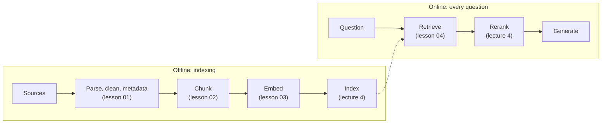
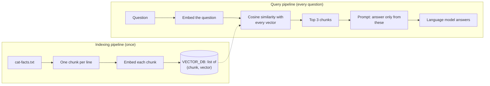

# Lecture 3: Retrieval-Augmented Generation

**Block C: Retrieval-augmented generation**

### Scope

How a system answers from documents it was not trained on: retrieval-augmented generation (RAG). A model's knowledge stops at its training cutoff and excludes your private data, and when it lacks an answer it may invent one, so RAG searches your documents at question time and gives the model the relevant passages. This lecture covers the building blocks of the retrieval pipeline, one lesson each: data preparation, chunking, embedding models and retrieval with cosine similarity. Choosing a vector database for scale, filtering and hybrid search follows in lecture 4.

### Learning Objectives

By the end of this lecture, you will be able to:

- **Explain** why a model needs retrieval, the two pipelines of a RAG system and where it can fail.
- **Design** an ingestion pipeline that fetches, parses, cleans and labels source documents, and protects personal data before indexing.
- **Choose** a chunking strategy for different content, and justify it with a retrieval measurement.
- **Explain** what an embedding encodes and how a bi-encoder is used at indexing and question time, and **choose** a closed embedding model on your own data.
- **Retrieve** passages with cosine similarity, and choose k and a score threshold.

### Support material

- [Introduction to Information Retrieval](Support_Material/Manning-et-al-Introduction-to-Information-Retrieval.pdf) (Manning, Raghavan and Schütze, 2008): section 6.3 explains cosine similarity in lesson 04; chapter 8 is used again for retrieval evaluation in lecture 4.

### Running example

A retail chain's FAQ assistant answers from returns, delivery, click and collect, loyalty and promotion pages, the same assistant whose prompt appears in lecture 1, and its documents mix prose, tables, FAQ pairs and exact codes, which exercises every stage.

### Lessons in this lecture

00. [Introduction to RAG](00-introduction-to-rag.md)
01. [Data Preparation, Ingestion and Indexing](01-data-preparation.md)
02. [Chunking Strategies](02-chunking-strategies.md)
03. [Embedding Models](03-embedding-models.md)
04. [Dense Retrieval with Cosine Similarity](04-retrieval-with-cosine-similarity.md)

### Companion notebook

[code/simple_rag.ipynb](code/simple_rag.ipynb): the smallest complete RAG system (one chunk per line, an in-memory vector store, cosine similarity, a grounded prompt), adapted from ngxson's simple RAG demo, with commentary that maps each step and limitation to the lessons. Runs offline, on Azure OpenAI or on local models.

### Coming next

- [Lecture 4](../L4_Advanced_RAG_and_evaluation/README.md): advanced retrieval and hybrid search, vector databases, re-ranking, retrieval evaluation, groundedness and faithfulness.
