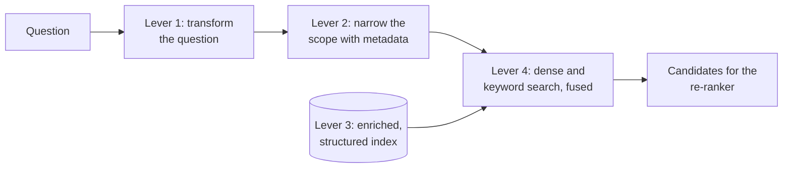
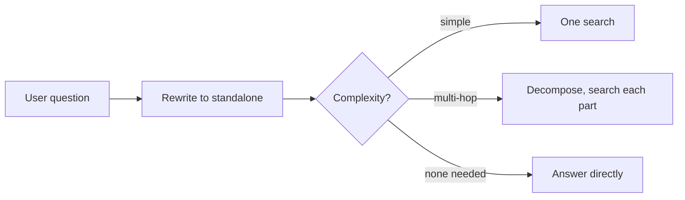
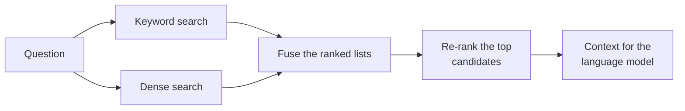

# Lesson 00: Advanced Retrieval

### Improving the first search: fixing the question, narrowing the scope, enriching the index and searching in more than one way

Basic dense retrieval with cosine similarity is a good start, and it fails in predictable places: on conversational follow-ups, on questions that bundle two requests into one, on questions that only make sense for one country or one period, on chunks that lose their meaning once they are cut out of their document, and on exact codes and acronyms that an embedding blurs. Advanced retrieval is the set of techniques that make the first search find the right passage more often, before a re-ranker puts what was found in order.

<p align="center">
  
</p>

### Learning Objectives

By the end of this lesson, you will be able to:

- **Apply** rewriting, multi-query, decomposition, HyDE and routing where they earn their cost.
- **Use** metadata to narrow a search to the documents that can contain the answer, and know what the metadata costs to maintain.
- **Choose** among index-side techniques such as contextual chunks, parent documents, summary trees and graphs.
- **Combine** keyword and dense search into a hybrid pipeline, and fuse their results.

---

### Lesson Content

#### What advanced retrieval is

Advanced retrieval covers everything that improves the first search, the step that turns a question into a pool of candidate passages, and it works on four levers. The first is **the question itself**: query transformation makes the question complete and specific before it is searched, for example by turning a follow-up into a standalone question or splitting a compound one. The second is **the scope of the search**: metadata such as country, product line or date restricts the search to the documents that can contain the answer. The third is **what is indexed**: enriching or restructuring chunks so that each one can be found for the right questions. The fourth is **how the search is run**: hybrid retrieval adds keyword search next to dense search, so that exact codes and terms have their own route to the right passage. All four serve one goal, putting the right passage among the candidates, which a re-ranker then puts in order.



*Figure 1. The four levers of advanced retrieval, all acting before re-ranking.*

#### Fixing the question before searching

The case for transforming the question is not mainly about vocabulary, since bridging different wordings for the same idea is exactly what dense retrieval is good at. It is about **intent**: the message a user types is often not a complete statement of what they want. A follow-up such as "and for express?" means nothing without the conversation before it, a compound question asks for two things that live in different documents, and a short, vague question gives the search little to work with. Transforming the question makes the intent explicit before it is searched.

| Technique | What it does | Evidence | Cost | Use when |
| :-- | :-- | :-- | :-- | :-- |
| Standalone rewriting | "and for express?" becomes "express delivery times to Portugal" | A trained rewriter gave consistent gains on open-domain and multiple-choice QA ([Ma et al., 2023](https://arxiv.org/abs/2305.14283)) | One model call | Multi-turn chat |
| Multi-query | Several rewordings of the intent, each searched, results merged | No controlled evaluation we rely on; a common practitioner technique | Extra searches | Vague questions with several plausible readings |
| Decomposition | Splits a compound or multi-hop question into sub-questions, each searched | Asking and searching follow-up sub-questions improved accuracy on compositional questions ([Press et al., 2022](https://arxiv.org/abs/2210.03350)) | Several searches | "Why did my refund fail after I changed my card?", which needs the refund policy, the payment troubleshooting guide and the customer's own transaction record |
| HyDE ([Gao et al., 2022](https://arxiv.org/abs/2212.10496)) | Embeds a model-written hypothetical answer instead of the question; the encoder filters invented details | Outperformed the strongest unsupervised dense retriever of the time without any relevance labels, and was comparable to fine-tuned retrievers | One generation | Short questions, long chunks |
| Routing ([Jeong et al., 2024](https://arxiv.org/abs/2403.14403)) | A classifier picks no retrieval, single-step or multi-step retrieval | Improved both accuracy and efficiency over other adaptive retrieval approaches on QA benchmarks | A classifier | Mixed easy and hard traffic |

In the HyDE paper, as in information retrieval generally, a "document" is simply the unit that is retrieved, which in a RAG system is a chunk; the technique helps when the question is much shorter than the chunks it must match, whatever the length of the original files.



*Figure 2. Query transformation and routing in front of the search. When an agent decides to call, rewrite and repeat retrieval itself, the system is agentic RAG.*

#### Narrowing the scope with metadata

Many questions are only answerable inside part of the corpus: "can I return this in the Lisbon store?" concerns one country's policy, and "what is this month's promotion?" concerns pages that are valid today. Searching the whole corpus lets a similar passage from the wrong country or an expired promotion rank first.

Filtering works because every chunk is stored in the vector database with its vector **and** a set of metadata fields, attached during data preparation, such as `country`, `product_line`, `doc_type` or `valid_until`. A search can then carry a filter, the equivalent of a SQL `WHERE` clause, and the database computes similarity only among the chunks whose fields match. When the conditions come from the question, a language model with a structured output turns the question into such a filter first:

```json
{
  "query": "return policy for shoes",
  "filter": {"country": "PT", "product_line": "footwear"}
}
```

The query text is embedded and searched as usual; the filter is passed to the database alongside it. Lesson 01 compares how well each vector database applies filters like this.

| Practice | What it does | What it takes | Use when |
| :-- | :-- | :-- | :-- |
| Filters from the session | The application adds what it already knows, such as the customer's country or permissions, to every search | Fields for tenant, permissions and country on every chunk, which ingestion copies from the source | Always, for permissions and tenancy |
| Filters from the question | A language model extracts conditions such as country, product line or period into a structured filter, as above | A small, fixed set of fields with known values, and a fallback to an unfiltered search when the extracted filter returns nothing | Questions that name a place, product or period |
| Freshness filters | Only chunks valid today are searched, for example `valid_until >= today` | A validity date per document, taken from the source system at ingestion; this is realistic only where the source records one, such as a CMS with publication and expiry dates or a promotions table | Promotions, prices, time-bound policies whose source has dates |
| Filter first, then search | The filter restricts the candidates before similarity is computed, so it cannot be outvoted by a similar but wrong passage | A database that pre-filters efficiently | Permissions and selective filters |

Metadata filtering is only as good as the metadata. Fields that the source systems already hold (owner, country, document type, publication and expiry dates) are cheap to carry over; fields that must be inferred are not. Where documents have no reliable validity date, deriving one, for example by checking whether a new document contradicts an older one, is a project of its own. The more practical alternative is usually to keep only the current version of each document in the index, replacing it on every sync, so that expired content is removed rather than filtered.

#### Changing what is indexed

A chunk cut out of its document often loses the context that would make it findable, and some questions are about more than any single chunk, so this lever works on the index rather than on the search.

| Technique | What it does | Cost | Use when |
| :-- | :-- | :-- | :-- |
| Contextual chunks | A language model writes a short note situating each chunk in its document, prepended before indexing | One model call per chunk at indexing | Chunks that say "it" or "this policy" without naming the subject |
| Parent documents (small to big) | Search small chunks for precision, return the larger section they belong to | A link from chunk to parent | Precise matching, but the answer needs surrounding text |
| Summary trees (RAPTOR, [Sarthi et al., 2024](https://arxiv.org/abs/2401.18059)) | Recursively cluster and summarise chunks into a tree, and retrieve at every level | Summaries at indexing | Long documents and questions spanning sections |
| Graph indexes (GraphRAG, [Edge et al., 2024](https://arxiv.org/abs/2404.16130)) | Build an entity graph and community summaries, answer global questions from the summaries | Expensive indexing | Corpus-wide or multi-hop questions such as "what are the main complaint themes?" |

#### Hybrid retrieval: more than one way to find the answer

Dense retrieval works when the customer and the document express the same idea in different words, and it struggles when the exact string matters. Codes, identifiers, acronyms and names carry little meaning for an embedding, so a search for them can return passages about similar things rather than the one that contains the term. This is obvious for internal assistants, where staff search for "error ERR-1042" or "product SKU 48213", but it matters just as much for customer-facing ones: a customer asking whether the invoice needs their "NIF", whether a plan is covered by "ADSE", or how a payment appears for "IRS" purposes needs the passage that contains that exact acronym, not one about a related tax or health topic. Hybrid retrieval searches in more than one way and combines the results, so that the system has more than one route to the right passage. It does not replace dense search; it adds to it.

| Method | Finds | Good for | Example |
| :-- | :-- | :-- | :-- |
| Keyword search (BM25) | Documents containing the literal terms | Codes, ids, acronyms, names, technical terms | "NIF" matches the invoicing page that names it; "ERR-1042" matches the page that lists that code |
| Dense search (embeddings) | Documents that express the same idea in other words | Paraphrased and conceptual questions | "my parcel never came" matches "lost delivery claims" |



*Figure 3. A hybrid pipeline: keyword and dense search run in parallel, and their results are fused and then re-ranked.*

The two lists have to be merged into one. A document that ranks high in both searches deserves more weight than one that ranks high in only one, and the scores of the two methods are on different scales, so adding them directly does not work.

| Fusion method | How it works | Trade-off |
| :-- | :-- | :-- |
| Reciprocal rank fusion (RRF) | Each document scores the sum of 1 / (k + rank) over the lists it appears in, using ranks only ([Cormack et al., 2009](https://plg.uwaterloo.ca/~gvcormac/cormacksigir09-rrf.pdf)) | No tuning, robust when either method changes; a sensible default |
| Weighted score | Normalise each method's scores and combine them with a weight, often called alpha | Can be tuned to the corpus, but must be re-tuned whenever either method or the data changes |

| Practice | Why |
| :-- | :-- |
| Start with RRF, and only tune weights if evaluation shows a gap | Avoids re-tuning every time one side changes |
| Log which method found each passage that reached the answer | A single fused score hides which side regressed when quality drops |
| Compare hybrid against each method alone on the evaluation set | Shows whether the extra search earns its latency |
| Apply the same permission and scope filters to every method | Restricted content must not slip in through the keyword side |
| Keep the keyword index and the embeddings in step when documents change | A stale index on one side silently degrades the fused results |

---

#### In practice

Start by rewriting conversational questions to standalone form and by applying permission and scope filters from the session, since both are cheap and fix common failures. If customers search for codes, acronyms or names, add keyword search next to dense search and fuse the two with RRF. Extract filters from the question only for a few fields with reliable values, and handle freshness by keeping only current documents in the index unless the source system already records validity dates. Reach for index-side techniques when retrieval evaluation shows that the right chunk exists but is not found because it lacks context, and keep graph indexes for products whose users really ask corpus-wide questions. Every technique adds model calls, at query time or at indexing time, so count them in the budget, and add them one at a time on held-out questions so you can tell which one helped.

**Summary:**
- Advanced retrieval improves the first search through four levers: the question, the scope, the index and the search method.
- Query transformation makes the user's intent explicit (standalone rewriting, multi-query, decomposition, HyDE, routing), rather than chasing matching words.
- Metadata filters restrict the search inside the vector database, and are only as reliable as the fields ingestion can fill.
- Contextual chunks, parent documents, summary trees and graphs fix the index.
- Hybrid retrieval adds keyword search for codes, acronyms and names to dense search, fused with reciprocal rank fusion and logged per method.

---

### References

- Ma et al. (2023), [Query Rewriting for Retrieval-Augmented Large Language Models](https://arxiv.org/abs/2305.14283); Press et al. (2022), [Measuring and Narrowing the Compositionality Gap in Language Models](https://arxiv.org/abs/2210.03350); Gao et al. (2022), [Precise Zero-Shot Dense Retrieval without Relevance Labels (HyDE)](https://arxiv.org/abs/2212.10496); Jeong et al. (2024), [Adaptive-RAG](https://arxiv.org/abs/2403.14403).
- Sarthi et al. (2024), [RAPTOR](https://arxiv.org/abs/2401.18059); Edge et al. (2024), [From Local to Global: A Graph RAG Approach](https://arxiv.org/abs/2404.16130).
- Cormack, Clarke and Büttcher (2009), [Reciprocal Rank Fusion Outperforms Condorcet and Individual Rank Learning Methods](https://plg.uwaterloo.ca/~gvcormac/cormacksigir09-rrf.pdf), SIGIR.

### Further Reading

- [Lecture 3, Lesson 04: Dense Retrieval with Cosine Similarity](../L3_Retrieval_augmented_generation/04-retrieval-with-cosine-similarity.md) - the previous lesson.
- [Lesson 01: Vector Databases for RAG](01-vector-databases-and-indexes.md) - the next lesson.
