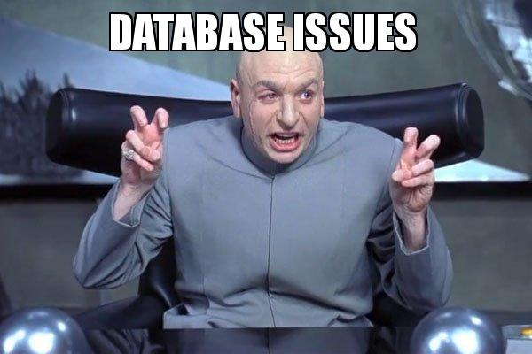
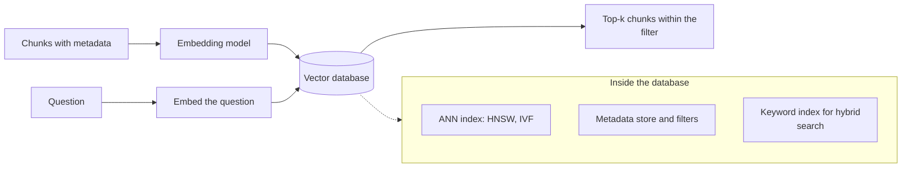
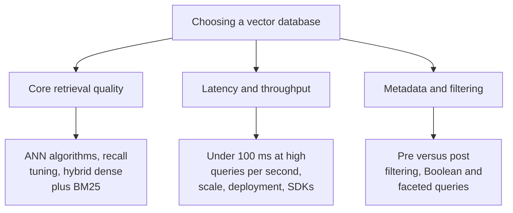
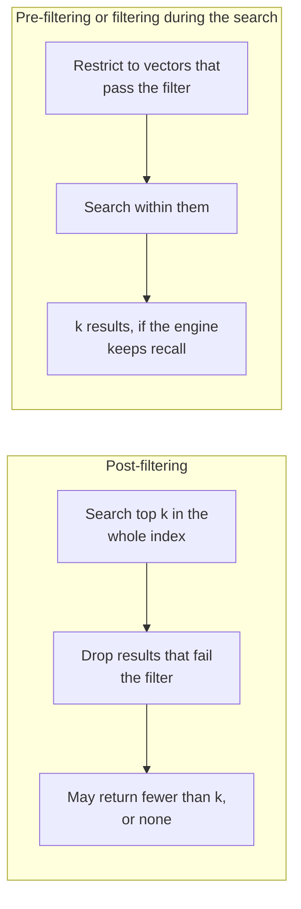
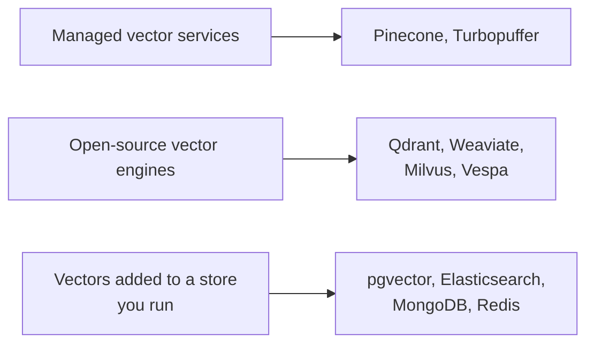
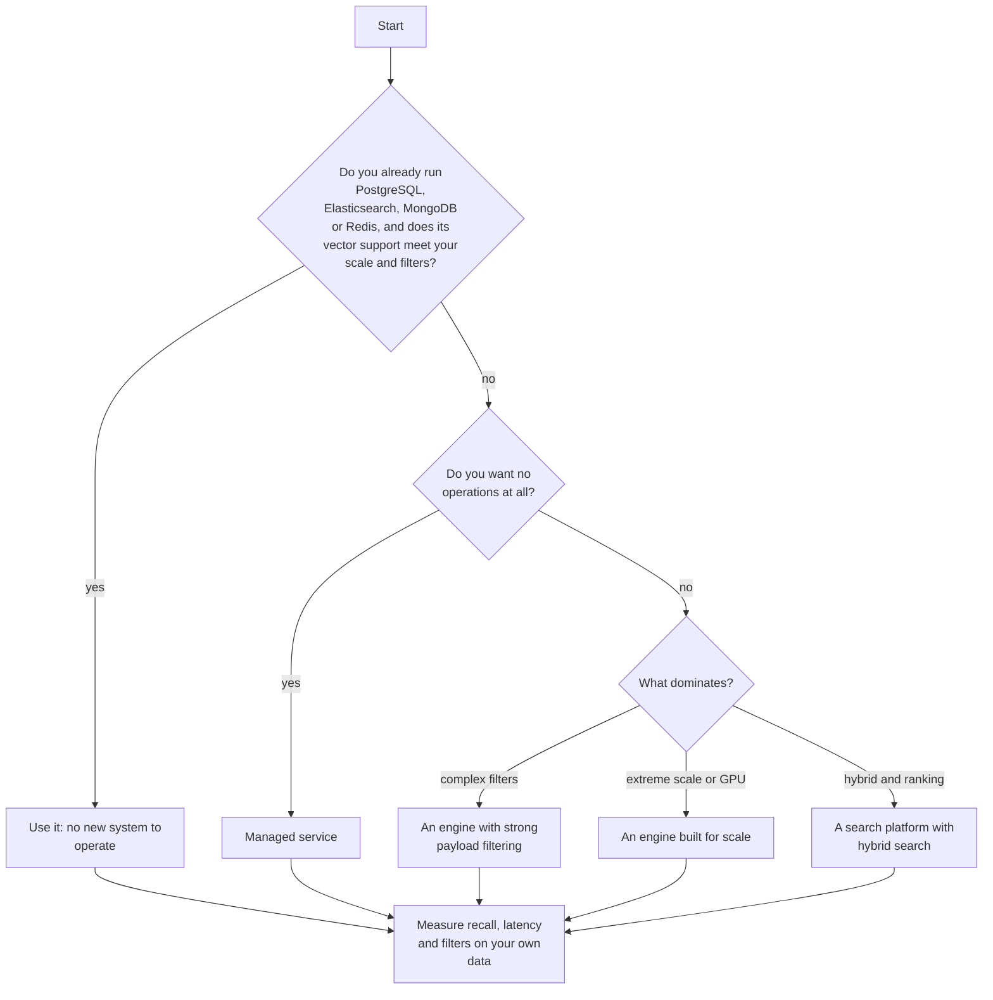

# Lesson 01: Vector Databases for RAG

### Choosing where the vectors live, by retrieval quality, speed and filtering

Once every chunk has a vector, answering a question means finding the chunk vectors closest to the question vector, quickly, among millions, and usually within a filter such as "only this store" or "only documents this customer may see". The system that does this is the vector database, and the choice matters more than it seems: a poor fit slows every answer, returns the wrong passages under filters, or costs more than the rest of the pipeline. The market is crowded, with managed services, open-source engines and vector features added to databases teams already run.

This lesson follows the comparison of ten vector databases for RAG pipelines published by [Tahir (2025)](https://www.zenml.io/blog/vector-databases-for-rag). It first explains what a vector database does, then uses the article's three evaluation criteria (retrieval quality, latency and throughput, metadata filtering), presents the ten databases in comparison tables, and ends with a way to choose. The scenario is the retail FAQ assistant, now with several hundred thousand chunks across stores and languages. The metadata filtering and hybrid search introduced in the previous lesson only work as well as the database underneath supports them, which is why they reappear here as selection criteria.

  

### Learning Objectives

By the end of this lesson, you will be able to:

- **Explain** what a vector database adds to an embedding model: approximate search, metadata, filtering and hybrid search.
- **Evaluate** a vector database on retrieval quality, latency and throughput, and metadata filtering.
- **Compare** managed, open-source and add-on vector databases by strengths, weaknesses and pricing model.
- **Choose** a database for a given workload and verify the choice with your own measurement.

---

### Lesson Content

#### What a vector database does in a RAG pipeline

Comparing a question against every stored vector, called exact or flat search, costs time in proportion to the number of vectors, which is fine for a prototype and too slow at scale. Vector databases use approximate nearest neighbour (ANN) indexes that compare against a small fraction of the vectors and return almost the same results much faster. The most common is HNSW ([Malkov and Yashunin, 2016](https://arxiv.org/abs/1603.09320)), a stack of proximity graphs in which a search starts in a sparse top layer and descends to denser ones, with search cost that its authors report scales logarithmically with the data. Around the index, a database adds what a RAG system needs in production.

*Figure 1. Where the vector database sits, and what it holds besides the vectors.*

| Capability | What it gives the RAG system |
| :-- | :-- |
| ANN index (HNSW, IVF) | Fast top-k search over millions of vectors, with a tunable trade-off between recall and speed |
| Metadata and filters | "Only this store, this language, this customer" applied to the search |
| Hybrid search | Keyword (BM25) and vector results combined, so codes and names are found as well as paraphrases |
| Updates and deletes | New and withdrawn documents reflected without a full rebuild |
| Namespaces or collections | Separation of tenants, languages or environments |
| Persistence, replication, scaling | The index survives restarts and grows with traffic |

#### Three criteria for choosing

The article evaluates databases on three criteria, which are a good checklist for any RAG workload.

*Figure 2. The three evaluation criteria used in the comparison.*

| Criterion | What to check | Why it matters for RAG |
| :-- | :-- | :-- |
| Core retrieval quality | Which ANN indexes (HNSW, IVF), whether recall can be tuned, whether hybrid dense and sparse (BM25) search is built in | Ambiguous queries (the article's example is "Apple", the company or the fruit) need both meaning and exact terms |
| Latency and throughput | Query latency under load (the article targets under 100 ms for interactive agents and chatbots), queries per second, behaviour at very large scale, ease of deployment, SDKs, community, persistence | Retrieval sits on the critical path of every answer |
| Metadata and filtering | Pre-filtering versus post-filtering, Boolean and faceted queries, efficiency of selective filters | Permissions, stores and languages are filters, and filters change the search |

Filtering deserves a closer look, because it is where systems differ most and benchmarks without filters hide the difference.

*Figure 3. Post-filtering can starve the results; filtering before or during the search keeps them, if the engine supports it well.*

A 2026 study of filtered search in production systems ([Amanbayev et al., 2026](https://arxiv.org/abs/2602.11443)) found that algorithmic adaptations inside the database engine often matter more than the raw speed of the index, that partition-based IVF indexes outperformed graph-based HNSW when filters match a small fraction of the data, and that the PostgreSQL extension's planner often chose an approximate scan when an exact scan would have given perfect recall at similar latency. Test with your real filters at their real selectivity.

#### Ten databases at a glance

The article's summary, with pricing as listed in October 2025. Prices and tiers change often, so check each product's page before deciding.

| Database | Kind | Best for (per the article) | Key RAG features | 
| :-- | :-- | :-- | :-- | 
| Pinecone | Managed, closed source | Managed serverless for rapid development | HNSW and IVFPQ, metadata filters during ANN search, namespaces, real-time indexing |
| Turbopuffer | Managed, object storage based | Cost efficiency at massive scale | Dense vectors and BM25, storage on object storage, millions of namespaces | From 64 USD per month; usage-based |
| Redis | In-memory, open source | Ultra-low-latency real-time RAG | FLAT and HNSW, millisecond queries, semantic cache, numeric, geo, tag and text filters | 
| Weaviate | Open source | AI-native with built-in vectorization | BM25 plus vector hybrid queries, built-in vectorizer modules, HNSW by default, GraphQL-style schema | 
| Qdrant | Open source, Rust | Performance with complex filtering | JSON payload filters (range, equality, geo), quantization, sparse vectors, several vectors per document | Open source; free 1 GB cloud cluster |
| Milvus | Open source (managed as Zilliz) | Enterprise scale | HNSW, IVF, PQ and GPU indexes, several vector fields per collection, sparse vectors | 
| Vespa | Open source search platform | Custom machine-learned ranking | Tensor operations, nested Boolean conditions and facets, models at query time | 
| pgvector | PostgreSQL extension | Teams already on PostgreSQL | Vector column, HNSW and IVF, SQL joins and filters with vector search |
| Elasticsearch | Search engine with vectors | Mature hybrid search | BM25 plus vector queries, neural reranking, aggregations, sharding and replication |
| MongoDB Atlas | Document database with vectors | Teams in the MongoDB ecosystem | Vector search stage in aggregation pipelines, filter by any document field | 

#### Strengths and weaknesses by family

The ten fall into three families, and the family often decides more than the individual product.

*Figure 4. Three families of vector databases.*

| Database | Pros (per the article) | Cons (per the article) |
| :-- | :-- | :-- |
| **Managed services** | | |
| Pinecone | Simple, serverless, real-time indexing, strong service levels | Closed source; costs rise beyond the free tier |
| Turbopuffer | Price and performance, compliance certifications | Cold queries and writes above 200 ms at the median; 64 USD minimum; not open source |
| **Open-source engines** | | |
| Qdrant | Efficient core, simple container setup, strong complex filtering | No built-in vectorizers; clustering is newer and less proven |
| Weaviate | Flexible, developer friendly, strong multimodal support | Schema design is critical; can lag bare-metal systems at very large scale; module costs add up |
| Milvus | GPU indexing for high throughput, many index options, large community | Complex to operate and tune; text filtering less intuitive than SQL |
| Vespa | Search quality and scale, advanced ranking and hybrid search | Detailed schema and query language; cloud costs hard to estimate; overkill for simple nearest-neighbour search |
| **Add-ons to existing stores** | | |
| pgvector | Data and vectors in one database, with SQL, foreign keys and transactions | Not built for massive vector workloads; large embedding tables can slow other queries |
| Elasticsearch | Mature hybrid search, easy for existing users | Complex to tune, memory heavy, historically slower vector indexing |
| MongoDB Atlas | No data migration, no added vector cost, good for prototypes | May lag dedicated systems at large scale; some tuning options not exposed; vector search needs the managed service |
| Redis | Raw speed, several data models in one store | RAM cost grows with data; scaling often needs your own sharding |

Two caveats apply to the whole comparison. The article describes testing for accuracy, throughput and filtering under realistic loads but publishes no benchmark numbers, so its rankings are qualitative. And it is published by a company that sells an orchestration layer, which it notes works with any vector store; its conclusion is that the database matters less than how well it fits into the workflow.

#### How to choose

The article's final picks map priorities to products: Pinecone for a managed, serverless service with enterprise reliability, Qdrant as the open-source option for performance and advanced filtering, Weaviate for built-in vectorization and multimodal search, and Milvus for extreme scale and GPU acceleration. Combined with the criteria above, a practical decision path follows.

*Figure 5. A decision path that ends, whatever the choice, in a measurement on your own data.*

| Priority | Lean towards | Watch out for |
| :-- | :-- | :-- |
| Fastest time to production, no operations | A managed service | Cost growth past the free tier, vendor lock-in |
| Lowest cost at very large scale | An object-storage-based service or a self-hosted engine | Cold-query latency, operations effort |
| Complex metadata and permission filters | An engine with filtering inside the search | Recall under very selective filters |
| Exact codes and names alongside meaning | Built-in hybrid search | Tuning the two retrievers together |
| Lowest latency | An in-memory store | RAM cost |
| Fewest systems to run | The vector feature of your current database | Limits at scale, interference with other queries |

#### In practice

Write down the workload first: number of vectors, queries per second, latency target, the filters every query uses and how selective they are, whether codes and names must be found exactly, and how often documents change. Shortlist two or three databases, starting with the one you already run, and measure recall against exact search, latency and filtered results on your own chunks and questions. Plan for re-embedding: a new embedding model means a new index, so build it beside the old one and switch traffic when it is ready. The most common mistakes are choosing from a ranking without measuring, testing without filters, and adding a new database when the existing one would have been enough.

**Summary:**
- A vector database adds an ANN index, metadata filters, hybrid search, updates and scaling around the vectors.
- Evaluate it on retrieval quality, latency and throughput, and metadata filtering, the last being where systems differ most.
- The ten databases compared fall into managed services, open-source engines and vector features added to existing stores.
- The article's picks are Pinecone for managed simplicity, Qdrant for filtering, Weaviate for built-in vectorization and Milvus for scale, with no published benchmarks behind them.
- Start with what you run, and decide by measuring recall, latency and filters on your own data.

---

### References

- Tahir (2025), [We Tried and Tested 10 Best Vector Databases for RAG Pipelines](https://www.zenml.io/blog/vector-databases-for-rag), ZenML blog, 1 October 2025. The comparison this lesson follows.
- Malkov and Yashunin (2016), [Efficient and robust approximate nearest neighbor search using Hierarchical Navigable Small World graphs](https://arxiv.org/abs/1603.09320). The HNSW index.
- Amanbayev et al. (2026), [Filtered Approximate Nearest Neighbor Search in Vector Databases: System Design and Performance Analysis](https://arxiv.org/abs/2602.11443). Filtered search in production systems.

### Further Reading

- [Lesson 00: Advanced Retrieval](00-advanced-retrieval.md) - the previous lesson.
- [Lesson 02: Re-ranking](02-re-ranking.md) - the next lesson.
- [Lecture 3, Lesson 03: Embedding Models](../L3_Retrieval_augmented_generation/03-embedding-models.md) - where the vectors come from.
