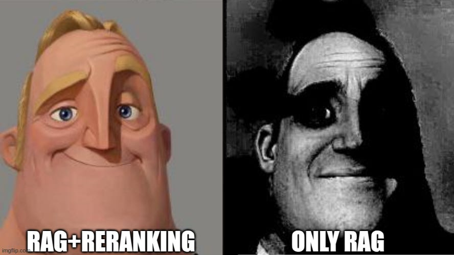
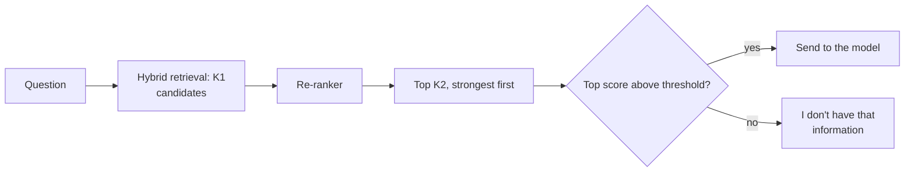
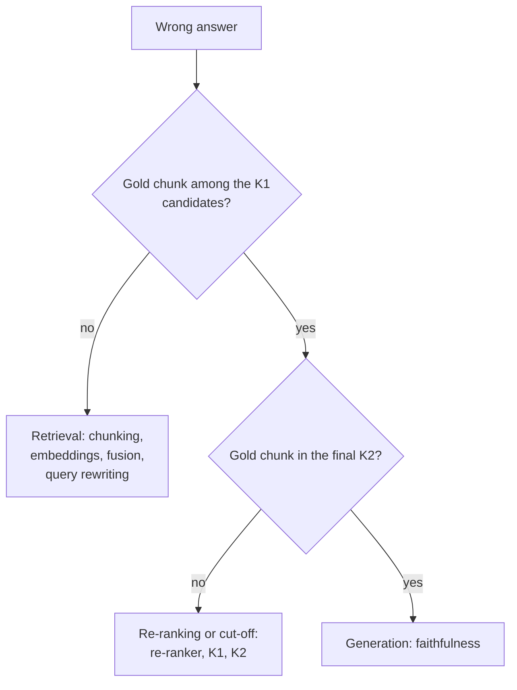

# Lesson 02: Re-ranking

### Casting a wide net, then choosing carefully

The first search scans millions of chunks in milliseconds by comparing vectors computed long before the question existed, which finds a good pool of candidates but may not put the single best passage first. A re-ranker reads the question and each candidate together and reorders the pool. Production RAG therefore runs a cascade: a fast retriever tuned for recall, a slower re-ranker tuned for precision, and a short list for the model. This lesson compares re-rankers, sets the cascade, and shows how to find the stage that caused a wrong answer.

  

### Learning Objectives

By the end of this lesson, you will be able to:

- **Explain** why a cross-encoder ranks better than retrieval vectors, and what it costs.
- **Configure** the cascade: candidate depth, final list size, order and a "no answer" threshold.
- **Diagnose** whether a wrong answer comes from retrieval, re-ranking or generation.

---

### Lesson Content

#### What re-ranking is

Re-ranking is a second, more careful pass over the candidates that the first search returned. Where retrieval shortlists dozens of passages quickly, a re-ranker reads the question together with each candidate, gives every pair a relevance score, and reorders the list so that only the best few are sent to the model, much as a recruiter screens many CVs quickly and then interviews a handful. It never finds new passages, it only decides their order, which is why it depends on the first search having found the right one.

#### Reading the question and the chunk together

A bi-encoder computes a vector for the question and one for the chunk separately, and the two are then compared; a cross-encoder reads both texts at once and can notice that a chunk mentions "returns" only for gift cards.

| Re-ranker | How it scores | Evidence | Cost |
| :-- | :-- | :-- | :-- |
| Cross-encoder | One transformer pass over (question, chunk) | Topped MS MARCO passage ranking, about 27% relative MRR@10 over the previous best ([Nogueira and Cho, 2019](https://arxiv.org/abs/1901.04085)) | One pass per candidate |
| Late interaction (ColBERT) | Precomputed token vectors, matched cheaply | Competitive with BERT rankers, two orders of magnitude faster ([Khattab and Zaharia, 2020](https://arxiv.org/abs/2004.12832)) | Much larger index |
| LLM re-ranker | A general language model reads the question and a window of candidates and puts them in order | Matched or beat supervised re-rankers ([Sun et al., 2023](https://arxiv.org/abs/2304.09542)); open RankZephyr ([Pradeep et al., 2023](https://arxiv.org/abs/2312.02724)). On queries newer than the models' training data their lead varied, and lightweight re-rankers were competitive ([Abdallah et al., 2025](https://arxiv.org/abs/2508.16757)) | Highest latency and cost per query |
| Reasoning re-ranker | An LLM re-ranker that reasons before scoring | Rank1 on reasoning-heavy retrieval ([Weller et al., 2025](https://arxiv.org/abs/2502.18418)) | Test-time compute per candidate |

Cross-encoders are the accurate default and LLM re-rankers are for the hardest questions. A re-ranker trained on web search can underperform on tariffs or product codes, so evaluate it on your own questions, and fall back to the retriever's order when an LLM re-ranker returns a malformed reply.

#### The cascade and its settings

*Figure 1. The retrieve, re-rank and select cascade.*

| Setting | Typical range | How to choose |
| :-- | :-- | :-- |
| `K1`, candidates | 50 to 150 | Raise until recall@`K1` stops improving; the re-ranker's ceiling is this recall |
| `K2`, passages to the model | 5 to 20 | Measure answer quality at several values |
| Order in the prompt | Strongest first | Models use the middle of long inputs worst ([Liu et al., 2023](https://arxiv.org/abs/2307.03172)) |
| Score threshold | Per corpus | Choose on questions with no answer in the corpus |
| Latency budget | Per product | Caps `K1` and the choice of re-ranker |

#### Finding the stage to blame

*Figure 2. Locate the failing stage first: recall@`K1` exposes retrieval, recall@`K2` and MRR expose re-ranking, faithfulness exposes generation. Log candidates, scores, the re-ranked list and the final prompt for every request.*

**Practices overview**

| Practice | Why | Evidence |
| :-- | :-- | :-- |
| Retrieve broadly, re-rank, send few | Recall first, precision where it counts | [Nogueira and Cho (2019)](https://arxiv.org/abs/1901.04085); [Thakur et al. (2021)](https://arxiv.org/abs/2104.08663) |
| Cross-encoder by default, LLM re-rankers for hard queries | Quality against latency and cost | [Sun et al. (2023)](https://arxiv.org/abs/2304.09542) |
| Strongest passages first | Middle positions are used worst | [Liu et al. (2023)](https://arxiv.org/abs/2307.03172) |
| Compare with and without the re-ranker | A mismatched re-ranker can lower quality | Retrieval evaluation |

#### In practice

Add a re-ranker once recall@`K1` is good and ranking is the problem, keep it behind one function so models can be swapped, and set `K1`, `K2` and the threshold by measurement. A weak or mismatched re-ranker can push the right chunk below a confident wrong one, so the most common mistake is adding one without checking that it beats the fused order on your own questions; log latency and tokens per stage next to quality. Agentic RAG goes one step further and lets an agent call retrieval as a tool.

**Summary:**
- A cross-encoder reads question and chunk together and ranks better than retrieval vectors, at one pass per candidate.
- Retrieve 50 to 150, re-rank, send 5 to 20 strongest first, abstain below a threshold, and find the failing stage with recall@`K1`, recall@`K2` and faithfulness before changing anything.

---

### References

- Nogueira and Cho (2019), [Passage Re-ranking with BERT](https://arxiv.org/abs/1901.04085); Khattab and Zaharia (2020), [ColBERT](https://arxiv.org/abs/2004.12832); Thakur et al. (2021), [BEIR](https://arxiv.org/abs/2104.08663).
- Sun et al. (2023), [Is ChatGPT Good at Search?](https://arxiv.org/abs/2304.09542); Pradeep et al. (2023), [RankZephyr](https://arxiv.org/abs/2312.02724); Abdallah et al. (2025), [How Good are LLM-based Rerankers? An Empirical Analysis of State-of-the-Art Reranking Models](https://arxiv.org/abs/2508.16757); Weller et al. (2025), [Rank1](https://arxiv.org/abs/2502.18418).
- Liu et al. (2023), [Lost in the Middle](https://arxiv.org/abs/2307.03172).

### Further Reading

- [Lesson 01: Vector Databases for RAG](01-vector-databases-and-indexes.md) - the previous lesson.
- [Lesson 03: Evaluating Retrieval](03-evaluating-retrieval.md) - the next lesson.
