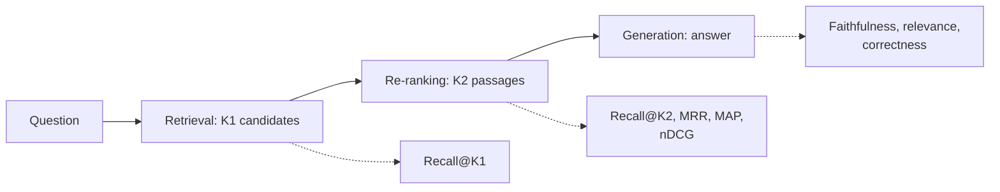
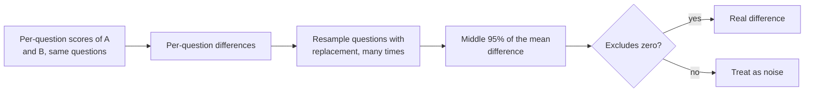

# Lesson 03: Evaluating Retrieval

### Measuring whether the evidence is found, so that changes can be trusted

Every lesson so far ended with "measure on your own questions", and this one supplies the measuring for the retrieval side. A RAG system has two parts that fail independently, a retriever that may not find the evidence and a generator that may not use it faithfully, and one end-to-end score hides which failed. Retrieval is the easier half to measure well: with questions labelled with the chunks that answer them, the metrics need no model and give the same number every time. This lesson covers the evaluation set, the relevance judgments that label it, the metrics those judgments allow, and how to tell a real improvement from noise.

  

### Learning Objectives

By the end of this lesson, you will be able to:

- **Build** an evaluation set from real user questions, including questions the corpus cannot answer.
- **Label** it with relevance judgments, by hand, semi-manually or with a language model.
- **Choose** among hit rate, recall, precision, R-precision, MRR, MAP and nDCG according to the judgments available.
- **Judge** whether a difference between two configurations is real.

---

### Lesson Content

#### What evaluating retrieval means

Evaluating retrieval means checking, on a fixed set of questions for which you know which chunks are relevant, whether the retriever brings those chunks back and how high it ranks them. It is done before looking at any generated answer, because an answer can only be as good as the evidence it was given, and because retrieval can be measured exactly and cheaply, with no model in the loop, every time the pipeline changes.

#### What to evaluate, stage by stage

*Figure 1. Each stage has its own metric, so a failure can be located. The retrieval metrics need, for each question, the chunks that are relevant to it; the generation metrics need a reference answer or a judge, covered in lesson 04.*

A survey of RAG evaluation ([Yu et al., 2024](https://arxiv.org/abs/2405.07437)) organises the field around retrieval quality, generation quality and whole-system abilities, and the RGB benchmark ([Chen et al., 2023](https://arxiv.org/abs/2309.01431)) tests four abilities separately: noise robustness, negative rejection (declining when the documents hold no answer), information integration and counterfactual robustness.

#### Building the evaluation set

| Question source | What it gives | Notes |
| :-- | :-- | :-- |
| Real user questions from logs and tickets | What people ask, in their words and in the proportions they ask it | The most important source; must be collected and anonymised |
| Expert-written questions | Rare, high-stakes cases | Slow to write |
| Synthetic questions from the documents | Scale, cheaply | Well formed and spread evenly over the chunks; echo document wording and flatter keyword retrieval |
| Questions with no answer in the corpus | Tests abstention | Needed by any system that should decline to answer, which includes most production systems |

Start from real questions and use the other sources to fill gaps. Real questions are much harder than synthetic ones: they contain typos, they are ambiguous, they ask about things the corpus does not cover, and they often need several chunks to answer. They are also far from evenly spread over the knowledge base. Generating one synthetic question per chunk gives every topic the same weight, so a system can do well on that set on average and still be poor on the two or three topics, say renewing a passport, that receive most of the real traffic. Sample real questions in the proportions they arrive, tag each with its topic, and report per topic as well as overall.

Questions with no answer in the corpus have no relevant chunks, so the retrieval metrics below are undefined for them; score them instead on whether the top score falls below the abstention threshold of [lesson 02](02-re-ranking.md). Realistic questions are hard for whole systems too: the CRAG benchmark ([Yang et al., 2024](https://arxiv.org/abs/2406.04744)), with 4,409 question-answer pairs across five domains and eight categories, found straightforward RAG at 44% accuracy and the best industry systems answering without hallucination on 63% of questions.

[Manning et al. (2008)](../L3_Retrieval_augmented_generation/Support_Material/Manning-et-al-Introduction-to-Information-Retrieval.pdf) give 50 questions as a usual minimum for a test set; a few dozen find large problems, and a few hundred are needed to see differences of a few points. Version the set, grow it from production failures, and never tune on the questions you report. To evaluate retrieval, each question needs only its relevance judgments; a reference answer, or a list of facts the answer must contain, is needed only when the same set is also used to evaluate answers, as in lesson 04.

#### Relevance judgments: the labels of retrieval

The labels of a retrieval evaluation are **relevance judgments**, called qrels in the information retrieval literature: for each question, the chunks that are relevant to answering it. Picture a matrix of questions against chunks in which almost every cell is empty. [Manning et al. (2008, chapter 8)](../L3_Retrieval_augmented_generation/Support_Material/Manning-et-al-Introduction-to-Information-Retrieval.pdf) define a retrieval test collection as exactly three things: the documents, a set of information needs expressed as queries, and these judgments. A chunk is relevant when it addresses the need behind the question, not because it contains the question's words.

A few judgments for a public-services assistant, graded from 0 (not relevant, the value of every pair not listed) to 2 (answers the question on its own):

| Question | Chunk | Relevance |
| :-- | :-- | :-- |
| q17 "how do i renew my pasport if it expired" | `passport-renewal#03` | 2, the renewal steps |
| q17 | `passport-renewal#04` | 1, the documents to bring |
| q17 | `fees#11` | 1, the fee |
| q23 "how long does a new citizen card take" | `citizen-card#02` | 2, the processing time |
| q41 "can you book me a flight to Madrid" | none | No relevant chunk: tests abstention |

Judgments are binary (relevant or not) or graded, as above. That choice, and how many relevant chunks a question usually has, decides which metrics in the next section make sense: with one relevant chunk per question MRR says almost everything, and nDCG only adds information when the judgments are graded.

Judging every chunk for every question is impossible beyond a small corpus, so judgments are normally collected by **pooling**: run several retrievers (keyword, dense and hybrid), take the union of their top results for each question, and judge only that pool. Any chunk outside the pool counts as not relevant, which penalises a new configuration that brings up a relevant chunk nobody judged, so judge the new chunks a change brings into the top results before comparing it with the old one.

| Who judges | How | Trade-off |
| :-- | :-- | :-- |
| People | A domain expert labels every pooled pair | Most trusted; slow and expensive |
| Semi-manual | A language model proposes a label for each pair; an expert confirms or corrects it | Much faster, and the expert still sees every label |
| A language model | The model labels every pair | Cheapest; [Thomas et al. (2024)](https://arxiv.org/abs/2309.10621) found prompted models as accurate as human labellers at Bing, and UMBRELA ([Upadhyay et al., 2024](https://arxiv.org/abs/2406.06519)) reproduces that assessor in open source. Accuracy changed even with simple paraphrases of the prompt, so check a sample against an expert with Cohen's kappa, as for the judge in lesson 04 |

#### Retrieval metrics

| Metric | Question it answers | Definition | Makes sense when |
| :-- | :-- | :-- | :-- |
| Hit rate@k | Is any relevant chunk in the top k? | 1 or 0 per question, averaged | Always; the coarsest view |
| Recall@k | How much of the relevant evidence was found? | Relevant chunks in the top k divided by all relevant chunks | Questions with several relevant chunks |
| Precision@k | How much of the top k is relevant? | Relevant chunks in the top k divided by k | Questions have similar numbers of relevant chunks |
| R-precision | How much of the top R is relevant, R being the number of relevant chunks? | Relevant chunks in the top R divided by R | Binary judgments, numbers of relevant chunks that vary by question |
| MRR | How early is the first relevant chunk? | Mean of 1 / rank of the first relevant chunk | One relevant chunk per question, or only the first one matters |
| MAP | Are all the relevant chunks ranked early? | Per question, the mean of precision@i at the rank of each relevant chunk, counting any never retrieved as 0; then averaged over questions | Binary judgments, several relevant chunks |
| nDCG@k | Are the most relevant chunks ranked first? | Graded gains discounted by 1 / log2(rank + 1), normalised by the best possible order | Graded judgments |

R-precision repairs a weakness of precision@k. If a question has only two relevant chunks, even a perfect retriever scores 0.4 on precision@5, so an average over questions mixes the quality of the retriever with how many relevant chunks each question happens to have. R-precision looks at the top R results instead, where R is that question's number of relevant chunks: the passport question above has three (counting any grade above 0), and finding two of them in the top 3 gives 2/3, which is also the recall at that cut-off. A perfect retriever scores 1 on every question, so the average means something, and [Manning et al. (2008)](../L3_Retrieval_augmented_generation/Support_Material/Manning-et-al-Introduction-to-Information-Retrieval.pdf) note that it agrees closely with MAP in practice.

Recall says whether the generator can see the evidence at all; MRR, MAP and nDCG say how early it appears, which matters because models use the middle of long contexts worst. Tune the first stage with recall@`K1` and the re-ranker with recall@`K2` and MRR. With binary judgments nDCG adds little over MAP and is harder to explain. RAGAS context precision ([Es et al., 2023](https://arxiv.org/abs/2309.15217)), covered in lesson 04, is average precision restricted to the top k, with a language model deciding relevance in place of the judgments.

#### Telling an improvement from noise

*Figure 2. A paired bootstrap: questions hard for both systems cancel out, so it is far more sensitive than two separate intervals.*

**Practices overview**

| Practice | Why | Evidence |
| :-- | :-- | :-- |
| Evaluate retrieval and generation separately | One end-to-end score hides the failing stage | [Yu et al. (2024)](https://arxiv.org/abs/2405.07437) |
| Build the set from real questions, in the proportions they arrive | Real questions are harder and concentrate on a few topics | [Yang et al. (2024)](https://arxiv.org/abs/2406.04744) |
| Include questions with no answer in the corpus | Abstention must be tested | [Chen et al. (2023)](https://arxiv.org/abs/2309.01431) |
| Choose metrics that match the relevance judgments | nDCG needs graded judgments; MRR suits one relevant chunk | [Manning et al. (2008)](../L3_Retrieval_augmented_generation/Support_Material/Manning-et-al-Introduction-to-Information-Retrieval.pdf) |
| Judge the new chunks a change brings to the top | Unjudged chunks count as not relevant | [Manning et al. (2008)](../L3_Retrieval_augmented_generation/Support_Material/Manning-et-al-Introduction-to-Information-Retrieval.pdf) |
| Check automatic judgments against an expert | Their accuracy depends on the prompt | [Thomas et al. (2024)](https://arxiv.org/abs/2309.10621) |
| Compare configurations with paired intervals, per topic | Small sets give noisy averages; averages hide regressions | Figure 2 |

#### In practice

Start from real questions sampled from the logs, add unanswerable and expert-written ones, and label them semi-manually: pool the top results of a keyword and a dense retriever, let a language model propose a grade for each pair, and have a domain expert confirm them, which catches errors and builds trust in the numbers. Run the evaluation on every change to chunking, embeddings, fusion or re-ranking, judge any new chunks the change brings to the top, gate merges per topic with paired intervals, and keep an error taxonomy (retrieval miss, ranking miss, wrong abstention) so the next fix targets the largest bucket.

**Summary:**
- Evaluate each stage with its own metric: recall@`K1` for retrieval; recall@`K2`, MRR, MAP and nDCG for ranking.
- Build the set mostly from real user questions, in the proportions they arrive, plus expert, synthetic and unanswerable ones, tagged by topic.
- Relevance judgments are the labels: whether they are binary or graded, and how many relevant chunks a question has, decide which metrics make sense.
- Trust a difference only when a paired interval excludes zero.

---

### References

- Yu et al. (2024), [Evaluation of RAG: A Survey](https://arxiv.org/abs/2405.07437); Chen et al. (2023), [Benchmarking LLMs in RAG](https://arxiv.org/abs/2309.01431); Yang et al. (2024), [CRAG](https://arxiv.org/abs/2406.04744).
- Manning, Raghavan and Schütze (2008), [*Introduction to Information Retrieval*](../L3_Retrieval_augmented_generation/Support_Material/Manning-et-al-Introduction-to-Information-Retrieval.pdf), chapter 8, Cambridge University Press.
- Thomas et al. (2024), [Large Language Models Can Accurately Predict Searcher Preferences](https://arxiv.org/abs/2309.10621); Upadhyay et al. (2024), [UMBRELA](https://arxiv.org/abs/2406.06519).
- Es et al. (2023), [Ragas](https://arxiv.org/abs/2309.15217).

### Further Reading

- [Lesson 02: Re-ranking](02-re-ranking.md) - the previous lesson.
- [Lesson 04: Groundedness and Faithfulness](04-groundedness-and-faithfulness.md) - the next lesson, the generation side.
- Oliveira, M. (2026), [What makes a good answer? Evaluating RAG systems in production](https://www.daredata.ai/blog/what-makes-a-good-answer-rag-evaluation), DareData blog - a practitioner account of the evaluation workflow, including nugget evaluation.
