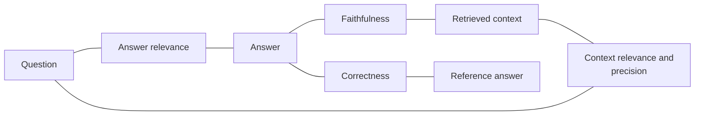
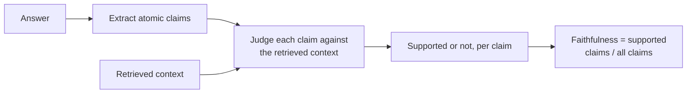
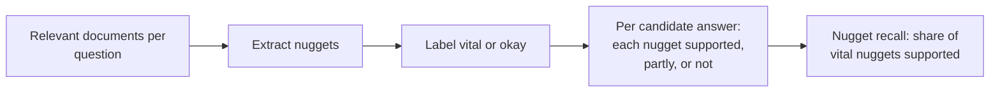
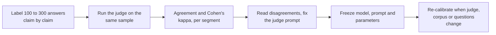
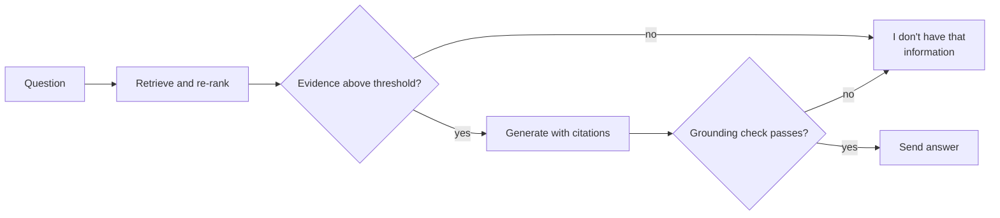

# Lesson 04: Groundedness and Faithfulness

### Checking that an answer says only what the evidence supports

A RAG answer can fail even when retrieval succeeded. The model may ignore the passages, blend them with remembered facts, or add a plausible detail that no document contains. The property that guards against this is called **groundedness** or **faithfulness**: every statement in the answer is supported by the retrieved context. It is the most direct measure of what RAG promises, and it needs no reference answer, so it can be measured on live traffic.

This lesson defines the RAGAS-style metrics and what each compares, shows how claim-level faithfulness is computed and how nuggets make correctness checkable, explains how far a model judge can be trusted, and turns the scores into hallucination management: citations, abstention ("I don't know") and release gates.

  

### Learning Objectives

By the end of this lesson, you will be able to:

- **Distinguish** faithfulness, answer relevance, context relevance and correctness by what they compare.
- **Describe** claim-level faithfulness: extract claims, verify each against the context, score the share supported.
- **Score** correctness with nuggets, the facts a good answer must contain.
- **Calibrate** a model judge against human labels before trusting its scores.
- **Apply** faithfulness to citations, abstention and release gates.

---

### Lesson Content

#### What groundedness and faithfulness mean

An answer is grounded, or faithful, when every statement in it can be traced back to the passages that were retrieved for it, so that the model added nothing of its own. Evaluating this RAGAS-style means doing the check automatically: the answer is broken into individual claims, each claim is compared with the retrieved passages, and the share of supported claims becomes the score. It is the measure closest to what RAG promises, answers that come from your documents.

#### What each metric compares

*Figure 1. Each metric compares a different pair. Faithfulness and answer relevance need no reference answer.*

| Metric | Compares | Question it answers | Needs a reference |
| :-- | :-- | :-- | :-- |
| Faithfulness (groundedness) | Answer and retrieved context | Is every claim supported by the context? | No |
| Answer relevance | Answer and question | Does it address what was asked? | No |
| Context relevance and precision | Retrieved context and question | Is the context focused on the question, relevant chunks first? | Usually no |
| Context recall | Retrieved context and reference answer | Does the context contain what the answer needs? | Yes |
| Correctness | Answer and reference answer | Is the answer right? | Yes |

[Es et al. (2023)](https://arxiv.org/abs/2309.15217) proposed Ragas to evaluate these dimensions (whether the retriever finds relevant and focused passages, whether the model uses them faithfully, and the quality of the answer) without human-annotated ground truth. Two consequences matter. A faithful answer can still be wrong, because faithfulness checks agreement with the context and not with the world, so a stale document gives a faithful and incorrect answer, which is a data problem. And an answer can be relevant and unfaithful when the model answers fluently from memory. Read the metrics together; never average them into one number.

#### How claim-level faithfulness is computed

*Figure 2. Faithfulness as the share of supported claims. Context recall applies the same steps to the reference answer.*

| Metric (RAGAS-style) | How it is computed |
| :-- | :-- |
| Faithfulness | Claims in the answer supported by the context, divided by all claims in the answer |
| Answer relevance | A model generates questions from the answer; their mean similarity to the real question. Does not measure factual accuracy |
| Context precision | Mean of precision@i at each rank holding a relevant chunk |
| Context recall | Claims of the reference answer supported by the context, divided by all reference claims |

Example: the answer "Returns are accepted within 30 days. You need the receipt. Gift cards can be returned within 14 days." against a context that states the 30-day window, requires proof of purchase and says gift cards cannot be returned has three claims, two supported, so faithfulness is 0.67, and the unsupported claim is exactly the invented policy. Three of the four metrics depend on a model to extract claims, generate questions or judge support, and inherit its errors.

#### Correctness with nuggets

Correctness needs a reference, and comparing a free-text answer with a free-text reference is hard to do reliably. Nugget evaluation turns the reference into facts. A **nugget** is one atomic fact a good answer should contain. The idea dates to TREC question answering in 2003 ([Voorhees](https://trec.nist.gov/pubs/trec12/papers/QA.OVERVIEW.pdf)) and was automated for RAG by [Pradeep et al. (2025)](https://arxiv.org/abs/2504.15068) for the TREC 2024 RAG track.

*Figure 3. Nugget evaluation: the first three steps are done once per question, the last is repeated for every answer. The relevant documents come from the relevance judgments of lesson 03.*

Comparing fully automatic nuggets and assignment with manual ones, the authors found agreement in ranking whole systems (Kendall's tau) of about 0.73, falling to between 0.36 and 0.54 when systems were ranked question by question. Automatic scores suit comparing configurations over a set and are weak for grading one answer. Automate the first steps and have a domain expert check the nuggets and label their importance, which catches errors and builds trust in the numbers.

#### Can the judge be trusted?

| Finding | Source |
| :-- | :-- |
| Strong judges reach over 80% agreement with human preferences, the level humans reach with each other | [Zheng et al. (2023)](https://arxiv.org/abs/2306.05685) |
| Judges show position bias, verbosity bias, self-enhancement bias and limited reasoning | [Zheng et al. (2023)](https://arxiv.org/abs/2306.05685) |
| Lightweight trained judges plus a few hundred human annotations, combined with prediction-powered inference, correct judge errors and give confidence intervals | ARES ([Saad-Falcon et al., 2023](https://arxiv.org/abs/2311.09476)) |
| Fine-grained diagnostic metrics separate retriever and generator errors | RAGChecker ([Ru et al., 2024](https://arxiv.org/abs/2408.08067)) |

*Figure 4. Calibrating a judge. Cohen's kappa discounts agreement expected by chance, so it is the number to trust over raw agreement.*

The judge's model version, prompt and parameters are part of the metric: change one and you have a new metric. Constrain the verdict to a structured output so code can read it.

#### Hallucination management

| Technique | What it does | Trade-off |
| :-- | :-- | :-- |
| Answer only from the context | Instruction in the prompt | Raises faithfulness, can raise unnecessary refusals |
| Citations per claim | Each statement points to a passage | Users can verify; citation accuracy is a cheap second grounding signal |
| Abstention ("I don't have that information") | Below a retrieval score threshold, or when the judge finds unsupported claims | Fewer wrong answers, some unanswered ones |
| Grounding check before sending | A judge call on the draft answer, with a fallback reply | Extra latency and cost; reserve for high-stakes categories |
| Negative questions in the evaluation set | Tests that the system declines when the corpus has no answer | Must be written deliberately |

*Figure 5. Hallucination management in the answer path: abstain when the evidence is weak or the draft is not grounded.*

**Practices overview**

| Practice | Why | Evidence |
| :-- | :-- | :-- |
| Measure faithfulness reference-free on live samples | Needs no gold answer | [Es et al. (2023)](https://arxiv.org/abs/2309.15217) |
| Read faithfulness, relevance and correctness together | A faithful answer can be wrong | Metric definitions above |
| Use automatic nugget scores to compare systems, not single answers | Agreement drops per question | [Pradeep et al. (2025)](https://arxiv.org/abs/2504.15068) |
| Calibrate the judge with kappa before trusting it | Judges agree with people but are biased | [Zheng et al. (2023)](https://arxiv.org/abs/2306.05685) |
| Correct judge scores with a few hundred human labels | Gives intervals, not point guesses | [Saad-Falcon et al. (2023)](https://arxiv.org/abs/2311.09476) |
| Track unnecessary refusals next to faithfulness | Stricter prompts trade one for the other | Course practice |
| Gate releases on faithfulness per segment | An average hides a category that invents policy | Course practice |

#### In practice

Start with a small labelled sample and an off-the-shelf judge, measure kappa before believing any score, and improve the judge prompt until agreement is good enough for your decisions. Use faithfulness to compare configurations and to flag answers for review, not as a precise grade for one answer. In production, judge a random sample plus every answer users downvote, report per segment, and re-calibrate whenever anything underneath changes.

**Summary:**
- Faithfulness compares the answer with the context, relevance with the question, correctness with a reference; read them together.
- Faithfulness is the share of the answer's claims that the context supports, computed by extracting and verifying claims.
- Nugget recall scores correctness as the share of vital facts an answer contains; automatic scores rank systems well and single answers poorly.
- Model judges agree with people about as well as people do, and are biased: calibrate with kappa and freeze the judge.
- Manage hallucination with grounded prompts, citations, abstention below thresholds and grounding checks, and track refusals alongside.

---

### References

- Es et al. (2023), [Ragas: Automated Evaluation of Retrieval Augmented Generation](https://arxiv.org/abs/2309.15217).
- Zheng et al. (2023), [Judging LLM-as-a-Judge with MT-Bench and Chatbot Arena](https://arxiv.org/abs/2306.05685).
- Saad-Falcon et al. (2023), [ARES: An Automated Evaluation Framework for Retrieval-Augmented Generation Systems](https://arxiv.org/abs/2311.09476).
- Ru et al. (2024), [RAGChecker](https://arxiv.org/abs/2408.08067).
- Voorhees (2003), [TREC 2003 QA Track overview](https://trec.nist.gov/pubs/trec12/papers/QA.OVERVIEW.pdf); Pradeep et al. (2025), [The Great Nugget Recall](https://arxiv.org/abs/2504.15068).
- Ragas documentation (accessed October 2026), metric definitions for faithfulness, response relevancy, context precision and context recall.

### Further Reading

- [Lesson 03: Evaluating Retrieval](03-evaluating-retrieval.md) - the previous lesson.
- [Lecture 6, Lesson 00: Hallucination Guardrails](../L6_Governance_and_risk/00-hallucination-guardrails.md) - guardrails in production.
- [Lecture 1, Lesson 01: Structured Outputs](../L1_Building_with_LLMs/01-structured-outputs.md) - constraining the judge's verdict.
- Oliveira, M. (2026), [What makes a good answer? Evaluating RAG systems in production](https://www.daredata.ai/blog/what-makes-a-good-answer-rag-evaluation), DareData blog - the nugget methodology in production.
