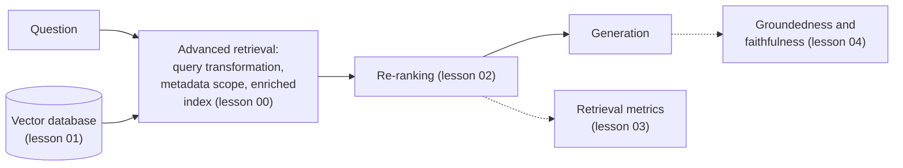

# Lecture 4: Advanced RAG and Evaluation

**Block C: Retrieval-augmented generation**

### Scope

How to move a working RAG pipeline to one that finds the right evidence and can prove its answers are grounded. This lecture covers advanced retrieval (query transformation, metadata filtering, index enrichment and an overview of hybrid retrieval), the choice of the vector database that has to support all of it, re-ranking, and evaluation of retrieval and of groundedness and faithfulness in the RAGAS style.

### Learning Objectives

By the end of this lecture, you will be able to:

- **Improve** the first search with query transformation, metadata filtering and index enrichment.
- **Choose** a vector database by retrieval quality, latency and filtering, and verify the choice on your own data.
- **Configure** a re-ranking cascade and diagnose which stage caused a wrong answer.
- **Evaluate** retrieval on a set built from real questions and labelled with relevance judgments, using the metrics those judgments support (recall@k, R-precision, MRR, MAP, nDCG).
- **Measure** faithfulness, answer relevance and nugget-based correctness with a calibrated judge, and manage hallucination with citations and abstention.

### Support material

- [Introduction to Information Retrieval](../L3_Retrieval_augmented_generation/Support_Material/Manning-et-al-Introduction-to-Information-Retrieval.pdf) (Manning, Raghavan and Schütze, 2008): chapter 8 is the reference for retrieval evaluation in lesson 03.

### Running example

The retail chain's FAQ assistant from lectures 1 and 3, now with a larger corpus and a labelled question set.

### Lessons in this lecture

00. [Advanced Retrieval](00-advanced-retrieval.md)
01. [Vector Databases for RAG](01-vector-databases-and-indexes.md)
02. [Re-ranking](02-re-ranking.md)
03. [Evaluating Retrieval](03-evaluating-retrieval.md)
04. [Groundedness and Faithfulness](04-groundedness-and-faithfulness.md)

### Coming next

- [Lecture 5](../L5_LLMOps/README.md): LLMOps: what an enterprise needs, prompt versioning, and observability and telemetry.
