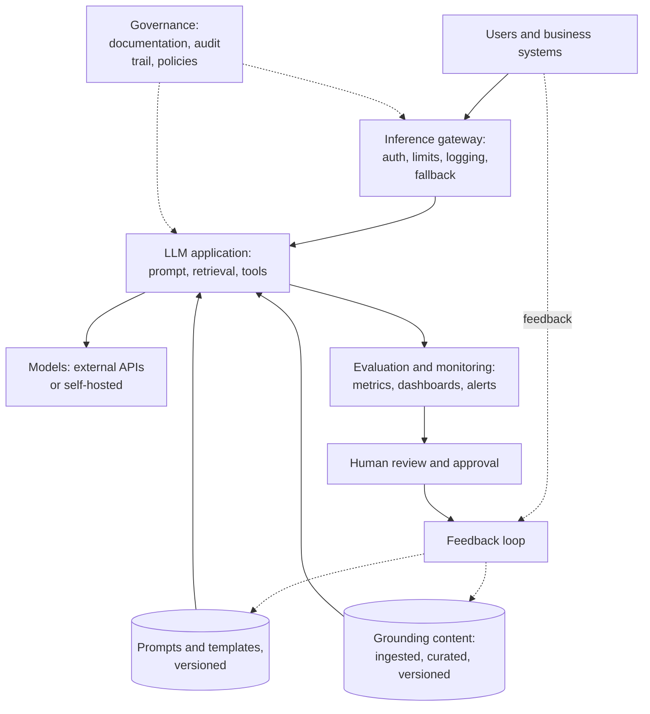

# Lesson 00: Introduction to LLMOps

### What it takes to run many LLM applications in production, and what an enterprise should look for

Most enterprises start with one or two LLM pilots: an internal assistant that answers questions about policies, a classifier that routes incoming documents, a chatbot on the website. Each pilot works, and each was built its own way, with prompts in the code, documents copied into an index by hand, no record of what the model answered, and a bill nobody can break down. The trouble starts when the second, fifth and tenth application go live: nobody can say which prompt version produced a wrong answer, which documents an answer was grounded on, how much each team spends, or whether the system would pass an audit.

**LLMOps** is the set of processes, tools and governance that turns those pilots into something an organisation can run at scale. It builds on MLOps, the practice of versioning, testing, deploying and monitoring machine learning models ([ml-ops.org](https://ml-ops.org/content/mlops-principles)), and adds what is specific to language models: prompts that behave like code, grounding content that changes every week, open-ended outputs that cannot be checked with a single accuracy number, costs per token, external model providers, and human review of what the model says. This lesson introduces what LLMOps sets out to do, its building blocks, the categories of tools on the market, the regulatory frame of the EU AI Act, and a checklist of what an enterprise should look for.

  

### Learning Objectives

By the end of this lesson, you will be able to:

- **Explain** what LLMOps adds to MLOps, and why pilots built one by one do not scale.
- **Describe** the building blocks of an LLMOps platform and what each one is responsible for.
- **Compare** the main categories of LLMOps tools by their strengths and limits.
- **Place** an LLM use case in the risk tiers of the EU AI Act, and name the obligations that follow.
- **Evaluate** an LLMOps platform or vendor against a checklist of enterprise requirements.

---

### Lesson Content

#### What LLMOps sets out to do

The goals of LLMOps follow from the problems of the pilots above.

| Goal | What it means in practice |
| :-- | :-- |
| Industrialise | Every LLM application is built, deployed and monitored the same way, so it scales and can be reproduced |
| Govern | Prompts, content, models and answers are documented and traceable, with control over sensitive interactions |
| Shorten time to production | Automation and shared components let a new use case go live in weeks, not months |
| Learn continuously | User feedback and human review flow back into prompts, content and evaluation sets |
| Manage grounding content | Documents used by RAG systems are ingested, curated, versioned and retired through robust pipelines |

#### The building blocks

An LLMOps platform is a set of shared components around each LLM application, so that every team does not rebuild them.

*Figure 1. The building blocks of an LLMOps platform around one application. Every request passes through the gateway, every answer is monitored, and feedback improves prompts and content.*

| Building block | What it does | What to look for |
| :-- | :-- | :-- | 
| Prompt and template management | Keeps prompts in a versioned repository and supports structured experiments with variations | Versions, release tags, rollback, a link from every answer to the prompt version | 
| Content management for grounding | Ingests internal documents continuously, embeds and indexes them, classifies them by topic and tracks their validity | Incremental sync, metadata, retirement of outdated documents | 
| Evaluation and monitoring | Measures quality, cost and latency, and shows problematic answers on dashboards | Offline and online evaluation, per-use-case metrics, alerts |
| Human review and approval | Puts people in the loop where needed, and approves new prompt or model versions before release | Review queues, approval workflows, sampling of answers | 
| Model adaptation | Fine-tunes models on internal data when prompts and retrieval are not enough, with versions and rollback | A clear separation between general and adapted models |
| Inference gateway | One secured entry point for all model calls, internal or external | Authentication, usage limits, logging, automatic fallback to another model, cost per team |
| Governance and compliance | Documents prompts, data, tests and metrics, and keeps an auditable record of interactions | Audit trail, usage policies, access control, a way to correct content | 
| Feedback and continuous learning | Collects user feedback on answers and turns it into improvements | Feedback buttons, annotation, failures added to evaluation sets |

> **A note on versioning prompts like code.** A prompt is code that a model executes: one changed sentence can fix a category of questions and quietly break others, and nothing fails to compile. Treat it the way software teams treat code. Keep prompts in a repository (or a dedicated folder of the service repository), change them only through pull requests with a review and an evaluation run, and on every merge build an **immutable artifact** that bundles the prompt with everything that shapes its behavior: model and version, temperature, tool definitions, few-shot examples and output schema.
>
> | Identifier | Points to | Used for |
> | :-- | :-- | :-- |
> | Commit hash | Exactly one immutable version | Reproducing an incident, development builds |
> | Release tag, for example `v1.5.0` | One released version | Deploying a known version to an environment |
> | Movable label, for example `production` | Whatever version is live in an environment | Switching or rolling back without changing application code |
>
> The application asks for a label or tag, never for a prompt string copied into its code, and every trace records the prompt version that produced the answer, so a wrong answer can be traced to its prompt and rolled back in minutes. Prompt registries such as [MLflow](https://mlflow.org/docs/latest/genai/prompt-registry/), [Langfuse](https://langfuse.com/docs/prompt-management/features/prompt-version-control) and [LangSmith](https://docs.langchain.com/langsmith/manage-prompts) implement the same model with immutable versions and movable aliases, labels or tags.

#### Choosing tools: five categories

There is no industry consensus yet on LLMOps practices or tools, and the market is fragmented, which is one reason many organisations struggle to move beyond pilots. Most tools fall into one of five categories, each with a different balance of flexibility, depth and focus.

| Category | Strengths | Limits | Fits |
| :-- | :-- | :-- | :-- |
| General data and AI platforms, with LLMOps modules (for example Databricks, Vertex AI) | Native integration with existing data and pipelines | Limited support for agents, human review and specialised RAG components | Organisations already invested in that platform |
| Specialised LLMOps and observability platforms | Deep visibility into cost, latency, quality and traces | Agents, workflows and production processes must be built around them | Technical teams that want operational detail |
| Evaluation and curation platforms | High-quality labelling, human evaluation and evaluation datasets | Focused on experimentation and pre-production, not on running applications | Building evaluation sets and regulated review processes |
| Low-code and no-code agent builders | Fast prototypes, accessible to non-technical teams | Limited customisation, integration, traceability and security control | Simple automations and demos |
| End-to-end agent platforms | Development, operation, monitoring, human review and governance in one place | More initial technical effort; risk of lock-in unless the agent code stays yours | Enterprises running many agents in regulated settings |

*The category matters more than the product: choose the one that matches your stack and your maturity, and prefer platforms where the prompts, agent code and data remain yours, so they can be migrated if the platform is replaced.

#### Regulation: the EU AI Act

The EU AI Act, [Regulation (EU) 2024/1689](https://eur-lex.europa.eu/eli/reg/2024/1689/oj/eng), sets the legal frame for developing and using AI systems in the EU. It classifies systems by the risk they pose and puts the heaviest obligations on high-risk systems. The [European Commission's overview](https://digital-strategy.ec.europa.eu/en/policies/regulatory-framework-ai) describes four levels:

| Risk level | Examples | What follows |
| :-- | :-- | :-- |
| Unacceptable | Social scoring, emotion recognition in workplaces and schools, manipulative techniques | Prohibited |
| High | CV screening for recruitment, credit scoring, exam scoring, AI safety components of medical devices | Risk management, quality data, logging, documentation, human oversight, robustness and accuracy, conformity assessment |
| Transparency | Chatbots, generated content, deepfakes | People must know they are talking to a machine, and generated content must be identifiable |
| Minimal | Spam filters, most internal productivity uses | No specific obligations; good practice recommended |

Most enterprise chatbots and assistants fall under transparency obligations. A use case moves towards high risk when it affects people's access to essential services, employment or safety: in healthcare, for instance, a model that predicts hospital readmission and changes follow-up care, or one that decides how claims are processed, may be high risk depending on how it is used and whether it is part of a regulated medical device. The classification of a specific system is a legal question for the organisation's legal and compliance teams, not something this lesson can settle.

Timing matters for planning. According to the Commission, the Act entered into force on 1 August 2024, prohibitions applied from 2 February 2025, obligations for general-purpose AI models from 2 August 2025, and most other rules from 2 August 2026. An amendment adopted in 2026 (the AI Omnibus) moved the high-risk obligations to 2 December 2027 for the use cases listed in Annex III and to 2 August 2028 for AI embedded in regulated products. LLMOps is where these obligations become practical: the documentation, logging, human oversight and monitoring the Act asks for are the same building blocks as in Figure 1.

#### What an enterprise should look for

Whether you build a platform or buy one, the same questions decide whether it will support many applications safely.

| Capability | Question to ask |
| :-- | :-- |
| Prompt versioning | Can every answer be traced to the exact prompt, model and configuration that produced it, and can we roll back in minutes? |
| Content lifecycle | Are grounding documents synced incrementally, labelled, and retired when outdated? |
| Evaluation | Can we run an evaluation set before every release and monitor quality in production per use case? |
| Human review | Can reviewers approve releases and sample, correct and annotate answers? |
| Gateway | Is there one entry point with authentication, limits, logging, fallback and cost per team? |
| Audit and explainability | Can we show an auditor what was asked, what was retrieved, what was answered and who approved it? |
| Data protection | Where are prompts, logs and documents stored and processed, and under which jurisdiction? |
| Ownership | Do prompts, agent code and data stay ours if we change platform? |

**Practices overview**

| Practice | Why | Evidence |
| :-- | :-- | :-- |
| Build shared components once instead of per pilot | Pilots built one by one cannot be traced, compared or audited | [MLOps principles](https://ml-ops.org/content/mlops-principles) |
| Version prompts and content, and link every answer to them | Reproducibility and rollback | [MLOps principles](https://ml-ops.org/content/mlops-principles) |
| Route all model calls through one gateway | Security, cost control and fallback in one place | Operations practice |
| Classify every use case under the AI Act early | Obligations and deadlines depend on the risk level | [European Commission](https://digital-strategy.ec.europa.eu/en/policies/regulatory-framework-ai) |
| Prefer tools where code and data remain yours | Avoids lock-in in a fragmented market | Procurement practice |

#### In practice

Start by inventorying the LLM applications already running, with their prompts, data sources, owners and monthly cost; the list is usually longer and messier than expected. Then put the gateway, prompt versioning and basic monitoring in place first, because they are needed by every application and make the others traceable. Classify each use case under the AI Act with the legal team before scaling it, and choose tools by category and fit with your existing stack rather than by feature lists.

**Summary:**
- LLMOps extends MLOps to prompts, grounding content, open-ended outputs, token costs, external providers and human review.
- Its building blocks are prompt and content management, evaluation and monitoring, human review, an inference gateway, governance and feedback.
- Tools fall into five categories; none covers everything, and ownership of code and data limits lock-in.
- The EU AI Act sets obligations by risk level, with transparency for chatbots and heavy requirements for high-risk systems from December 2027.

---

### References

- ml-ops.org, [MLOps Principles](https://ml-ops.org/content/mlops-principles).
- MLflow, [Prompt Registry](https://mlflow.org/docs/latest/genai/prompt-registry/); Langfuse, [Prompt version control](https://langfuse.com/docs/prompt-management/features/prompt-version-control); LangSmith, [Manage prompts](https://docs.langchain.com/langsmith/manage-prompts) (accessed October 2026).
- [Regulation (EU) 2024/1689 (AI Act)](https://eur-lex.europa.eu/eli/reg/2024/1689/oj/eng).
- European Commission, [AI Act: regulatory framework for AI](https://digital-strategy.ec.europa.eu/en/policies/regulatory-framework-ai) (accessed October 2026). Risk levels, obligations and timeline, including the AI Omnibus.

### Further Reading

- [Lesson 01: Observability and Telemetry](01-observability-and-telemetry.md) - the next lesson.
- [Lecture 6: Governance and Risk](../L6_Governance_and_risk/README.md) - guardrails, data privacy and budgets.
