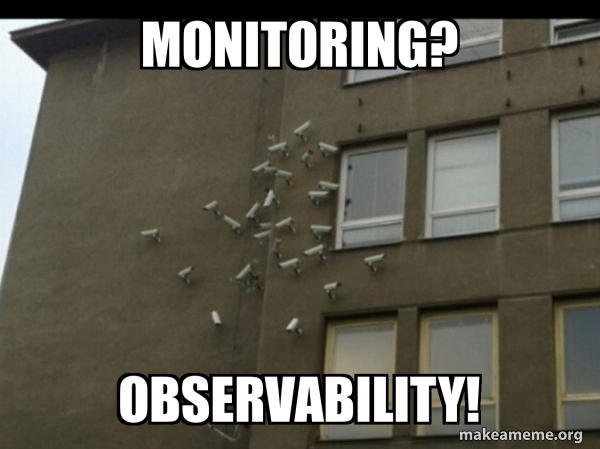
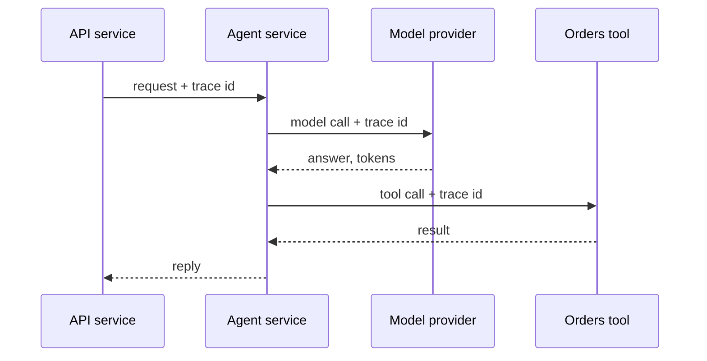
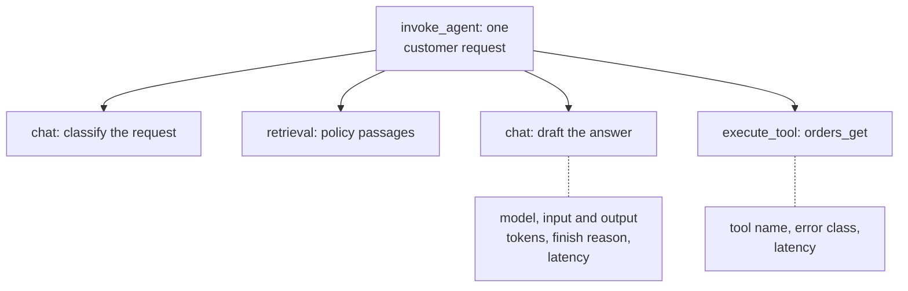
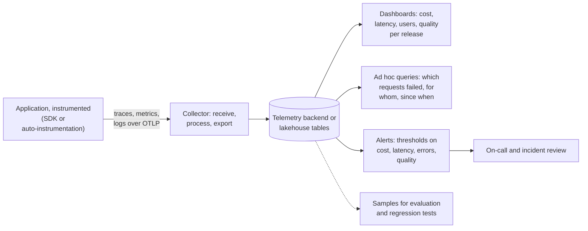
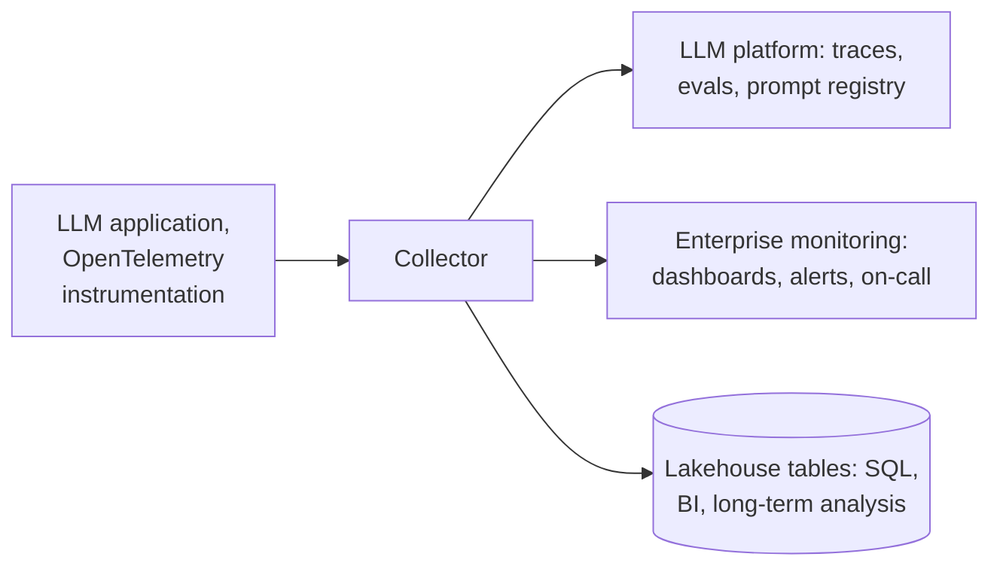

# Lesson 01: Observability and Telemetry

### Seeing what an LLM application did, what it cost, and whether it still works

An LLM application that answers correctly in a demo can still fail quietly in production: a prompt change that doubles the token bill, a tool that times out for one customer segment, an agent that loops before answering, or a slow drift in answer quality that nobody notices until complaints arrive. Unlike a classic service, the same request can take a different path on another day, every request has a variable cost, and a wrong answer looks exactly like a right one from the outside. **Observability** is the ability to answer, after the fact and without changing the code, what a system did, why, and at what cost, including questions nobody thought to ask in advance. **Telemetry** is the data that makes it possible: the outputs a running application emits about its own activity.

This lesson introduces telemetry from the ground up. It starts with the kinds of signal an application emits, as defined by OpenTelemetry, the open standard most tools now build on, then looks at each one in turn (traces, metrics and logs) with what an LLM application should record, shows how the data travels from the application to dashboards and alerts, connects it to evaluation, and ends with the products that most teams use instead of building all this themselves.

<p align="center">
  
</p>

### Learning Objectives

By the end of this lesson, you will be able to:

- **Describe** the OpenTelemetry signals (traces, metrics, logs and baggage) and the question each one answers.
- **Read** a trace: spans, parent and child, attributes, events, status and the trace id that ties them together.
- **Choose** the metric instruments and the metrics that show cost, latency, usage and quality.
- **Design** the path from instrumentation through the Collector to dashboards, queries, alerts and evaluation.
- **Compare** the main telemetry products and decide where an LLM application's data should go.

---

### Lesson Content

#### Signals: the raw material of telemetry

OpenTelemetry calls the outputs an application emits about itself [signals](https://opentelemetry.io/docs/concepts/signals/): records of what the software and the system underneath it did. Several kinds exist because each answers a different question, and they are most useful together, joined by shared identifiers.

| Signal | What it is | Question it answers | In an LLM assistant |
| :-- | :-- | :-- | :-- |
| Trace | The path of one request through the application, made of spans | "What did this request do, step by step, and where did the time go?" | A question that triggered a classification, a retrieval, two model calls and a tool call |
| Metric | A measurement captured at runtime and aggregated over time | "Is the system healthy right now, and how is it trending?" | Requests per minute, p95 latency, tokens and cost per day |
| Log | A timestamped record of an event | "What exactly happened at this moment?" | A tool error, a guardrail decision, a rejected refund |
| Baggage | Context passed between services and signals with the request | "Which customer, tenant or experiment does this belong to?" | A tenant id or experiment group attached to every span of the request |

*Profiles (resource usage at code level) and events (a specific kind of log) are also part of OpenTelemetry but still in development, as of October 2026.*

A useful way to see the difference: a metric says that p95 latency doubled at 10:00, a trace shows that the extra time is spent in the retrieval step of one kind of question, and a log on that step shows a timeout from the vector database. Each signal narrows the search for the next.

#### Traces and spans: what one request did

A [trace](https://opentelemetry.io/docs/concepts/signals/traces/) is a collection of **spans**, and a span is one unit of work: a model call, a retrieval, a tool call, or the whole request. Spans are nested: the first span of a request, the **root span**, has no parent, and every step below it records its parent, which is how a trace becomes a tree.

| Part of a span | What it holds | LLM example |
| :-- | :-- | :-- |
| Name | What the operation is | `chat`, `retrieval`, `execute_tool orders_get` |
| Span context | A trace id shared by every span of the request, and the span's own id | The same trace id on the agent, model and tool spans |
| Parent span id | The span that started this one | The tool call's parent is the agent span |
| Start and end time | When it ran, and so how long it took | A model call of 1.8 seconds |
| Attributes | Key-value details about the operation | Model name, input and output tokens, prompt version |
| Events | A meaningful moment inside the span, with its own timestamp | "First token received", "retry after rate limit" |
| Status | Unset, Ok or Error | Error when the tool timed out |
| Kind | The role of the span: client, server, internal, producer or consumer | Client for the call to the model provider |

Put together, one model-call span looks like this (simplified; the `gen_ai.*` names come from the GenAI semantic conventions, and `app.*` marks attributes the team adds itself):

```json
{
  "name": "chat gpt-4.1-mini",
  "context": {
    "trace_id": "5b8aa5a2d2c872e8321cf37308d69df2",
    "span_id": "051581bf3cb55c13"
  },
  "parent_id": "5fb397be34d26b51",
  "kind": "CLIENT",
  "start_time": "2026-10-27T10:00:01.120Z",
  "end_time": "2026-10-27T10:00:02.940Z",
  "status": { "code": "UNSET" },
  "attributes": {
    "gen_ai.operation.name": "chat",
    "gen_ai.provider.name": "azure.ai.openai",
    "gen_ai.request.model": "gpt-4.1-mini",
    "gen_ai.usage.input_tokens": 1840,
    "gen_ai.usage.output_tokens": 212,
    "gen_ai.response.finish_reasons": ["stop"],
    "app.prompt.version": "refund-answer@v14"
  },
  "events": [
    { "name": "first_token", "timestamp": "2026-10-27T10:00:01.610Z" }
  ]
}
```

The `parent_id` points to the agent span, the 1.8 seconds between start and end are the latency, and the tokens and prompt version are what later turn into cost per prompt version. A status of `UNSET` means no error was recorded, which is the normal case.

A request rarely stays in one process: it passes from an API to an agent service, to a model provider and to a tool. **Context propagation** carries the trace id (and any baggage) across each of those boundaries, usually in request headers, so that the spans recorded by different services join into one trace.



*Figure 1. Context propagation: the trace id travels with the request, so spans from every service join one trace.*

For LLM applications, OpenTelemetry is developing semantic conventions for generative AI, so that every tool records the same fields under the same names. Its [description of an agent trace](https://opentelemetry.io/blog/2026/genai-observability/) has a top-level agent span with one child span per model call and per tool execution, records the model, input and output tokens and the reason generation stopped on each model call, and keeps prompt and response content capture off by default.



*Figure 2. A trace of one request: one parent span and a child span per model call, retrieval and tool call.*

| Record on every span | Why |
| :-- | :-- |
| A trace id shared by all spans of a request | Reconstruct one conversation end to end |
| Model and version, input and output tokens, finish reason | Cost, and why generation stopped (answer, tool call or length limit) |
| Latency | Find the slow step |
| Prompt version | Tie every answer to the prompt that produced it |
| Tool name, error class, retry count | Separate a broken tool from a confused model |
| User, session, tenant and release tags | Slice everything by customer, segment and version |

Prompt and response content are different from metadata, because they can contain personal data. Record metadata always, and capture content deliberately: scrubbed, sampled, and in a store whose access you control.

#### Metrics: numbers over time

A [metric](https://opentelemetry.io/docs/concepts/signals/metrics/) is a measurement captured while the application runs, and OpenTelemetry records it through **instruments**, each suited to a kind of number.

| Instrument | What it records | LLM example |
| :-- | :-- | :-- |
| Counter | A total that only goes up | Requests served, tokens consumed, errors |
| Up-down counter | A total that goes up and down | Active conversations, requests waiting in a queue |
| Gauge | The current value when read | GPU memory in use on a self-hosted model |
| Histogram | The distribution of many values | Latency, tokens per request, cost per request |

Metrics are cheap because they are **aggregated**: instead of storing every request, the application keeps running totals or histogram buckets and exports them every few seconds. **Views** let you choose which instruments to export, how to aggregate them and which attributes to keep, which matters because every extra attribute (for example a user id) multiplies the number of time series to store.

What is exported is not one record per request but one summary per period. This histogram data point (simplified) covers one minute of model calls for one model and release:

```json
{
  "name": "gen_ai.client.operation.duration",
  "unit": "s",
  "type": "histogram",
  "data_points": [
    {
      "attributes": {
        "gen_ai.operation.name": "chat",
        "gen_ai.request.model": "gpt-4.1-mini",
        "app.release": "2026.10.3"
      },
      "start_time": "2026-10-27T10:00:00Z",
      "time": "2026-10-27T10:01:00Z",
      "count": 412,
      "sum": 698.4,
      "explicit_bounds": [0.5, 1, 2, 4, 8],
      "bucket_counts": [21, 96, 210, 71, 12, 2]
    }
  ]
}
```


| Metric | Audience | What it reveals |
| :-- | :-- | :-- |
| Cost per request, per user, per day (tokens times price) | Business, platform | Expensive features, runaway loops, the effect of a prompt change on the bill |
| Latency, tokens and cost per request as percentiles (p50, p95, p99), per step and per task | Engineering, product | Slow models, slow tools, long prompts, and the share of requests that behave much worse than the typical one |
| Number of users, sessions and requests | Business, product | Adoption and load |
| Usage by capability (which features, intents or tools are used) | Product | What the assistant is actually used for |
| Error and fallback rate by class | Engineering | Timeouts, rate limits, invalid tool arguments |
| Escalation and refusal rate | Product, operations | How often a person must step in, and whether the assistant refuses too much |
| Quality signals: user feedback, sampled judge scores | Product | Whether answers are good, not just fast |

#### Logs: what happened at one moment

A [log](https://opentelemetry.io/docs/concepts/signals/logs/) is a timestamped record of an event, and the most familiar signal, since every application already writes them. OpenTelemetry recommends **structured** logs, with a consistent set of named fields (time, severity, message, tool name, error code) that tools can parse reliably, over free-text lines that need fragile pattern matching to search. Its key contribution is correlation: when tracing is active, the trace id and span id are added to each log record automatically, so the timeout logged by the orders tool can be opened directly from the span it belongs to. Existing logging libraries do not need to be replaced; a bridge or appender sends their output through OpenTelemetry. For LLM applications, log the decisions around the model rather than the model's text: guardrail verdicts, policy checks, tool errors, fallbacks to another model.

A structured log record for a tool timeout (simplified) carries the same `trace_id` as the model span above, which is what lets a backend show it inside that request's trace:

```json
{
  "timestamp": "2026-10-27T10:00:03.105Z",
  "severity_text": "ERROR",
  "body": "orders_get timed out after 5 s",
  "trace_id": "5b8aa5a2d2c872e8321cf37308d69df2",
  "span_id": "a3c1f09e7d2b4410",
  "attributes": {
    "gen_ai.tool.name": "orders_get",
    "error.type": "timeout",
    "app.retry_count": 2,
    "app.tenant": "store-pt"
  }
}
```


#### OpenTelemetry: one way to collect and send everything

> **Why a unified framework matters.** OpenTelemetry gives every part of the system one way to describe what happened: the same instrumentation libraries, the same data model for traces, metrics and logs, and one transport (OTLP) to send them anywhere. Without it, each framework, model provider and observability product emits its own format, so a single request that passes through an agent framework, a model API, a vector database and a tool ends up split across tools that cannot be joined. With it, the application is instrumented once, the same trace id follows the request through every component, and the data can be sent to one backend or several at the same time, or moved to another product later, without touching the code.

The data takes the same path whatever the backend. The application is **instrumented**, by hand or with auto-instrumentation libraries for common frameworks and model SDKs, and an exporter sends its signals over OTLP to the [OpenTelemetry Collector](https://opentelemetry.io/docs/collector/), a separate service that receives, processes (batching, sampling, scrubbing personal data) and forwards them to one or more backends, where they become dashboards, queries and alerts.



*Figure 3. The telemetry pipeline: instrument once, process in the Collector, then dashboard, query and alert.*


#### Telemetry is productised

Few teams build their own telemetry backend any more. Because the signals and the transport are standardised, the market offers ready-made backends, and the choice is mostly about category: platforms built for LLM applications, which add evaluation and prompt management to tracing; the enterprise monitoring stacks most organisations already run; the tracing built into a cloud provider's AI services.

| Product | Category | Tracing | Evaluation | Prompt management | Deployment and openness | OpenTelemetry |
| :-- | :-- | :-- | :-- | :-- | :-- | :-- |
| [LangSmith](https://docs.langchain.com/langsmith) | LLM observability platform | Traces and threads, production metrics | Datasets from traces, online evaluation, annotation queues | Commits, tags, environments with rollback | Cloud, hybrid or self-hosted; framework-agnostic | Not documented |
| [Grafana Cloud](https://grafana.com/docs/grafana-cloud/monitor-applications/ai-observability/) | Enterprise monitoring stack | LLMs, vector databases, GPUs and MCP servers | Not its focus | Not its focus | Managed cloud on the open-source Grafana stack, with alerting | Built on OpenTelemetry |
| [Microsoft Foundry tracing](https://learn.microsoft.com/en-us/azure/ai-foundry/concepts/trace) | Cloud-native | Traces stored in Azure Application Insights | Connected to evaluation runs | Not documented | Managed in Azure | OpenTelemetry instrumentation |



*Figure 4. One instrumentation, several destinations.*

**Practices overview**

| Practice | Why | Evidence |
| :-- | :-- | :-- |
| Instrument with OpenTelemetry from the first prototype | One standard; every product can read it | [OpenTelemetry signals](https://opentelemetry.io/docs/concepts/signals/) |
| Propagate the trace id across every service and attach it to logs | Signals from different services join into one story | [OpenTelemetry traces](https://opentelemetry.io/docs/concepts/signals/traces/) |
| Use histograms for latency, tokens and cost, and report percentiles | Averages hide the tail | [OpenTelemetry metrics](https://opentelemetry.io/docs/concepts/signals/metrics/) |
| Tag every span with prompt version and release | Changes become traceable in every chart | Release practice |
| Capture content deliberately, scrubbed or sampled | Prompts and outputs can contain personal data | [OpenTelemetry GenAI](https://opentelemetry.io/blog/2026/genai-observability/) |
| Report cost and quality together | Accuracy alone rewards costly systems | [Kapoor et al. (2024)](https://arxiv.org/abs/2407.01502) |
| Choose backends by category, and keep the instrumentation vendor-neutral | Products change; the data model should not | Product documentation |

#### In practice

Instrument before the first user arrives, because a failure without a trace is a guess. Start with one trace per request, propagated across services, with token and latency attributes on every model span and a prompt-version tag; add a handful of histograms (latency, tokens, cost) and structured logs for guardrail and tool decisions. Route everything through a Collector, send it to the backend your organisation already runs plus one LLM platform for debugging and evaluation, build two dashboards (business and engineering) and three alerts (latency, cost, errors), and turn every interesting failure into a regression test case.

**Summary:**
- Telemetry is made of signals: traces for one request's path, metrics for trends, logs for single events, and baggage for context that travels with the request.
- A trace is a tree of spans joined by a trace id, with attributes, events and status; context propagation carries the id across services.
- Metrics use counters, gauges and histograms and are aggregated; report latency, tokens and cost as percentiles.
- OpenTelemetry standardises instrumentation and transport, and the Collector routes the data to dashboards, queries, alerts and evaluation.
- Telemetry is productised: LLM platforms, open-source tools, enterprise monitoring stacks and cloud services all read the same standard data.

---

### References

- OpenTelemetry, [Signals](https://opentelemetry.io/docs/concepts/signals/), [Traces](https://opentelemetry.io/docs/concepts/signals/traces/), [Metrics](https://opentelemetry.io/docs/concepts/signals/metrics/), [Logs](https://opentelemetry.io/docs/concepts/signals/logs/), [Baggage](https://opentelemetry.io/docs/concepts/signals/baggage/) and [Collector](https://opentelemetry.io/docs/collector/) (accessed October 2026).
- OpenTelemetry (2026), [Inside the LLM Call: GenAI Observability with OpenTelemetry](https://opentelemetry.io/blog/2026/genai-observability/).
- Kapoor et al. (2024), [AI Agents That Matter](https://arxiv.org/abs/2407.01502).

### Further Reading

- [Lesson 00: Introduction to LLMOps](00-introduction-to-llmops.md) - the previous lesson.
- [Lecture 4, Lesson 03: Evaluating Retrieval](../L4_Advanced_RAG_and_evaluation/03-evaluating-retrieval.md) - building evaluation sets.
- [Lecture 6, Lesson 02: Cost and Latency Budgeting](../L6_Governance_and_risk/02-cost-and-latency-budgeting.md) - budgets measured from these traces.
