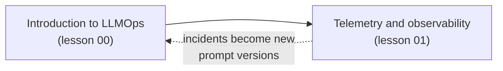

# Lecture 5: LLMOps

**Block D: Operating LLM systems**

### Scope

How to run LLM applications in production: what LLMOps adds to MLOps and what an enterprise needs, with its building blocks, tool categories, prompt versioning and EU AI Act obligations, and then observing what every request did and cost. The lecture builds on the evaluation methods of lectures 2 and 4 and turns them into operational practice.

### Learning Objectives

By the end of this lecture, you will be able to:

- **Explain** what LLMOps adds to MLOps, its building blocks, tool categories and the EU AI Act obligations an enterprise must plan for.
- **Describe** the OpenTelemetry signals and **instrument** an LLM application with traces, metrics and logs that feed dashboards, alerts and evaluation.
- **Compare** the main telemetry products, from LLM platforms to enterprise monitoring stacks.
- **Version** prompts like code, with immutable artifacts, release tags and movable environment labels.
- **Compare** the main categories of LLMOps tools and what an enterprise should look for.

### Lessons in this lecture

00. [Introduction to LLMOps](00-introduction-to-llmops.md)
01. [Observability and Telemetry](01-observability-and-telemetry.md)

### Coming next

- [Lecture 6: Governance and Risk](../L6_Governance_and_risk/README.md): hallucination guardrails, data privacy and cost and latency budgets.
