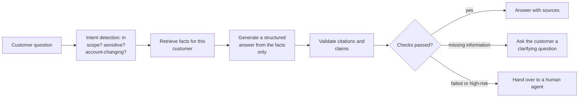

# Lesson 00: Hallucination Guardrails

### Making answers stay on the facts, show their sources, and know when to stop

A language model writes a wrong answer in exactly the same confident, fluent tone as a right one. For any assistant whose answers people act on, that is a real risk: an invented price, a policy clause that does not exist, or a promise of a refund the policy does not allow becomes a complaint, a cost or a regulatory issue. Retrieval gives the model the right facts, but nothing forces it to use them, so production systems wrap the model in **guardrails**: checks placed before, during and after generation that keep answers grounded, make them verifiable, and route the cases they cannot clear to a person.

This lesson builds those layers in the order a request meets them: detecting the intent, grounding the answer in retrieved facts, forcing a structured output, validating the citations, and deciding from those checks whether to answer, ask the customer for more information, or hand over to a human. The examples come from a customer-support assistant that answers questions about products, orders, accounts and policies, but the same layers apply to any LLM application that answers from company data.

  

### Learning Objectives

By the end of this lesson, you will be able to:

- **Design** guardrail layers before, during and after generation.
- **Specify** a structured output with answer, citations and missing information.
- **Validate** citations and claims against the retrieved documents.
- **Route** each answer, based on the checks, to the customer, a clarifying question or human review.

---

### Lesson Content

#### Guardrails as layers

No single check catches every hallucination, so guardrails are stacked, each cheap enough to run on every request and each catching what the previous one let through.

*Figure 1. Guardrail layers in the order a request meets them.*

| Layer | Stops | Example in a support assistant |
| :-- | :-- | :-- |
| Intent detection | Out-of-scope, sensitive or risky requests reaching the generator | "Cancel my contract" goes to a guarded flow, "write me a poem" is declined |
| Grounding | Answers from memory instead of from documents | The price of a plan comes only from the current price list |
| Structured output | Wandering, unverifiable prose | Every answer carries its sources and anything it could not determine |
| Citation validation | Sources that do not say what the answer claims | A cited policy clause must actually mention the price quoted |
| Routing | Answers that failed a check reaching the customer | An answer about a disputed bill whose citation fails validation goes to an agent |

#### Intent detection first

Before anything is retrieved or generated, a classifier (a small model or a constrained model call) decides what the customer wants. This is the familiar router pattern used as a safety layer: questions outside the product scope are declined politely, sensitive topics such as complaints or legal threats are routed to people, and anything that changes the account (porting a number, cancelling a contract, applying a credit) leaves the free-text path and enters a flow with explicit confirmation. Deciding the intent early means the most dangerous requests never depend on how well the model behaves.

#### Grounding: answer only from facts, and show them

Grounding means the answer is built only from the retrieved passages and customer data, never from what the model remembers, and that the sources are shown to the customer or agent. The instruction alone is not enough, which is why the next layers check it, but presenting the sources changes behavior on both sides: the model is asked to point to evidence for every claim, and the reader can verify it.

#### Structured outputs so the model cannot wander

Forcing the model to reply in a schema turns a free-text answer into fields that code can check.

| Field | Content | Used for |
| :-- | :-- | :-- |
| `answer` | The reply to the customer | Display |
| `citations` | For each claim, the id of the passage or record that supports it | Citation validation, display of sources |
| `missing_information` | What the model could not determine from the facts, such as "which line the customer means" | Asking the customer a clarifying question |
| `intent` | The detected intent, confirmed | Routing and analytics |
| `requires_human` | True when policy requires a person, for example any refund above a limit | Hand-over |

The `missing_information` field matters: when a value cannot be inferred from the data (which of several accounts the customer is asking about, which period), the right move is to ask, not to guess.

#### Citation validation: checking the sources

A citation is only useful if it supports the claim. [Gao et al. (2023)](https://arxiv.org/abs/2305.14627) built the ALCE benchmark for answers with citations and found that, on one of its datasets, even the best models lacked complete citation support about half of the time, so citations must be checked, not trusted.

| Check | How | Cost |
| :-- | :-- | :-- |
| The cited source exists | Each citation id is among the passages actually retrieved | Free, deterministic |
| Exact values match | Prices, dates, plan names and numbers in the answer appear in the cited passage | Cheap, deterministic |
| The source supports the claim | A judge model or an entailment model checks each claim against its passage | One extra model call |
| No claim without a citation | Every sentence that states a fact has at least one citation | Cheap, from the structured output |

**Practices overview**

| Practice | Why | 
| :-- | :-- | 
| Classify intent before generating | Risky requests never depend on model behavior | 
| Ground every claim and show sources | Answers become verifiable |
| Force a structured output with citations and missing information | Code can check and route the answer | 
| Validate every citation | Models often lack full citation support |
| Route answers that fail a check to clarification or a human | A wrong answer costs more than a hand-over | 

#### In practice

Start with the cheap deterministic layers: intent detection, a structured output, a check that citations point to retrieved passages and that numbers match. Add judge-based validation only for intents where a wrong answer is expensive, such as billing disputes and contract terms. Decide per intent which failed checks go to a person, and track how often each route fires, since an assistant that hands everything to humans is as broken as one that never does.

**Summary:**
- Guardrails are layers: intent detection, grounding, structured output, citation validation and routing.
- A structured output with citations and missing information lets code check and route each answer.
- Citations must be validated, because even strong models often lack full support for what they cite.
- Answers that pass the checks go to the customer; missing information leads to a clarifying question, and failed or high-risk answers go to a person.

---

### References

- Gao et al. (2023), [Enabling Large Language Models to Generate Text with Citations](https://arxiv.org/abs/2305.14627). The ALCE benchmark.

### Further Reading

- [Lecture 4, Lesson 04: Groundedness and Faithfulness](../L4_Advanced_RAG_and_evaluation/04-groundedness-and-faithfulness.md) - measuring grounding.
- [Lesson 01: Data Privacy and PII](01-data-privacy-and-pii.md) - the next lesson.
