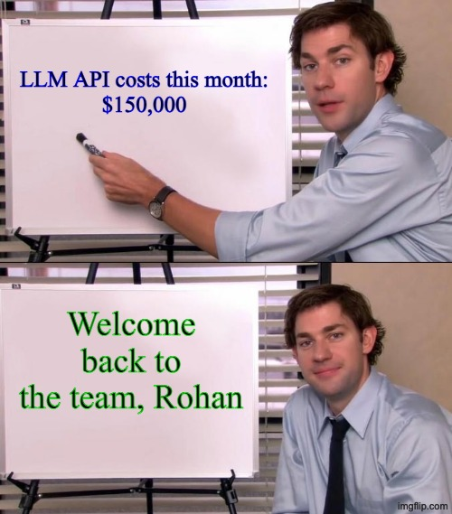
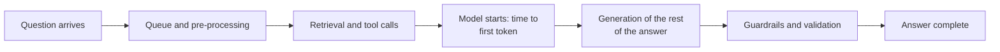
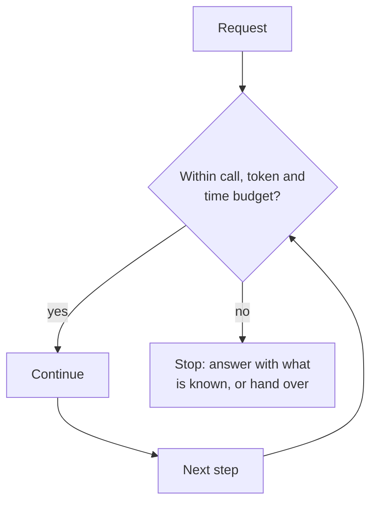

# Lesson 02: Cost and Latency Budgeting

### Measuring, capping and testing what an LLM application spends in money and in time

A prototype that costs a few cents and answers in three seconds can cost thousands a day and keep customers waiting at scale, because every request multiplies tokens, model calls and tool calls, and agents multiply them again. Averages hide the problem: the median customer may be served quickly while one in a hundred waits half a minute for an agent that looped. Governance at scale therefore means setting budgets for cost and latency, measuring them as distributions rather than averages, enforcing hard limits in code, and testing realistic scenarios before production.

This lesson covers latency as a distribution and its components, the units that make cost meaningful, the limits that stop runaway requests, and how to test budgets before release. The examples come from a customer-facing assistant whose traffic peaks at predictable moments, such as month-end or a product launch.

  

### Learning Objectives

By the end of this lesson, you will be able to:

- **Measure** latency with percentiles and time to first token, and explain why the mean misleads.
- **Track** cost per request, per model call and per successful task.
- **Enforce** budgets with call limits, token caps, timeouts and fallbacks.
- **Test** budgets on realistic scenarios before production.

---

### Lesson Content

#### Latency is a distribution, not a number

| Measure | What it tells you | Why it matters |
| :-- | :-- | :-- |
| Mean | The average | Pulled up by a few very slow requests, so it describes nobody |
| Median (p50) | What a typical customer experiences | The everyday experience |
| p95 | What 1 in 20 customers experiences or worse | Where complaints start |
| p99 | What 1 in 100 experiences or worse | Where loops, retries and timeouts show up |
| Distribution shape | Whether there is a long tail or two clusters | Two clusters often mean two paths, such as with and without a tool call |

When the mean is far above the median, a tail of slow requests is dragging it, and those requests are where to look. Plot the full distribution per intent, since a billing question with three tool calls and a greeting have nothing in common.

*Figure 1. Where the time goes in one request. Each segment is a span in the trace.*

| Latency metric | Definition |
| :-- | :-- |
| Time to first token (TTFT) | How long the user waits after sending a prompt before the first output token arrives; longer prompts and queuing increase it |
| Time per output token | The average gap between tokens after the first one |
| End-to-end latency | Time to first token plus the time to generate the rest of the answer |
| Throughput | Tokens or requests completed per second, per user or across the system |

These definitions follow the [benchmarking metrics](https://docs.anyscale.com/llm/serving/benchmarking/metrics) used for LLM serving. Streaming makes time to first token what the customer perceives as responsiveness, but guardrails that validate the whole answer before showing it bring the full end-to-end time back, so decide per intent which answers can stream and which must be checked first.

#### The units that make cost meaningful

| Unit | Formula | Reveals |
| :-- | :-- | :-- |
| Tokens per request | Input plus output tokens of all calls | Prompt bloat, long retrieved context |
| Model calls per request | Number of model calls in the trace | Agent loops, retries, extra validation calls |
| Cost per request | Tokens times price, per model | The bill per interaction |
| Cost per successful task | Total cost divided by tasks completed correctly | The real price of value delivered |
| Cost per user per month | Cost aggregated per customer | Whether the feature is economically viable |

Cost per successful task is the number that matters for decisions. A cheap model that fails half the time and triggers retries or hand-overs can cost more per resolved question than an expensive one that succeeds, which is why [Kapoor et al. (2024)](https://arxiv.org/abs/2407.01502) argue for evaluating cost and accuracy together rather than accuracy alone.

#### Enforcing budgets in code

Budgets that are only monitored are discovered after the money is spent; the limits below are enforced on every request.

| Limit | Stops | Typical setting for a support assistant |
| :-- | :-- | :-- |
| Maximum model calls per request | Agent loops and runaway retries | A small fixed number per intent |
| Maximum tool calls per request | Repeated lookups | Per intent |
| Token caps on input and output | Huge prompts, endless answers | Cap retrieved context and output length |
| Timeouts per call and per request | Hanging providers and tools | A request timeout with a graceful fallback message |
| Retry limits with backoff | Retry storms during provider incidents | Few retries, then fail over |
| Fallback model | Cost and latency spikes | A smaller model for simple intents or when the main one is slow |
| Caching | Paying twice for the same answer | Cache retrieval results and answers to frequent, non-personal questions |

*Figure 2. Every step checks the budget; exceeding it ends the request gracefully instead of letting it run.*

#### Testing budgets before production

Most budget surprises come from inputs nobody tested: very long messages, accounts with hundreds of records, follow-ups that trigger multi-step agent paths, or a provider that slows down at peak. Replay realistic scenarios before release and treat budgets as release gates, alongside the quality gates of the prompt release process.

| Test | Purpose |
| :-- | :-- |
| Replay of anonymised real conversations | Realistic mix of intents and lengths |
| Atypical inputs: very long, very large accounts, mixed languages | Find the tail before customers do |
| Load test at peak traffic, such as month-end or a launch | Queuing, rate limits and throughput |
| Provider slowdown and failure simulation | Timeouts, retries and fallbacks behave as designed |
| Budget gates in CI | Block a release whose p95 latency or cost per task rises beyond the agreed margin |

**Practices overview**

| Practice | Why | Evidence |
| :-- | :-- | :-- |
| Report p50, p95 and p99, never the mean alone | Tails hold the loops and failures | Latency is a distribution |
| Track time to first token separately | It is what streaming users perceive | [LLM serving metrics](https://docs.anyscale.com/llm/serving/benchmarking/metrics) |
| Report cost per successful task | Cheap but failing models are expensive | [Kapoor et al. (2024)](https://arxiv.org/abs/2407.01502) |
| Enforce call limits, token caps and timeouts in code | Loops and hangs are stopped, not just observed | Bounding the loop |
| Use fallbacks and caching | Cut cost and tail latency | Operations practice |
| Gate releases on budgets after realistic replay | Surprises are found before customers | Release gates |

#### In practice

Set a latency and cost budget per intent before launch, written down with the product owner, and wire the call limits, token caps and timeouts into the request handler on day one. Build the percentile and cost-per-task dashboards from the request traces, and replay real conversations against every release. The most common surprise at scale is not the average cost rising but a small share of requests, usually agent loops or very long inputs, consuming most of the budget.

**Summary:**
- Latency is a distribution: report p50, p95 and p99 and time to first token, not the mean.
- Cost per successful task, not cost per request, decides whether a design is worth it.
- Enforce maximum calls, token caps, timeouts, retry limits and fallbacks in code.
- Test realistic and atypical scenarios under load, and gate releases on budgets.

---

### References

- Anyscale, [LLM serving benchmarking metrics](https://docs.anyscale.com/llm/serving/benchmarking/metrics) (accessed October 2026). Time to first token, time per output token, end-to-end latency, throughput.
- Kapoor et al. (2024), [AI Agents That Matter](https://arxiv.org/abs/2407.01502).

### Further Reading

- [Lesson 01: Data Privacy and PII](01-data-privacy-and-pii.md) - the previous lesson.
- [Lecture 5, Lesson 01: Observability and Telemetry](../L5_LLMOps/01-observability-and-telemetry.md) - the traces these budgets are measured from.
- [Lecture 2, Lesson 02: Agent Architectures and ReAct](../L2_Agentic_systems_and_tool_calling/02-agent-architectures-and-react.md) - bounding the loop.
