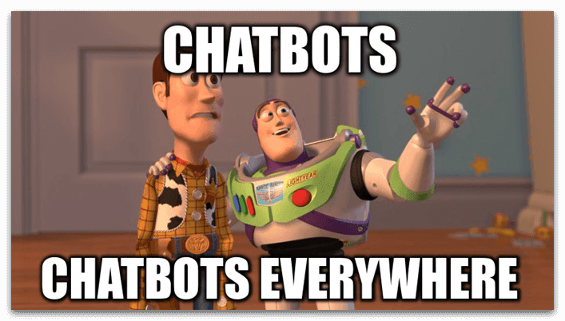
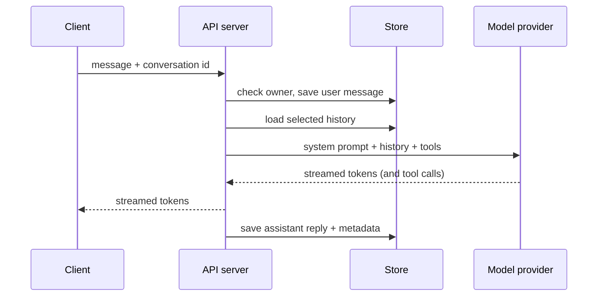

# Lesson 00: Chatbot Architecture

### The parts of a chat product and the path of one message

A chat window looks simple: the user types, the answer streams in, and the conversation is still there tomorrow. Behind it there is more machinery than a call to a model, because the model keeps nothing between requests, many users share the same servers, answers arrive token by token over connections that drop, and the assistant may call tools, read files and remember facts about a person. Teams that start from a single endpoint that forwards text to a provider usually discover these requirements one incident at a time.

This lesson lays out the components of a multi-user chat application and follows one message through them, then explains why the application, not the model, owns the state. The next lessons take the two hardest parts, storage and context management, one at a time. The scenario is a resort booking assistant.

  

### Learning Objectives

By the end of this lesson, you will be able to:

- **Name** the components of a chat application and what each is responsible for.
- **Trace** one user message from the client to the model and back, including streaming and persistence.
- **Explain** why the application, and not the model, owns conversation state.

---

### Lesson Content

#### What a chat application is made of

A minimal chatbot has three parts: a client that renders the conversation, a server that receives messages, and a model behind an API. Most of what makes a product out of it sits in the server. It authenticates users and keeps their data apart, which is the multi-user requirement that a demo hides. It routes each request to a model provider through a gateway that hides the differences between providers, such as parameter names and message formats. It runs the tool layer when the model asks for a function, including tools exposed through the Model Context Protocol, and it can retrieve passages from documents before the model answers. It stores every conversation and lets users search, rename and delete them. It also records what happened, in logs and traces, because a chat product is debugged from its transcripts.

Three smaller parts are easy to overlook. Streaming sends the answer to the client as it is generated, so the server holds an open connection per active reply and needs a plan for when that connection breaks. File handling accepts uploads, extracts their text or embeds them for retrieval, and applies the same per-user isolation as the messages. Memory keeps durable facts about a user across conversations, a separate problem from the history of one conversation.

#### The path of one message

When a user sends a message, the client posts it to the API with the conversation identifier. The server checks who the user is and whether the conversation belongs to them, saves the user's message so that it exists even if the model call fails, and builds the request: the system prompt, a selection of the stored history, any retrieved passages, and the tool definitions. It sends the request to the chosen provider and streams the reply back, executing tool calls in a loop and when the reply is complete it saves it with metadata such as the model, token counts and finish reason. A title for a new conversation is often generated by a second, cheaper model call after the first exchange.

*Figure 1. The path of one message, from the client through the API server, the store and the model provider.*

Two details of this path decide how dependable the product is. Saving the user's message before calling the model, and the reply as soon as it is complete, means a failure in the middle leaves a consistent record. And the stream is a first-class concern: a common design records every streamed chunk of a generation, so that after a dropped connection, a refresh or a switch of device the server can rebuild the content so far, send it in one go and resume live streaming. With one server that record can live in memory; behind a load balancer it needs a shared store such as Redis, so that a generation started on one instance can resume on another.

#### In practice

List the components before writing code, with a concrete choice for each, and decide early which you will buy and which you will build. Many teams are better served by reusing an existing chat platform and spending their effort on what is specific to them: the tools, the documents and the evaluation. Keep the conversation store, the model gateway and the tool layer behind interfaces from the start, because they are the parts that change when the product grows.

**Summary:**
- A chat product is a client, an API server, a model gateway, tools, retrieval, a conversation store, search, files and memory, with authentication and isolation across all of them.
- One message is saved, expanded with selected history, retrieved passages and tool definitions, streamed back and saved again, and streaming needs a plan for dropped connections.

---

### Further Reading

- [Lesson 01: Conversation Storage](01-conversation-storage.md) - the next lesson.
- [Lecture 2, Lesson 04: Introduction to MCP](../L2_Agentic_systems_and_tool_calling/04-introduction-to-mcp.md) - MCP.
