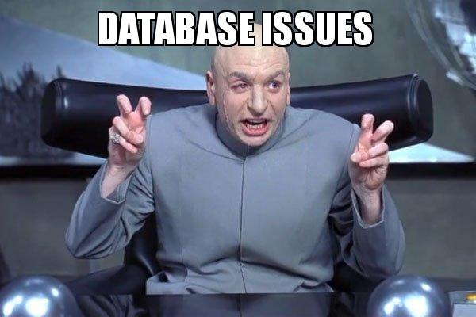
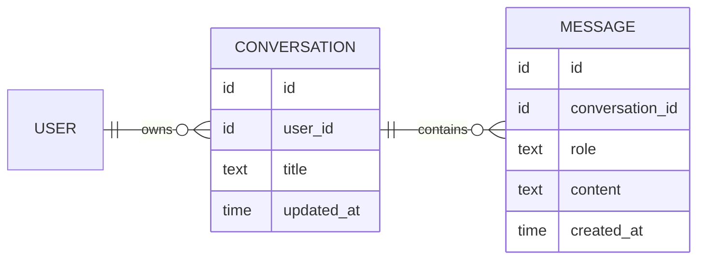
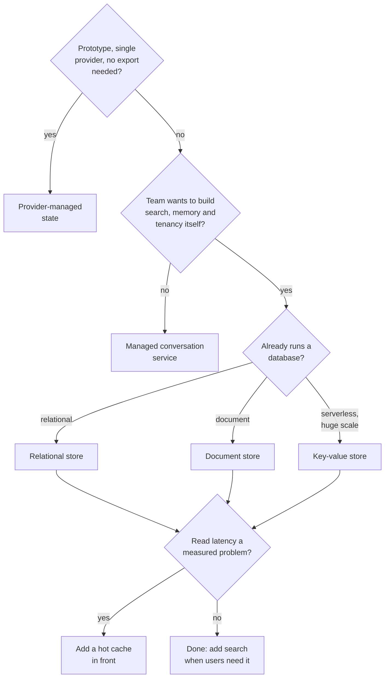

# Lesson 01: Conversation Storage

### Where a conversation lives between requests, which architecture to pick, and what each choice buys

A chat feels continuous, but the model behind it keeps nothing between requests, so every sense of memory in a chat product is produced by the application around it. If the application loses the history, the assistant has amnesia; if it mixes histories between users, the assistant leaks private information. Storage looks like the boring part of a chatbot, and it is where much of its quality and risk is decided: the same store determines what the assistant can remember, what a conversation costs to replay, who can see what, and whether a user can be forgotten when they ask.

This lesson treats storage independently of any product. It lists what a conversation store has to guarantee, describes the data model, then turns the main architectures into a go or no-go decision with the gains and costs of each, and ends with the tools teams use for each pattern as of October 2026. The scenario is a resort booking assistant.

  

### Learning Objectives

By the end of this lesson, you will be able to:

- **List** the requirements of a production conversation store.
- **Design** a minimal data model for conversations and messages, and extend it when a product needs branching.
- **Decide** go or no-go on the main storage architectures for a given product, and state what each gains and costs.
- **Name** the current tools for each architecture, and plan search, retention, deletion and concurrency around them.

---

### Lesson Content

#### What the store has to guarantee

A guest asks "is breakfast included in hotel X?", then "what about check-in time?", then "and is it good for families?". The last question names no property, and the assistant can answer only because the application hands the earlier messages to the model again. A practitioner comparison of storage approaches ([DialogueDB, 2026](https://dialoguedb.com/blog/how-to-store-ai-chat-history)) sums up the job in six requirements, "simple at small scale, hard at production scale":

| Requirement | What it means | What breaks without it |
| :-- | :-- | :-- |
| Isolation | Every read and write is scoped to the authenticated user and tenant | One guest sees another guest's booking |
| Ordering and roles | Messages come back in order, tagged user, assistant, system or tool | The model misreads who said what |
| Metadata | Timestamps, token counts, tags, model and prompt version | No budgeting, no debugging, no analytics |
| Retrieval | The last N messages of a branch, a list per user, search across history | The conversation cannot be resumed or found |
| Cleanup | Expiry and deletion on request | Personal data kept forever, storage that only grows |
| Concurrency | Two requests on one conversation do not corrupt it | Duplicated or interleaved replies |

The most important rule is the first one. Filter by the authenticated user in every query, not by conversation id alone, and treat a missing check as a security bug: an id leaks or is guessed eventually, and a prompt cannot enforce access, only code can.

#### The data model

Whatever the database and whatever the product, conversation management rests on two entities: a **user** owns many **conversations**, and a conversation holds an ordered list of **messages**. Everything else is an extension that a given product may or may not need.

*Figure 1. The minimal model: a conversation belongs to one user and holds ordered messages.*

This is enough to list a user's conversations, resume one, replay its history to the model and delete it. Ownership sits on the conversation, so every query can filter by user; order comes from the message id or timestamp; the role tells the model who said what. Products then add fields as needs appear, typically a metadata field for token counts, model and feedback, an expiry date for temporary chats, and a parent reference when users can edit or regenerate. The shape maps onto any store: two tables in a relational database, documents in a document database, or one partition per conversation in a key-value store.

#### Architectures: go or no-go

There is no best store, only a best fit for what the team already runs, how central conversations are to the product, and how much of the conversation layer it wants to build. The options fall into five patterns.

*Figure 2. A go or no-go path through the storage architectures.*

| Architecture | Go when | No-go when | What you gain | What it costs |
| :-- | :-- | :-- | :-- | :-- |
| Relational database | You already run one; you need transactions, joins with users and bookings, and SQL analytics | Message shapes change constantly and nobody owns migrations | Strong consistency, recursive queries for branches, JSON columns for state, vector search through an extension | You own schema, indexes, connection pooling, partitioning as it grows, and the search pipeline |
| Document database | Messages carry variable parts (files, tool content, feedback) and the team knows the database | You need cross-entity reporting or strict relational integrity | One document per message without schema changes; native TTL indexes for expiry | Weaker joins; index discipline is on you; search needs an extra index |
| Key-value or wide-column store | Serverless deployment, very large or spiky scale, access patterns known up front | You expect new query patterns, ad-hoc reporting or in-store search | Scales without capacity planning; pay per request; built-in TTL | Every access pattern designed in advance; no full-text or semantic search without another service |
| Hot cache in front of a durable store | Measured read latency on active conversations, or many temporary chats | As the only store, or before latency is a measured problem | Sub-millisecond reads for active chats; native expiry | Memory is expensive; two stores to keep consistent; persistence must be configured |
| Provider-managed state | Prototypes, one model provider, short-lived history | Multi-provider routing, regulated data, or a need to export and analyse history | Least code: the provider keeps the thread and replays it | Lock-in, the provider's retention rules, and the whole chain is still billed as input tokens |
| Managed conversation service | Conversations are central, the team is small, and search, memory and tenancy are needed now | Data residency or sovereignty rules the vendor cannot meet, or deep custom data models | Conversations, threading, semantic search and memory behind one API, in minutes | An external dependency on the critical path, an extra network hop, plan limits, and an exit plan to verify |

> **A use case for each architecture**
> - **Relational database:** a hotel group already runs its bookings on PostgreSQL, so conversations go in two new tables, and an analyst can join chats with reservations to see which questions lead to a booking.
> - **Document database:** an insurance assistant receives photos, claim forms and tool results in the same chat, and each message keeps its own shape without a schema migration.
> - **Key-value or wide-column store:** a consumer app with millions of short chats and traffic spikes at weekends only ever reads "this user's conversations" and "this conversation's messages", both known up front.
> - **Hot cache in front of a durable store:** a busy support chat reloads the active conversation on every turn, so the last messages are served from memory while the database keeps the full record.
> - **Provider-managed state:** a two-week internal prototype on one model provider, where nobody needs to export or analyse the history yet.
> - **Managed conversation service:** a three-person startup whose product is a conversational coach needs search across past sessions and long-term memory this quarter, and has no data residency constraint.

#### The tools, as of 2026

| Tool | Architecture | Search over history | Expiry | Notes |
| :-- | :-- | :-- | :-- | :-- |
| [PostgreSQL](https://www.postgresql.org/docs/current/queries-with.html) with [pgvector](https://github.com/pgvector/pgvector); managed as [Supabase](https://supabase.com/docs), [Neon](https://neon.com/docs) or the cloud providers' services | Relational | Full-text built in; semantic with pgvector | Scheduled deletes | Recursive queries handle branches; the default choice |
| [MongoDB](https://www.mongodb.com/docs/manual/core/index-ttl/) | Document | Atlas Search and Vector Search when hosted on Atlas | TTL indexes | Common in open-source chat platforms |
| [Azure Cosmos DB](https://learn.microsoft.com/en-us/azure/cosmos-db/introduction) | Document and key-value, serverless | Integrated vector search | [Per-item TTL](https://learn.microsoft.com/en-us/azure/cosmos-db/time-to-live) | Used by [Foundry Agent Service](https://learn.microsoft.com/en-us/azure/cosmos-db/gen-ai/azure-agent-service) to store threads in your own account |
| [Redis](https://redis.io/docs/latest/develop/) or Valkey | Hot cache | Query engine and vector search in recent Redis versions | Native key expiry | Pair with a durable store |
| [OpenSearch](https://opensearch.org/) or [Meilisearch](https://www.meilisearch.com/docs) | Search index beside the store | Keyword, and vector in OpenSearch | Follows the source | Must be included in every deletion |
| [OpenAI Conversations](https://developers.openai.com/api/docs/guides/conversation-state) and [Azure AI Foundry Agent Service](https://learn.microsoft.com/en-us/azure/ai-foundry/agents/overview) threads | Provider-managed | Provider's | Provider's rules | Tied to one provider's API |
| [LangGraph persistence](https://docs.langchain.com/oss/python/langgraph/persistence) | Framework layer over Postgres, Redis and others | From the backend | From the backend | Checkpoints agent state per thread; not a store on its own |

#### Search, retention, deletion and concurrency

**Search.** Users expect to find an old conversation by a word they remember, so keyword search over titles and message text comes first, from the database itself or from a search index next to it. Semantic search over history needs an embedding per message and a vector index, the same machinery as document retrieval, and is worth adding only when keyword search demonstrably fails users.

**Retention and deletion.** Conversations contain personal data, so decide before launch how long each kind is kept, and use the store's expiry feature for temporary chats. Deletion on request must reach every copy: messages, files, search indexes, caches, shared links, exported analytics and any long-term memory extracted from the chat. Memory deserves an explicit decision, because users who delete a conversation often expect what was learned from it to go too.

**Concurrency.** A user can double-click send or open two tabs, and two replies are then generated from the same history and saved in a confusing order. Handle one request at a time per conversation, with a lock or a version number checked on save, or reject a new message while one is being answered, and make saves idempotent (for example with a client-generated message id) so a retry after a network error does not duplicate history.

**Practices overview**

| Practice | Why | Evidence |
| :-- | :-- | :-- |
| Scope every query by the authenticated user and tenant | Isolation is a security property, enforced in code | [DialogueDB (2026)](https://dialoguedb.com/blog/how-to-store-ai-chat-history) |
| Start with the durable database you already run, behind an interface | Lowest risk, and the choice stays reversible | [DialogueDB (2026)](https://dialoguedb.com/blog/how-to-store-ai-chat-history) |
| Start from the minimal model and extend it per product need | Fewer fields to migrate; extensions stay justified | Data model above |
| Add a parent reference before shipping edit or regenerate | Editing and regeneration turn history into a tree | Branching, Figure 2 |
| Use a cache only in front of a durable store | Memory is expensive and volatile | [DialogueDB (2026)](https://dialoguedb.com/blog/how-to-store-ai-chat-history) |
| Check retention and export before adopting provider-managed or managed services | Your users' history lives under someone else's rules | [OpenAI conversation state](https://developers.openai.com/api/docs/guides/conversation-state) |
| Test that deletion removes every copy | Indexes, caches, links and memories are copies too | Privacy obligations (lecture 6) |

#### In practice

For most teams the answer is a relational or document database they already operate, holding the minimal conversation and message model, owned by the user and extended only as the product needs, with an interface in front; a cache only when latency is measured; and keyword search first. Choose a managed conversation service when conversations are the product and the team would rather spend its time elsewhere, after checking residency, export and the exit path. Keep provider-managed state for prototypes. In every case, store everything and send a selection: the store keeps the complete record, and the techniques of the next lesson decide what each request carries.

**Summary:**
- A conversation store must guarantee isolation, ordering, metadata, retrieval, cleanup and concurrency, with isolation enforced in code.
- The core model is a user who owns conversations, each holding ordered messages with a role and content; metadata, expiry and branching are extensions, and branched history is loaded by path, not by time.
- Plan search, retention, deletion of every copy and concurrency before launch.

---

### References

- DialogueDB (2026), [How to Store AI Chat History: 4 Approaches Compared](https://dialoguedb.com/blog/how-to-store-ai-chat-history), 15 February 2026. Requirements, data models and trade-offs; written by a managed-service vendor.
- OpenAI, [Conversation state](https://developers.openai.com/api/docs/guides/conversation-state) (accessed October 2026). Provider-managed state, retention and billing.
- Tool documentation as linked in the tools table (accessed October 2026).

### Further Reading

- [Lesson 00: Chatbot Architecture](00-chatbot-architecture.md) - the previous lesson.
- [Lesson 02: Conversation Management](02-conversation-management.md) - the next lesson.
