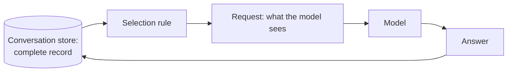
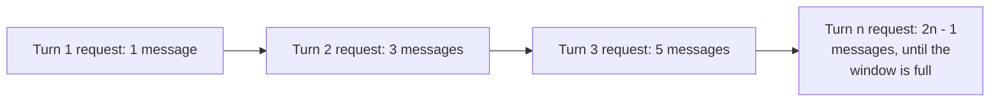
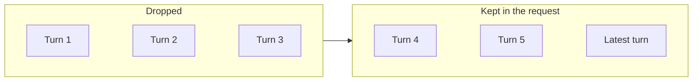
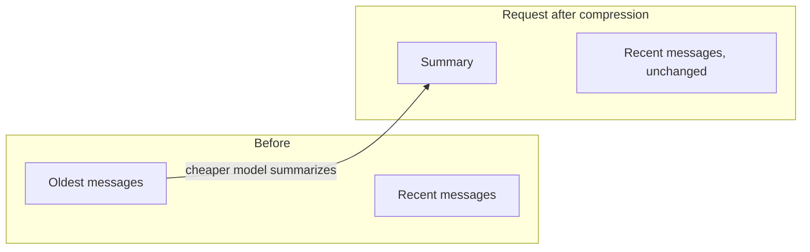
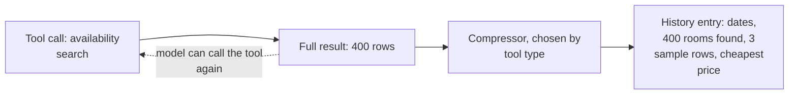
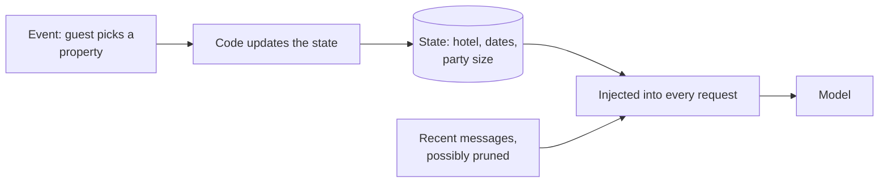
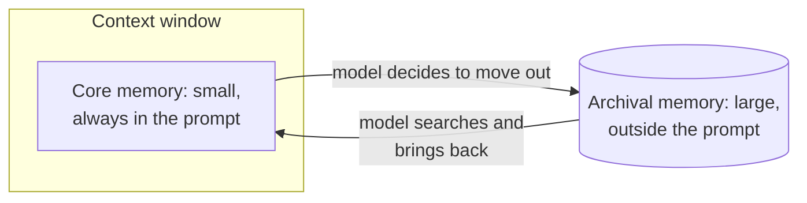
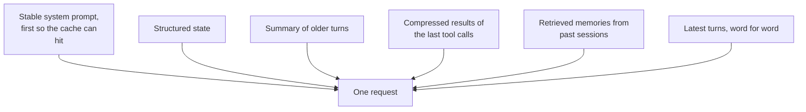

# Lesson 02: Conversation Management

### Deciding what each request carries, and what the assistant remembers

The conversation store keeps everything, and the model reads only what you send in each request. The question that decides the quality and the cost of a long conversation is therefore what to send. Sending the whole history works for a short chat and fails as sessions grow, for two reasons: window size and price are hard limits, and quality suffers well before the window is full. [Liu et al. (2023)](https://arxiv.org/abs/2307.03172) found that models use information at the start and end of a long input better than information in the middle, and Anthropic's account of [context engineering](https://www.anthropic.com/engineering/effective-context-engineering-for-ai-agents) calls the same effect context rot, where recall accuracy drops as the window fills, so that every added token costs some of the model's attention.

The job is selective injection: for each request, pick the subset of the stored history that is relevant, recent and affordable. This lesson presents seven options in order of effort, each with the problem it solves, how it works and what it costs you. It then shows how a real product designs memory across conversations and gives a way to choose. The scenario is a long session with the resort assistant, in which a family compares three properties, checks dates twice and asks to "go back to the first one".

  

### Learning Objectives

By the end of this lesson, you will be able to:

- **Explain** why sending everything fails on long conversations.
- **Compare** sliding windows, summaries, tool-result compression, structured state and tiered memory by what each keeps and what each loses.
- **Design** a memory that persists across conversations, including what it stores and who controls it.
- **Choose** a combination of techniques for a given product and test that it works.

---

### Lesson Content

#### Selective injection: the store keeps everything, the request carries a selection

Two things are easy to confuse here. The conversation store is the complete record, and it keeps growing. The request is what you assemble from that record for one model call, and it has a budget. Every technique below is a different rule for going from the first to the second.

*Figure 1. The store grows with every turn; the selection rule decides what part of it each request carries.*

The seven options differ in how much they keep, what they lose and how much work they ask of you. The table is a map to return to while reading the subsections, and the final section of the lesson explains how to combine them.

| Technique | Keeps | Loses | Effort | Fits |
| :-- | :-- | :-- | :-- | :-- |
| 1. Send everything | All of it | Nothing, until the window fills | None | Short sessions |
| 2. Sliding window | The latest turns | Everything older, silently | Very low | Independent exchanges, FAQ chat |
| 3. Summarization | A condensed past | Detail the summary omits | Moderate | Exploratory sessions |
| 4. Tool-result compression | What was done, a sample of data | Raw output | Moderate | Agents with data-heavy tools |
| 5. Structured state | Chosen facts, exactly | Facts you did not track | Moderate, design first | Workflows with clear facts |
| 6. Notes and tiered memory | What the model chooses to keep or fetch | Predictability | High | Very long sessions |
| 7. Hybrid | A mix | Depends on the mix | High | Production agents |

#### The seven techniques, from simplest to most elaborate

##### 1. Send everything

The simplest approach passes the entire history on every call: system prompt, every user message, every answer and every tool result. It is the right start, since the model has complete information and nothing needs maintenance. The weakness is cost. Without prompt caching, every call retransmits all earlier tokens, so the cumulative tokens billed across a session grow roughly with the square of the number of turns. Prompt caching, which several providers offer, lowers the price of the repeated part, but the window itself still fills, and the failure arrives suddenly when a request is rejected as too long.

*Figure 2. Each request contains every earlier turn, so the total sent across the session grows with the square of its length.*

Use it for short sessions and as the baseline against which the other techniques are tested.

##### 2. Sliding window

A sliding window keeps the system message and only the most recent turns, dropping the oldest as new ones arrive. Token use stays bounded and the logic is a few lines. A simple version counts tokens and drops the oldest user and assistant pair (a pair, so the alternation of roles stays intact) until the conversation plus the room reserved for the answer fits the budget.

*Figure 3. Everything outside the window is gone from the request, whether or not it still matters.*

The cost of a window is that everything older is gone without notice, so a fact stated at turn 2 ("we are traveling with two kids") has left the request by turn 15, and "go back to the first one" no longer says which property that was. A window also changes the start of the request on every turn, which breaks prompt caching. It suits chatbots whose exchanges are mostly independent, such as FAQ answering, and fails for multi-step work, where later steps build on earlier decisions.

##### 3. Summarization

Summarization compresses instead of discarding. When the history crosses a threshold, a model, usually a cheaper one, summarizes the oldest part and the summary replaces those messages, so the request carries a condensed past followed by the recent turns word for word.

*Figure 4. The oldest part of the history is replaced by a summary, and the recent turns stay verbatim.*

In the script, summarizing the 24 oldest messages of the same session leaves 8 messages and 177 tokens. The cost is an extra model call, added latency and lost nuance, since the summary holds only what the summarizer chose to keep. Tune the summary prompt for recall first (decisions, open questions, key details), and run compression in occasional batches and not on every turn, so the start of the prompt stays stable for the cache. For sessions of 50 messages or more, Khan's article describes hierarchical summarization: detailed summaries every few messages, moderate ones that combine them, and a high-level overview at the top, with the request carrying the latest overview, the last moderate summaries and the most recent raw messages. This costs more model calls and keeps both the big picture and the recent detail better than a single level.

##### 4. Tool-result compression

Tool results are often far larger than user messages, and a search with many passages or a query with hundreds of rows exhausts the budget after a few calls. The principle is that history should answer "what did I do?" and not "what were the exact details?". Store a compact form chosen by tool type (the date range, the number of rooms found, a few sample rows and the cheapest price), and let the model call the tool again if it needs the full data.

*Figure 5. The full result serves the current step; only the compact form stays in history.*

Anthropic's context engineering article lists clearing old tool results as the lightest form of compaction, and it is often the cheapest first step in agent loops. The loss is the raw output, so compress only what can be fetched again.

##### 5. Structured state

The most dependable technique is to stop hoping the model finds a fact in old messages and track the fact in code. Structured state is a small data structure that your application updates at the right moments (the guest picks a property, the code sets `state["hotel"] = "X"`) and injects into every request as a short line such as "Known facts about this guest: hotel X, two adults, arriving 12 May", so it survives however many messages you prune and is deterministic.

*Figure 6. The state lives outside the message history, so pruning messages cannot erase it.*

Without it, a sliding window answers "show me the summary for that sales file" with "which file?" once the file was loaded outside the window; with it, the file name is in every request. The cost is design work, since you decide which facts matter and where in the code they are updated, and a fact you did not track is still lost.

##### 6. Notes and tiered memory

Tiered memory lets the model manage its own context. MemGPT ([Packer et al., 2023](https://arxiv.org/abs/2310.08560)) borrows the memory hierarchy of operating systems: a small main context stays in the prompt, a larger external store lives outside, and the model decides through function calls what to move between them, which the authors evaluated on document analysis beyond the model's window and on multi-session chat. A related pattern is structured note-taking, which the Anthropic article describes as agents writing notes to memory outside the window and reading them back later, so that long multi-step work survives context resets. Khan's article also mentions context folding (a ByteDance paper of October 2025, as described there), in which an agent branches into a sub-task and, when it finishes, collapses the intermediate steps into a short summary of the outcome. The Anthropic article's sub-agents follow the same logic: they work in clean windows and return a condensed summary, and just-in-time retrieval keeps lightweight identifiers such as file paths and loads content with tools when needed.

*Figure 7. The model pages information between a small working memory and a large external store, like an operating system with RAM and disk.*

The trade-off is control: part of the context decisions move to the model, so behavior is less predictable than with fixed rules. Memory services turn the idea into a product. Mem0 ([Chhikara et al., 2025](https://arxiv.org/abs/2504.19413)) extracts, consolidates and retrieves key information from conversations, and on the LOCOMO benchmark its authors report a 26% relative improvement in LLM-judge score over OpenAI's memory system and, against a full-context approach, a 91% lower p95 latency and more than 90% token cost savings. These are the authors' own results from the abstract, so evaluate any memory service on your conversations before relying on it.

##### 7. Hybrid

Production systems combine techniques, because each one covers a different part of the problem. Structured state holds the facts that must be exact, tool-result compression keeps data-heavy output small, summarization condenses old conversation, retrieval from past sessions brings back older work when the user asks for it, and the latest turns stay verbatim.

*Figure 8. A hybrid request, assembled from the techniques above.*

The order matters for cost: keeping the stable parts first lets the provider cache them. The price is complexity, so add each layer only when a real failure justifies it.

#### In practice

Start with the cheapest option that protects the facts you cannot afford to lose: pin the durable facts in structured state, keep recent turns verbatim, compress tool results, and add summarization or memory only when sessions really run long. For a simple FAQ assistant a window or periodic summary is usually enough, workflows with clear facts need structured state, and very long exploratory sessions are where notes and tiered memory pay off. The table compares the techniques on the points that usually decide the choice.

| Technique | Request size | Prompt cache | Exact facts survive | Extra model calls | Reach for it when |
| :-- | :-- | :-- | :-- | :-- | :-- |
| Send everything | Grows every turn | Good, the start never changes | Yes, until the window fills | None | The session is short |
| Sliding window | Bounded | Poor, the start changes every turn | No, old facts drop silently | None | Exchanges are independent |
| Summarization | Bounded, plus the summary | Good if compression runs in batches | Only what the summary kept | One per compression | Sessions are exploratory and the gist matters |
| Tool-result compression | Smaller per tool call | Neutral | Not the raw output, but it can be refetched | Optional, for the compressor | Tools return large results |
| Structured state | A small fixed addition | Good, the state block is short | Yes, for the tracked facts | None | A few facts must never be lost |
| Notes and tiered memory | Bounded core, retrieval on demand | Depends on the design | Depends on what the model chose to keep | Several, including searches | Sessions are very long and the model can be trusted to manage context |
| Hybrid | Bounded | Good with a stable prefix | Yes for state, partly for the rest | Some | The product runs in production on long sessions |

**Summary:**
- Sending everything fails on length, cost and attention, so the job is selective injection from a complete record.
- Sliding windows lose old facts silently, summaries lose detail, and both change the start of the prompt, so compress in batches.
- Pin durable facts in structured state, compress tool results, and use notes or tiered memory only for very long sessions.
- Cross-conversation memory is a store with limits, categories and user control, and it needs its own retention rules.

---

### References

- Khan (2025), [Context Management for AI Agents](https://medium.com/@najeebkan/context-management-for-ai-agents-d68716a37965). The seven-technique progression used in this lesson.
- Liu et al. (2023), [Lost in the Middle](https://arxiv.org/abs/2307.03172). How models use long contexts.
- Anthropic (2025), [Effective context engineering for AI agents](https://www.anthropic.com/engineering/effective-context-engineering-for-ai-agents). Compaction, note-taking, sub-agents and just-in-time retrieval.
- Packer et al. (2023), [MemGPT: Towards LLMs as Operating Systems](https://arxiv.org/abs/2310.08560). Tiered memory.
- Chhikara et al. (2025), [Mem0](https://arxiv.org/abs/2504.19413). Scalable long-term memory (authors' results).

### Further Reading

- [Lesson 01: Conversation Storage](01-conversation-storage.md) - the previous lesson.
- [Lesson 03: Chatbot Security](03-chatbot-security.md) - the next lesson.
