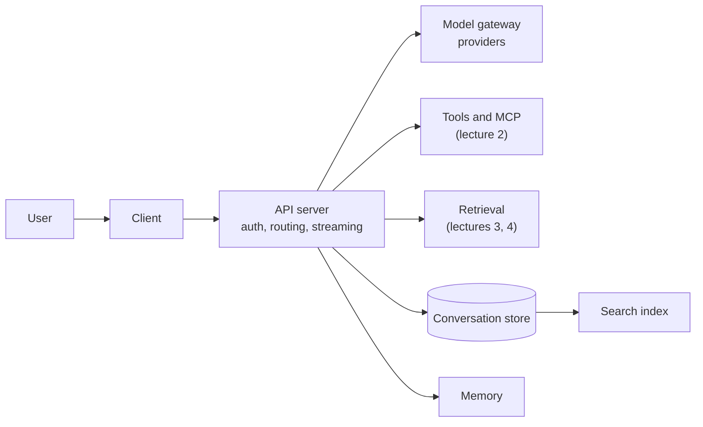

# Lecture 7: An Applied AI Chatbot

**Block E: Applied use cases**

### Scope

How the pieces of earlier lectures fit together in a chat product that real people use. The lecture starts with the architecture of a chat application, goes into the two problems every chatbot has to solve (where a conversation is stored and what part of it each request carries), and closes with the security practices a chatbot needs once it reads real data and takes actions.

### Learning Objectives

By the end of this lecture, you will be able to:

- **Describe** the components of a multi-user chat application and trace one message through them.
- **Choose** a storage model for conversations, including branching, search, retention and deletion.
- **Select** context management techniques that keep long conversations inside a token budget.
- **Apply** chatbot security practices to access, inputs, responses and the platform around them.

### Running example

A resort assistant that answers guests' questions about properties.

### Lessons in this lecture

00. [Chatbot Architecture](00-chatbot-architecture.md)
01. [Conversation Storage](01-conversation-storage.md)
02. [Conversation Management](02-conversation-management.md)
03. [Chatbot Security](03-chatbot-security.md)

### Coming next

- [Lecture 8](../L8_Voicebot_Use_Case/README.md): the same ideas in a voice agent: voice architectures, turn detection, noise and voice frameworks.

### Prerequisites

Lecture 1 (tokens, context windows, structured outputs), lecture 2 (tool calling and MCP) and lecture 3 (retrieval).
