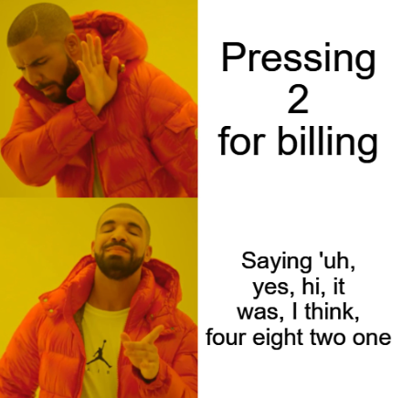
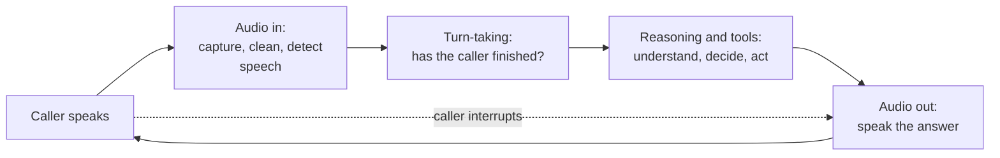

# Lesson 00: Introduction to Voicebots

### What changes when the user speaks instead of types

A chatbot that works well in a browser can fail badly on the phone. The same customer who types "order 4821, wrong size" will say "uh, yes, hi, I ordered, it was, I think, four eight two one, and the size is wrong", pause in the middle to check a receipt, talk over the agent when it starts answering, and call from a train. The model behind both channels may be identical; what changes is everything around it: audio has to become text or tokens, the system has to decide when the person has finished, the answer has to be spoken back fast enough to feel like a conversation, and none of it can rely on a screen.

A **voicebot**, or voice agent, is a system that holds a spoken conversation with a person to answer questions or complete tasks. This lesson defines the term, shows how voicebots evolved and where they are used, explains why voice is harder than chat, introduces the channels and the metrics by which a voicebot is judged, and maps the rest of the lecture.

  

### Learning Objectives

By the end of this lesson, you will be able to:

- **Describe** the parts of a spoken exchange and the job of each component in a voicebot.
- **Explain** why voice is harder than text chat, from latency to noise to the absence of a screen.
- **Name** the channels a voicebot runs on and the metrics used to judge it.
- **Identify** the privacy obligations specific to voice: recordings and voice as biometric data.

---

### Lesson Content

#### From phone menus to voice agents

Voice automation is older than language models. **Interactive voice response (IVR)** systems played recorded menus and read the keypad tones (DTMF) the caller pressed ("press 2 for billing"); they were reliable and universally disliked. Speech recognition then let callers say the option instead of pressing it, and intent-based voicebots mapped each utterance to one of a fixed list of intents with hand-written dialogue flows. Large language models changed what the middle of the system can do: a voice agent can now understand free speech, keep the context of the conversation, call tools and answer questions that nobody scripted.

| Generation | How it understands the caller | How it responds | Typical limit |
| :-- | :-- | :-- | :-- |
| IVR with DTMF | Keypad tones | Recorded prompts | Rigid menus, no free speech |
| Speech IVR and intent bots | Speech recognition mapped to a fixed list of intents | Scripted flows, recorded or synthetic speech | Breaks on anything outside the intents |
| LLM voice agents | Free speech, transcribed or heard directly by a model | Generated answers, tool calls, synthetic speech | Latency, reliability of tool use, cost |

#### The anatomy of a spoken exchange

Every voicebot, whatever its architecture, performs the same four jobs on each turn of the conversation.

*Figure 1. The four jobs of a voicebot on every turn. An interruption stops the audio out and starts a new turn.*

Audio comes in as a stream, so the system first cleans it (lesson 01) and detects where speech is. It then decides whether a pause means the caller has finished or is only thinking (lesson 02). The reasoning step is the language model with its tools, as in the agents of lecture 2, and the answer is spoken back, ideally starting before it has been fully generated. How these jobs are split between models is the architecture question of lesson 03, and the frameworks that wire them together are the subject of lesson 04.

#### Why voice is harder than chat

People take turns in conversation with remarkably short gaps. [Stivers et al. (2009)](https://pubmed.ncbi.nlm.nih.gov/19553212/) measured response timing across ten languages, from indigenous communities to major world languages, and found the same pattern in all of them: speakers avoid overlapping and minimise the silence between turns, with average gaps that differ between languages by only a few hundred milliseconds. A voicebot is judged against that expectation, so a pause of two seconds that would go unnoticed in a chat window feels broken on the phone.

| Difference | In a text chat | In a voice conversation | Consequence for the design |
| :-- | :-- | :-- | :-- |
| Latency | Seconds are acceptable; text streams on screen | Gaps of a fraction of a second are expected | Stream every stage and budget the latency end to end |
| No screen | Lists, links and tables can be shown | Everything must be heard once, in order | Short answers, one question at a time, no markdown |
| Disfluency | Users edit before sending | Hesitations, repairs, self-corrections, filler words | Turn detection and tolerant understanding |
| Interruptions | Users wait or send a new message | Users talk over the agent | The agent must stop speaking and listen |
| Audio quality | Clean text | Noise, other voices, echo, narrowband phone audio | Noise cancellation, robust speech recognition |
| Exact values | Copied and pasted | Numbers, names and spellings heard and spoken | Confirmation of key values, read-back |
| Undo | Messages can be reread | Spoken words are gone | Summaries and confirmations before actions |

The cost of these differences shows up in measurement. [Ray et al. (2026)](https://arxiv.org/abs/2603.13686) built τ-Voice, a voice version of the τ²-bench customer-service tasks, and found that a text model with reasoning completed 85% of the tasks while voice agents completed 31 to 51% in clean audio and 26 to 38% with noise and varied accents, keeping only 30 to 45% of the text capability; most failures came from agent behavior. A voicebot therefore needs more careful design and testing than the chatbot of lecture 7, not less.

#### Channels and how a call reaches the agent

| Channel | Transport | Audio | Typical use |
| :-- | :-- | :-- | :-- |
| Phone | The public telephone network, connected to software over SIP (Session Initiation Protocol) through a SIP trunk provider | Narrowband, often 8 kHz, with line noise | Contact centres, outbound calls |
| Web and mobile apps | WebRTC, the real-time media standard built into browsers and mobile SDKs | Wideband, with echo cancellation in the client | Assistants inside a product |
| Devices | Embedded clients, speakers, cars, kiosks | Varies; distant microphones pick up the room | Hands-free assistants |

A phone call reaches a voice agent through a **SIP trunk**, a service that connects phone numbers to internet telephony, and a media server that turns the call into an audio stream the agent can process. The same agent can then serve phone and web users.

#### How a voicebot is judged

| Metric | What it measures | Why it matters |
| :-- | :-- | :-- |
| Voice-to-voice latency | Time from the end of the caller's speech to the first audio of the answer | The main driver of perceived naturalness |
| Word error rate (WER) | Share of words the speech recogniser gets wrong | Errors here propagate into every later step |
| Turn-taking quality | How often the agent interrupts the caller, or misses that the caller finished | Cutting people off and long silences both feel broken |
| Interruption handling | Whether the agent stops and listens when the caller talks over it | Callers interrupt constantly |
| Task completion and containment | Share of calls resolved without a human, and resolved correctly | The business outcome; containment alone rewards bots that refuse to transfer |
| Cost per call | Speech recognition, model and speech synthesis per minute, plus telephony | Voice multiplies per-turn costs by call length |

#### What is different about privacy in voice

Everything in lecture 6 applies, and voice adds two obligations. Calls are usually **recorded**, so callers must be told, recordings need a lawful basis and a retention limit, and transcripts are personal data like any chat log. And a voice is more than its words: the European Data Protection Board's [guidelines on virtual voice assistants](https://www.edpb.europa.eu/documents/guideline/guidelines-022021-on-virtual-voice-assistants_en) treat voice data as personal data and note that when it is processed to identify a person, as in voice authentication, it becomes biometric data, a special category under GDPR article 9 with stricter conditions. A voicebot that only transcribes speech to answer a question is in the first case; one that recognises callers by their voice is in the second.

**Practices overview**

| Practice | Why | Evidence |
| :-- | :-- | :-- |
| Budget latency against human turn-taking, not against chat | People expect gaps of a fraction of a second | [Stivers et al. (2009)](https://pubmed.ncbi.nlm.nih.gov/19553212/) |
| Write for the ear: short answers, one question at a time, read back key values | Nothing can be reread | Voice design practice |
| Test in realistic audio, with noise and accents, before launch | Voice agents keep only a fraction of text capability | [Ray et al. (2026)](https://arxiv.org/abs/2603.13686) |
| Measure task completion, not containment alone | Containment rewards bots that never transfer | Contact-centre practice |
| Inform callers of recording, set retention, and treat voice identification as biometric | Recordings are personal data; voice identification is a special category | [EDPB Guidelines 02/2021](https://www.edpb.europa.eu/documents/guideline/guidelines-022021-on-virtual-voice-assistants_en) |

#### In practice

Start from the calls you already have: listen to a sample of recordings, write down the most frequent reasons people call and how they phrase them, and turn those into the first test set, including callers in cars, on speakerphone and with strong accents. Decide early which channel comes first, since phone audio, SIP and telephony costs shape the whole design, and agree with the business on the success metric before building, because containment, task completion and caller satisfaction pull in different directions. The most common mistake is to take a chatbot prompt that works in text and connect speech to both ends: the answers are too long, the agent reads out lists and links, and every pause becomes an interruption.

**Summary:**
- A voicebot holds a spoken conversation; LLM voice agents replace the rigid menus and intent lists of earlier IVR and speech systems.
- Every turn has four jobs: audio in, turn-taking, reasoning with tools, and audio out, with interruptions able to cut in at any time.
- Voice is harder than chat because of latency expectations, no screen, disfluencies, interruptions, noisy audio and exact values heard by ear.
- Voicebots run on phone (SIP), web and app (WebRTC) and devices, and are judged by voice-to-voice latency, WER, turn-taking, task completion and cost per call.
- Recordings need consent and retention limits, and identifying people by voice makes it biometric data.

---

### References

- Stivers et al. (2009), [Universals and cultural variation in turn-taking in conversation](https://pubmed.ncbi.nlm.nih.gov/19553212/), PNAS. Response timing across ten languages.
- Ray et al. (2026), [τ-Voice: Benchmarking Full-Duplex Voice Agents on Real-World Domains](https://arxiv.org/abs/2603.13686). Voice agents against text on grounded customer-service tasks.
- European Data Protection Board (2021), [Guidelines 02/2021 on virtual voice assistants](https://www.edpb.europa.eu/documents/guideline/guidelines-022021-on-virtual-voice-assistants_en).

### Further Reading

- [Lesson 01: Noise and Voice Isolation](01-noise-and-voice-isolation.md) - the next lesson.
- [Lecture 2, Lesson 01: Tool Calling](../L2_Agentic_systems_and_tool_calling/01-tool-calling.md) - the reasoning step of a voice agent.
- [Lecture 6, Lesson 01: Data Privacy and PII](../L6_Governance_and_risk/01-data-privacy-and-pii.md) - hosting, provider guarantees and personal data.
- [Lecture 7, Lesson 00: Chatbot Architecture](../L7_AI_Chatbot_Use_Case/00-chatbot-architecture.md) - the text counterpart of this lecture.
