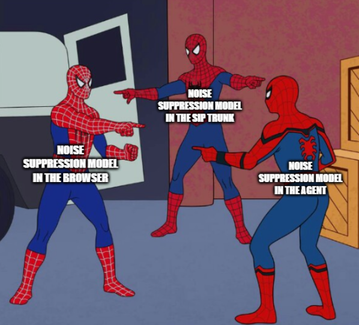
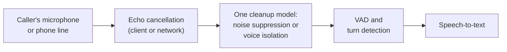

# Lesson 01: Noise and Voice Isolation

### Hearing the caller, and only the caller, before anything else happens

Every later stage of a voice agent depends on the audio it receives. A television in the background, a colleague talking at the next desk or traffic outside a car window can make the VAD start a turn nobody spoke, make the turn detector wait for a sentence that never ends, and put another person's words into the transcript, which the language model then answers as if the caller had said them. Background speech is the worst case, because it is real speech: a model that removes noise keeps it, and a speech recogniser transcribes it faithfully.

This lesson explains the three kinds of audio cleanup, the models available for each, how phone audio differs from browser audio, and where in the chain to apply them.

  

### Learning Objectives

By the end of this lesson, you will be able to:

- **Distinguish** noise suppression, background voice cancellation and echo cancellation, and the problem each solves.
- **Compare** open-source and commercial models for cleaning the caller's audio.
- **Decide** where to apply cleanup and why stacking several models makes things worse.
- **Account** for the differences between telephony and browser audio.

---

### Lesson Content

#### Why noise hurts a voice agent more than a phone call

A person on a noisy call understands the other speaker anyway; a voice agent makes discrete decisions on the audio and each wrong decision compounds. Noise and background voices cause false starts of turns and false interruptions (lesson 02), raise the word error rate of speech recognition, and add words to the transcript that the caller never said. τ-Voice ([Ray et al., 2026](https://arxiv.org/abs/2603.13686)) measured the effect on task completion: voice agents completed 31 to 51% of customer-service tasks in clean audio and 26 to 38% under realistic conditions with noise and varied accents.

| Problem | Example | Effect on the agent |
| :-- | :-- | :-- |
| Stationary and non-stationary noise | Fans, traffic, keyboard, music | VAD false starts, recognition errors |
| Background voices | Television, open office, people nearby | Other people's words in the transcript, turns that never end |
| Echo | The agent's own voice returning through the caller's speaker | The agent interrupts itself or transcribes its own words |
| Narrowband and compressed audio | Phone lines, mobile networks | Lower recognition accuracy, especially for names and numbers |

#### Three kinds of cleanup

**Noise suppression** removes sound that is not speech, such as fans, traffic or music, and keeps all voices. **Background voice cancellation**, also called voice isolation, keeps only the primary speaker, the voice closest to the microphone, and removes other people's speech as well as noise. **Echo cancellation** removes the agent's own audio from the caller's microphone signal; in browsers and mobile apps WebRTC does this in the client, while on phone lines it depends on the network and the handset.

The European Data Protection Board makes a related point from the privacy side: its [guidelines on virtual voice assistants](https://www.edpb.europa.eu/documents/guideline/guidelines-022021-on-virtual-voice-assistants_en) note that recordings may contain other people's voices and background noise that the service does not need, and recommend technologies that filter them out, so voice isolation also serves data minimisation.

#### The models

| Model | Kind | Licence and deployment | Notes |
| :-- | :-- | :-- | :-- |
| RNNoise ([Valin, 2017](https://arxiv.org/abs/1709.08243)) | Noise suppression | Open source, runs on CPU | A hybrid of signal processing and a small neural network, light enough for real time at 48 kHz on low-power processors |
| DeepFilterNet2 ([Schröter et al., 2022](https://arxiv.org/abs/2205.05474)) | Noise suppression | Open source, runs on CPU | Full-band (48 kHz) speech enhancement with a real-time factor of 0.04 on a notebook CPU |
| Krisp background voice cancellation (BVC), and its telephony variant | Voice isolation | Commercial, through LiveKit Cloud and Pipecat Cloud | Removes background voices and noise; a separate model tuned for phone audio |
| ai-coustics Voice Focus | Voice isolation | Commercial, through LiveKit Cloud or its own licence key | Vendor-reported word error rate reductions; treat as the vendor's claims |

The open-source models suppress noise but do not separate one voice from another, so they help with fans and traffic and not with a television. Voice isolation is, so far, mostly a commercial capability: [LiveKit's documentation](https://docs.livekit.io/transport/media/noise-cancellation/) offers Krisp and ai-coustics models to agents through its cloud, recommends voice isolation for one-to-one voice AI and plain noise suppression when several people should be heard, and bills these models separately from the media service. The demo of lesson 04 uses Krisp BVC for browser callers and the telephony variant for callers who arrive over SIP, chosen per participant.

#### Where to clean the audio

*Figure 1. Cleanup sits before VAD and speech recognition, once.*

Cleanup must happen before VAD and speech recognition, since both make decisions on the audio they receive. It should also happen once: LiveKit's documentation advises against applying enhanced noise cancellation both in the agent and in the frontend or the SIP trunk, because each model removes part of the speech along with the noise and stacking them distorts the voice, while the standard WebRTC noise suppression and echo cancellation in the client can stay on. Telephony and browser audio need different models, since phone lines carry narrowband audio (often 8 kHz) with their own artefacts, which is why the telephony variants exist. And not every model runs everywhere: the commercial models are offered through cloud services, so a fully self-hosted deployment, often chosen for the residency reasons of lecture 6, has to check licensing or fall back to open-source noise suppression without voice isolation.

**Practices overview**

| Practice | Why | Evidence |
| :-- | :-- | :-- |
| Clean the audio before VAD and speech recognition | Every later decision depends on it | [Ray et al. (2026)](https://arxiv.org/abs/2603.13686) |
| Use voice isolation for one-to-one agents in shared spaces | Noise suppression keeps other people's voices | [LiveKit noise cancellation](https://docs.livekit.io/transport/media/noise-cancellation/) |
| Apply one enhancement model in the chain, not several | Stacked models distort speech | [LiveKit noise cancellation](https://docs.livekit.io/transport/media/noise-cancellation/) |
| Use telephony-specific models for SIP callers | Phone audio is narrowband with its own artefacts | [LiveKit noise cancellation](https://docs.livekit.io/transport/media/noise-cancellation/) |
| Filter other voices also to minimise personal data | Recordings capture people who did not call | [EDPB Guidelines 02/2021](https://www.edpb.europa.eu/documents/guideline/guidelines-022021-on-virtual-voice-assistants_en) |
| Check deployment and licensing of cleanup models before choosing a host | Some models are cloud-only | [LiveKit noise cancellation](https://docs.livekit.io/transport/media/noise-cancellation/) |

#### In practice

Record a test set in the conditions your callers actually use (car, street, open office, television on, speakerphone) and measure word error rate, false turn starts and task completion with and without cleanup, because the right model depends on the channel and the gain is easy to overestimate in a quiet room. Turn on voice isolation for phone and mobile callers first, choose the telephony variant for SIP, and make sure nothing upstream, such as the trunk provider or the web client, applies a second enhancement model. Revisit the VAD threshold after enabling cleanup, since cleaner audio changes what the VAD sees.

**Summary:**
- Noise and background voices cause false turns, recognition errors and words the caller never said, and lower task completion.
- Noise suppression removes non-speech sound, voice isolation also removes other voices, and echo cancellation removes the agent's own voice.
- Open-source models (RNNoise, DeepFilterNet) suppress noise; voice isolation (Krisp, ai-coustics) is mostly commercial and cloud-delivered.
- Clean once, before VAD and recognition, with a telephony model for phone callers, and check where the model can be deployed.

---

### References

- Ray et al. (2026), [τ-Voice](https://arxiv.org/abs/2603.13686). Task completion in clean and realistic audio.
- Valin, J.-M. (2017), [A Hybrid DSP/Deep Learning Approach to Real-Time Full-Band Speech Enhancement](https://arxiv.org/abs/1709.08243) (RNNoise); [code](https://github.com/xiph/rnnoise).
- Schröter et al. (2022), [DeepFilterNet2: Towards Real-Time Speech Enhancement on Embedded Devices for Full-Band Audio](https://arxiv.org/abs/2205.05474); [code](https://github.com/Rikorose/DeepFilterNet).
- LiveKit, [Noise and echo cancellation](https://docs.livekit.io/transport/media/noise-cancellation/) (accessed October 2026). Krisp and ai-coustics models, placement and telephony.
- European Data Protection Board (2021), [Guidelines 02/2021 on virtual voice assistants](https://www.edpb.europa.eu/documents/guideline/guidelines-022021-on-virtual-voice-assistants_en).

### Further Reading

- [Lesson 00: Introduction to Voicebots](00-introduction-to-voicebots.md) - the previous lesson.
- [Lesson 02: Turn-Taking: VAD and Turn Detection](02-turn-taking-vad-and-turn-detection.md) - the next lesson.
- [Lecture 6, Lesson 01: Data Privacy and PII](../L6_Governance_and_risk/01-data-privacy-and-pii.md) - hosting and data minimisation.
