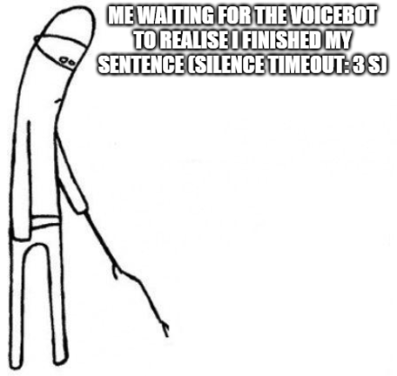
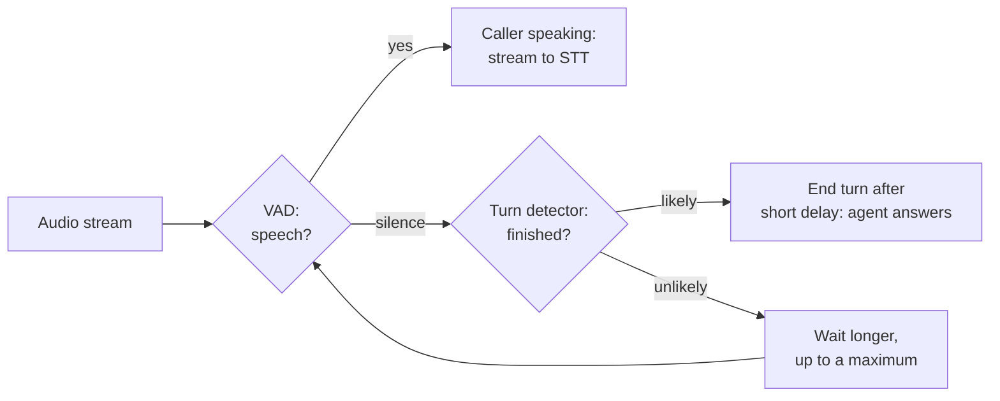

# Lesson 02: Turn-Taking: VAD and Turn Detection

### Knowing when the caller is speaking, when they have finished, and when they interrupt

A caller says "my customer number is four eight two..." and stops to read the rest from a letter. If the agent answers at that pause, it cuts the caller off and gets half a number; if it waits two seconds after every pause to be safe, every answer feels slow. In text chat this problem does not exist, because the user presses send. In voice, the system has to decide from the audio alone when a turn has ended, and it has to make that decision hundreds of times per call within a fraction of a second.

Two kinds of small models make this decision together. **Voice activity detection (VAD)** tells whether there is speech in the audio right now; a **turn detector** tells whether a pause in that speech means the caller has finished. This lesson explains both, how they combine, how interruptions are handled, and which settings to tune, using the components of the demo in lesson 04 as examples.

  

### Learning Objectives

By the end of this lesson, you will be able to:

- **Explain** what VAD decides and why silence alone is a poor signal for the end of a turn.
- **Describe** how a turn detector uses audio or transcript context to decide when the caller has finished.
- **Configure** endpointing and interruption settings, and know the symptom each one fixes.
- **Decide** when to use the turn detection built into a realtime API and when to use your own.

---

### Lesson Content

#### Two failures: cutting people off and making them wait

| Failure | What the caller experiences | Usual cause |
| :-- | :-- | :-- |
| Early end of turn | The agent answers in the middle of a sentence, a number or an address | A short silence was taken as the end of the turn |
| Late end of turn | Long silences after every sentence | A long silence timeout set to avoid the first failure |
| Missed interruption | The agent keeps talking while the caller says "no, wait" | Agent speech not stopped when the caller speaks |
| False interruption | The agent stops at a cough, a "mm-hm" or background noise | Any detected sound treated as an interruption |

Both of the first two failures come from the same mistake, using the length of a silence as the only signal. People pause in the middle of turns all the time, to think, to read, or between the digits of a number, and they also end turns with very short gaps, as the turn-taking research of lesson 00 shows. No single silence threshold separates the two cases well, which is why production systems add a model that looks at what was said and how.

#### Voice activity detection: is anyone speaking?

A VAD model labels short frames of audio as speech or non-speech. [Silero VAD](https://github.com/snakers4/silero-vad), an MIT-licensed pre-trained model, is the common default in voice frameworks: it is small, runs on a CPU, and processes audio in short chunks fast enough for streaming. Its output drives three things: when to start sending audio to speech recognition, when the caller starts speaking over the agent, and how long the current silence has lasted.

| VAD setting | What it controls | Raise it when | Lower it when |
| :-- | :-- | :-- | :-- |
| Activation threshold | How confident the model must be to call a frame speech | Noise or background voices trigger false starts | Quiet callers are missed |
| Minimum speech duration | How long speech must last to count | Clicks and coughs start turns | Short answers such as "yes" are missed |
| Minimum silence duration | How long silence must last to count as a pause | Turns are split at short pauses | Responses feel slow (and a turn detector handles the rest) |

The demo of lesson 04 sets the Silero activation threshold to 0.9, a high value that makes the agent less likely to start a turn because of background sound on a phone line. As [Vaz (2026)](https://blog.daredata.engineering/voice-architectures/) puts it, VAD only detects whether there is speech, so it cannot tell whether the caller has finished; that is the turn detector's job.

#### Turn detection: has the caller finished?

A turn detector runs when VAD reports a pause and estimates the probability that the caller has completed their turn. If the probability is high, the agent answers quickly; if it is low, for example after "my number is four eight two", the agent waits longer. Turn detectors come in two kinds.

| Kind | Looks at | Example | Notes |
| :-- | :-- | :-- | :-- |
| Text-based | The transcript of the conversation so far | LiveKit's multilingual text turn detector, a fine-tuned Qwen2.5-0.5B model, 396 MB, about 50 to 160 ms per turn on CPU ([LiveKit docs](https://docs.livekit.io/agents/logic/turns/turn-detector/)) | Needs speech recognition; understands grammar and content but not tone |
| Audio-based | The sound of the speech itself: intonation, pace, trailing words | [Pipecat Smart Turn v3.2](https://github.com/pipecat-ai/smart-turn), BSD-2, 23 languages, about 65 ms on a standard cloud instance; LiveKit's newer audio turn detector | Hears falling intonation and hesitation, independent of transcription |

*Figure 1. VAD gates the turn detector, which runs only during silence and sets how long the agent waits.*

Both kinds are small models that run locally on a CPU, as Vaz notes, and both are designed to run alongside a VAD rather than replace it: the Smart Turn documentation recommends a short VAD silence setting (0.2 s) so that the turn model, not the timer, decides. The demo of lesson 04 uses LiveKit's multilingual text model; as of October 2026 LiveKit's documentation describes that text model as an open-weights option that no longer receives feature work, and presents the newer audio turn detector as the default.

#### Interruptions and barge-in

Callers interrupt constantly: to correct the agent, to say they already know, or because the agent misheard. **Barge-in** is the ability to stop speaking and listen as soon as the caller talks over the agent. The framework detects the caller's speech while the agent is talking, stops speech synthesis, discards the unspoken part of the answer, records in the conversation history how much was actually said, and starts a new turn. Getting the history right matters: if the model believes it said the whole answer, it will later refer to things the caller never heard.

The opposite error is a **false interruption**, where a cough, a backchannel such as "mm-hm" or a noise stops the agent. LiveKit's [turn-handling options](https://docs.livekit.io/agents/logic/turns/) treat an interruption followed by silence and no transcript as false and, by default, resume speaking where the agent left off after a timeout; a minimum interruption duration or a minimum number of words serves the same purpose. Some utterances should not be interruptible at all, such as a legal disclosure that must be read in full. In Full-Duplex-Bench-v3 ([Lin et al., 2026](https://arxiv.org/abs/2604.04847)), handling self-corrections and interruptions remained hard for every system tested, including the best one.

#### Turn detection inside realtime APIs

Speech-to-speech and half-cascade APIs such as OpenAI Realtime and Google's Live API include their own turn detection on the server side. That is convenient and fast, since the model that hears the audio also decides when to answer, but it is a black box that you cannot tune per use case, and it differs between providers. Vaz notes that these APIs let you disable their turn detection and use your own instead, which is worth doing when you need consistent behaviour across providers, a different language, or control over cases such as reading out a card number. Smart Turn lists "modes" for credit card, phone number and address entry among its planned work for the same reason: those inputs are full of pauses that are not ends of turns.

**Practices overview**

| Practice | Why | Evidence |
| :-- | :-- | :-- |
| Combine VAD with a turn detector instead of a silence timer | VAD cannot tell a pause from the end of a turn | [Vaz (2026)](https://blog.daredata.engineering/voice-architectures/); [Smart Turn](https://github.com/pipecat-ai/smart-turn) |
| Keep the VAD silence setting short and let the turn model decide | Long timers make every answer slow | [Smart Turn](https://github.com/pipecat-ai/smart-turn) |
| Raise the VAD threshold on noisy channels such as phone lines | Background sound starts false turns | Demo configuration (lesson 04) |
| Enable barge-in and record only the spoken part of interrupted answers | Callers interrupt; the history must match what they heard | [LiveKit turn handling](https://docs.livekit.io/agents/logic/turns/) |
| Filter false interruptions with a minimum duration or word count | Coughs and "mm-hm" should not stop the agent | [LiveKit turn handling](https://docs.livekit.io/agents/logic/turns/) |
| Test turn-taking with numbers, addresses and self-corrections | These are where turn detectors fail | [Lin et al. (2026)](https://arxiv.org/abs/2604.04847) |

#### In practice

Start with the framework's defaults (Silero VAD plus a turn detector), then listen to real calls and count the four failures rather than tuning by feel. Most teams first discover early ends of turns during numbers and addresses, and fix them with the turn detector and, for known inputs such as a customer number, by telling the caller what to say ("please say your eight-digit number") so that the agent can wait for eight digits. Tune one setting at a time, log every interruption and end-of-turn decision in the traces, and re-test on noisy calls, since noise moves every threshold.

**Summary:**
- VAD detects whether there is speech; a turn detector decides whether a pause ends the caller's turn.
- Text-based turn detectors read the transcript, audio-based ones hear intonation and pace; both are small CPU models that run alongside VAD.
- Barge-in stops the agent when the caller speaks, and the history must record only what was actually said; false interruptions should be filtered.
- Realtime APIs have built-in turn detection that is fast but opaque; disable it when you need control.

---

### References

- Vaz, B. (2026), [Voice architectures](https://blog.daredata.engineering/voice-architectures/), DareData blog. VAD and turn detectors.
- Silero, [Silero VAD](https://github.com/snakers4/silero-vad) (accessed October 2026).
- LiveKit, [Turn detection and interruptions](https://docs.livekit.io/agents/logic/turns/) and [Turn detector](https://docs.livekit.io/agents/logic/turns/turn-detector/) (accessed October 2026).
- Pipecat, [Smart Turn](https://github.com/pipecat-ai/smart-turn) (accessed October 2026). Open-source audio turn detection model.
- Lin et al. (2026), [Full-Duplex-Bench-v3](https://arxiv.org/abs/2604.04847).

### Further Reading

- [Lesson 01: Noise and Voice Isolation](01-noise-and-voice-isolation.md) - the previous lesson.
- [Lesson 03: Voice Architectures](03-voice-architectures.md) - the next lesson.
- [Lecture 7, Lesson 02: Conversation Management](../L7_AI_Chatbot_Use_Case/02-conversation-management.md) - keeping the history consistent across turns.
