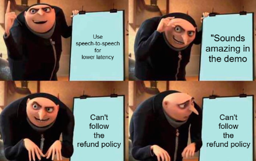
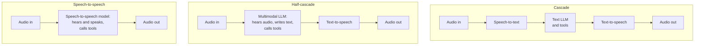
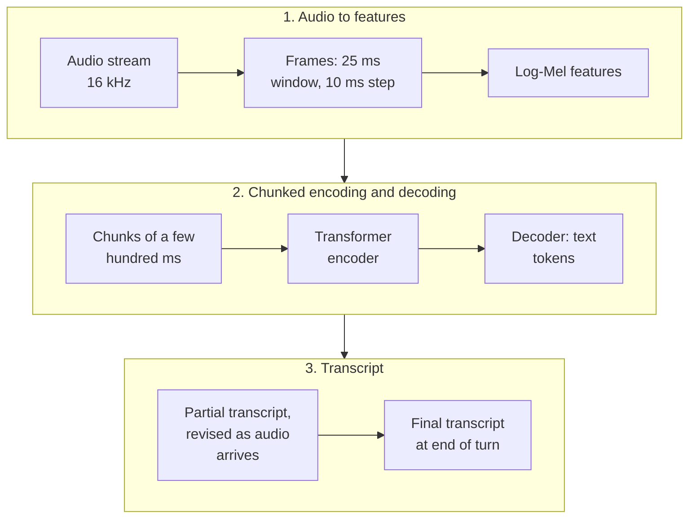
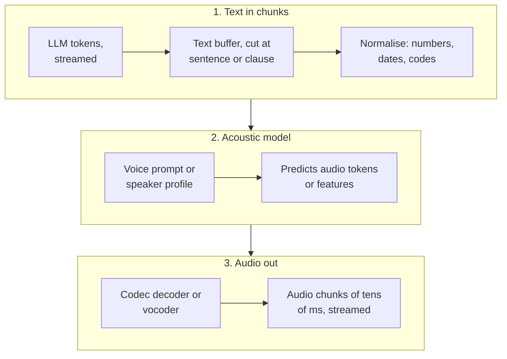
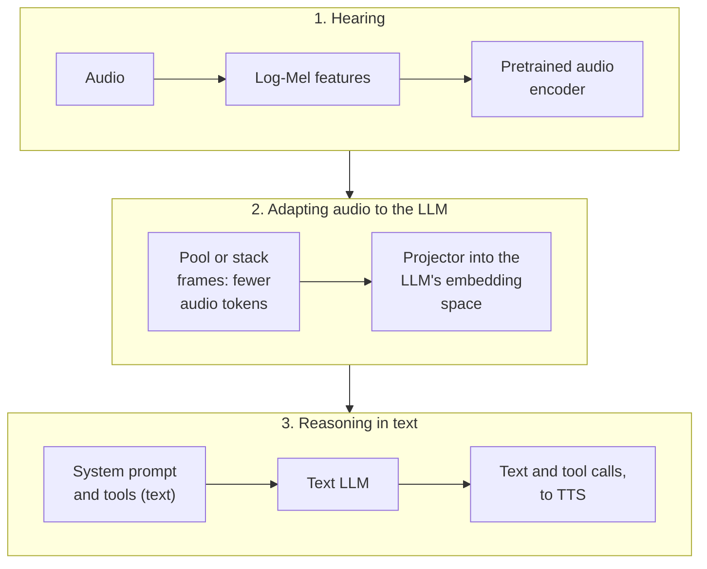
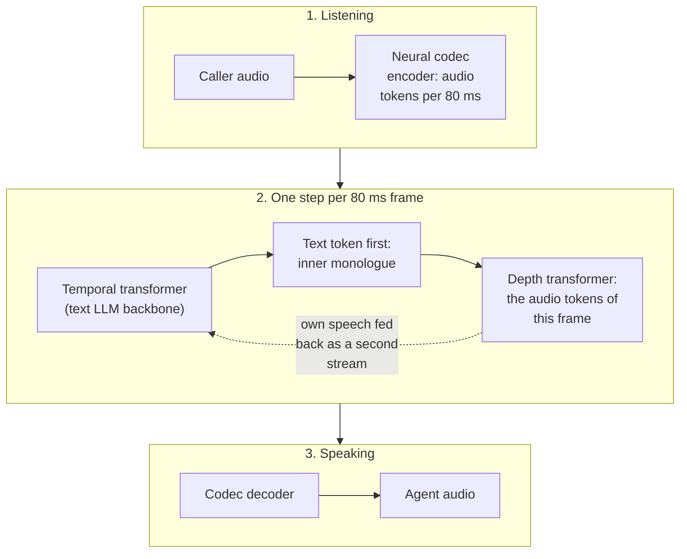
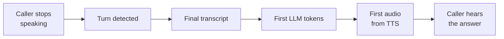

# Lesson 03: Voice Architectures

### Cascade, half-cascade and speech-to-speech, and how to choose between them

The first design decision for a voice agent is how many models stand between the caller's voice and the agent's voice. The traditional answer chains three: a speech-to-text model transcribes, a text language model decides what to say and which tools to call, and a text-to-speech model speaks the answer. Newer multimodal models can hear audio directly, and some can also produce it, which removes steps, cuts latency and keeps the tone of voice that a transcript throws away. Each removal also costs something: fewer providers to choose from, less control over the voice, and, so far, weaker instruction following and tool calling.

This lesson follows an article of [Bruno Vaz (2026)](https://blog.daredata.engineering/voice-architectures/), which groups voice agents into three architectures, compares them on the criteria that matter in production and recommends when to use each, and adds the research evidence on how far speech-to-speech models have come.

  

### Learning Objectives

By the end of this lesson, you will be able to:

- **Describe** the cascade, half-cascade and speech-to-speech architectures and where each one puts the language model.
- **Understand** how each architecture turns audio into text or tokens and back, chunk by chunk, and how its models are trained.
- **Compare** them on latency, naturalness, instruction following, tool calling, voice control and failure points.
- **Choose** an architecture for a use case, and explain why cascade remains the production default as of October 2026.
- **Explain** why every stage of a voice pipeline must stream.

---

### Lesson Content

#### Three ways to turn speech into speech

*Figure 1. The three voice architectures, after Vaz (2026). Each step to the right removes a model from the chain.*

#### Inside the models: how audio becomes text, and text becomes audio

The architectures differ in which model does the conversion between sound and meaning, and the conversion always happens in **chunks**. Audio arrives as a continuous signal, typically 16,000 samples per second, and no model reads it one sample at a time: it is cut into short overlapping frames (about 25 ms, advancing every 10 ms), turned into features or tokens, and grouped into chunks that a model can process while the caller is still talking. Text goes back to audio the same way, a sentence or clause at a time, so the first words can play while the rest is still being written. How big these chunks are, and how much a model may look ahead before committing, sets most of the latency in each design.

##### Voice Architecture 1: Cascade: speech-to-text, a text LLM, text-to-speech

A cascade converts twice, with two separate models around the text language model: speech-to-text turns the caller's audio into a transcript, and text-to-speech turns the model's answer back into audio. Each is trained and sold on its own, which is why every stage can come from a different provider.

**Speech-to-text.**

*Figure 2. Speech-to-text. The audio is cut into short frames, turned into a picture of which frequencies are present over time, and read chunk by chunk; the model writes the words it hears. **Trained audio to text:** the model sees huge amounts of recorded speech paired with its transcript, and learns to produce the transcript from the sound. Its particular point is the trade-off between chunk size and look-ahead: a streaming recogniser commits to words after a short chunk and may correct them as more audio arrives, so it shows partial transcripts and hands only the final one to the language model.*

**Text-to-speech.**

*Figure 3. Text-to-speech. The synthesiser receives the answer a sentence or clause at a time, rewrites what must be read aloud ("A-10492", "15/03"), predicts the sound, and plays it back in short audio chunks. **Trained text to audio:** the reverse pairing of speech-to-text, recorded speech with its transcript, but here the model learns to produce the sound from the words, and a short sample of a voice can be given as a prompt to imitate it, which is how voice cloning works. Its particular point is the size of the text chunk: a whole sentence gives natural intonation but delays the first sound, while a few words start faster but can sound flat or stress the wrong word.*

##### Voice Architecture 2: Half-cascade: a language model that hears

A half-cascade removes the speech-to-text model: the language model itself takes the audio in and writes text out, and the same text-to-speech stage as in the cascade (Figure 3) voices the answer.

*Figure 4. Half-cascade. There is no transcript: an audio encoder turns the speech into vectors, neighbouring frames are merged so that a second of audio becomes a manageable number of audio tokens, and a small adapter translates them into the same space where the language model reads text. **Trained audio to text, on top of a text-to-text model:** the language model is first trained on text alone, as any text LLM, and the adapter is then trained on speech paired with text so that the model treats what it hears like words it reads. Often only the adapter is trained and the language model is left untouched, which is why a half-cascade keeps most of the text model's instruction following and tool calling while also hearing tone and hesitation.*

##### Voice Architecture 3: Speech-to-speech: one model that listens and speaks

A speech-to-speech model removes both conversions: audio goes in and audio comes out of the same model, with no transcript and no separate synthesiser.

*Figure 5. Speech-to-speech. A neural codec turns audio into a few tokens every 80 ms, in both directions; at each step the model reads the caller's tokens and its own, first predicts a text token (an inner monologue that keeps the answer coherent), then the sound for that frame. **Trained text to text, then audio to audio:** the model starts from a text language model, is then trained on large amounts of raw speech so that it learns to continue audio the way a text model continues text, and finally on two-speaker conversations, so that listening and speaking can happen at the same time. Its particular point is that it can be interrupted or say "mm-hm" without a separate turn detector; its weakness is that tool calling and strict instructions are learned mostly from text and must be retaught on top, which is why these models still trail text models at them.*

##### The three side by side

| | Cascade | Half-cascade | Speech-to-speech |
| :-- | :-- | :-- | :-- |
| Unit going into the language model | Final transcript (text) | Audio tokens, one per tens of ms | Audio tokens per 80 ms frame, both directions |
| What the language model hears of tone | Nothing | Tone, hesitation, emotion | Tone, and it shapes its own |
| Where chunk size matters most | STT commit and TTS sentence buffer | TTS sentence buffer | Codec frame size |
| How it learns tools | Inherited from the text model | Mostly inherited (frozen model) | Must be trained in |

#### How they compare

| Criterion | Cascade | Half-cascade | Speech-to-speech |
| :-- | :-- | :-- | :-- |
| Available models | Many providers at every stage | Few | Few |
| Voice cloning and custom voices | Yes, through the speech synthesis provider | Yes, through the speech synthesis provider | Limited |
| Failure points | Three models | Two models | One model |
| Latency | Highest: three network round trips with managed services | Lower | Lowest |
| Naturalness | Lowest: the model only sees words, so sarcasm and intonation are lost | Higher: the model hears paralinguistic cues | Highest: it also shapes the sound of its own answer |
| Instruction following and tool calling | Best, since it uses text LLMs | Between the two | Still behind text LLMs |

#### What the benchmarks say

Independent benchmarks confirm the trade-off and show how fast it is moving.

| Study | What it measured | Finding |
| :-- | :-- | :-- |
| Full-Duplex-Bench-v3 ([Lin et al., 2026](https://arxiv.org/abs/2604.04847)) | Multi-step tool use from real human speech with disfluencies, for GPT-Realtime, Gemini Live 2.5 and 3.1, Grok, Ultravox and a cascade (Whisper, GPT-4o, TTS) | GPT-Realtime led on task success (Pass@1 0.600); Gemini Live 3.1 was fastest (4.25 s) but took its turn least reliably (78.0%); the cascade took every turn correctly but was slowest (10.12 s) |
| τ-Voice ([Ray et al., 2026](https://arxiv.org/abs/2603.13686)) | Grounded customer-service tasks with policies and tools, voice against text | Voice agents kept only 30 to 45% of the task completion of a text model with reasoning |
| [Qiu et al. (2026)](https://arxiv.org/abs/2603.05413) | Whether an enterprise can self-host an end-to-end speech model | No fully self-hostable speech-to-speech option was practical (Qwen3-Omni reached about 702 ms only through its cloud API), so a streaming cascade remained the practical self-hosted architecture |
| [Hu et al. (2026)](https://arxiv.org/abs/2609.19334) | A duplex speech model that delegates tool calls to a text LLM backend | 92 to 97% tool-call recall in single-turn tests while keeping duplex turn-taking: a hybrid that borrows the cascade's strength |

The latencies in Full-Duplex-Bench-v3 include multi-step tool calls and are measured differently from simple voice-to-voice latency, so they are useful for comparing systems within the study, not as targets.

#### Streaming is what makes any architecture fast

Whatever the architecture, the time the caller waits is the sum of the stages that cannot overlap, which is why every stage must stream.

*Figure 6. The critical path of a cascade turn. Voice-to-voice latency runs from the first box to the last.*

Speech recognition transcribes while the caller is still talking, so only the last words remain when the turn ends; the language model streams tokens; and speech synthesis starts speaking the first sentence while the rest is still being generated. Tool calls add their own time on the critical path, which is why voice agents often say a short filler ("let me check that for you") before a slow lookup. The latency budget of lecture 6 applies stage by stage, measured as percentiles in the traces of lecture 5.

#### Which architecture to choose

| Use case | Recommended | Why |
| :-- | :-- | :-- |
| Complex support with strict policies and several tool calls | Cascade | Best instruction following and tool calling; every stage replaceable |
| Strict data residency or self-hosting | Cascade | The widest choice of providers and self-hostable components |
| Brand voice or cloned voice required | Cascade or half-cascade | Speech synthesis stays under your control |
| Simple conversations where naturalness matters most | Speech-to-speech | Lowest latency, most natural turn-taking and prosody |
| Callers whose tone matters (complaints, emotion) | Half-cascade or speech-to-speech | The model hears how things are said |

> Cascade remains the most used architecture for complex production work because accurate answers and correct tool calls matter more than the last few hundred milliseconds, while the trend, and the providers' investment, points toward speech-to-speech. Two architectures can also coexist in one product: the demo of lesson 04 runs its support agent as a cascade and hands billing questions to a half-cascade agent.

**Practices overview**

| Practice | Why | Evidence |
| :-- | :-- | :-- |
| Default to cascade for complex, tool-heavy production use | Best instruction following and tool calling | [Vaz (2026)](https://blog.daredata.engineering/voice-architectures/); [Lin et al. (2026)](https://arxiv.org/abs/2604.04847) |
| Test at least two architectures on your own calls | The ranking changes quickly and depends on the task | [Vaz (2026)](https://blog.daredata.engineering/voice-architectures/) |
| Add fallbacks for each provider in a cascade | Three models means three failure points | [Vaz (2026)](https://blog.daredata.engineering/voice-architectures/) |
| Stream every stage and measure voice-to-voice latency as percentiles | Waiting time is the sum of the stages that cannot overlap | Latency budgets |
| Check provider availability in your region before choosing | Some speech models are not offered in the EU | [Vaz (2026)](https://blog.daredata.engineering/voice-architectures/) |
| Compare voice task completion with the text version of the agent | Voice agents keep only part of text capability | [Ray et al. (2026)](https://arxiv.org/abs/2603.13686) |

#### In practice

Start with a cascade built from streaming components, because it lets you reuse the text agent you already trust, swap any stage and meet residency rules, and measure its voice-to-voice latency on real calls before deciding it is too slow. Then run the same test set through a speech-to-speech model and compare task completion, not only how natural it sounds, since a smooth voice that calls the wrong tool is worse than a slower one that gets it right. Revisit the choice every few months: this is the part of the stack that changes fastest.

**Summary:**
- Cascade chains speech-to-text, a text LLM and text-to-speech; half-cascade lets a multimodal model hear the audio; speech-to-speech hears and speaks in one model.
- Audio is always processed in chunks: frames and transcript chunks into speech-to-text, sentence chunks into text-to-speech, audio tokens through a projector in a half-cascade, and 80 ms codec frames in both directions in speech-to-speech.
- Removing models lowers latency and keeps tone of voice, at the cost of fewer providers, less voice control and weaker tool calling.
- As of 2026 cascade remains the production default for complex, tool-heavy agents, while speech-to-speech is closing the gap.
- Every stage must stream, and voice-to-voice latency is the sum of the stages that cannot overlap.

---

### References

- Vaz, B. (2026), [Voice architectures](https://blog.daredata.engineering/voice-architectures/), DareData blog. The three architectures, their comparison and recommendations.
- Lin et al. (2026), [Full-Duplex-Bench-v3: Benchmarking Tool Use for Full-Duplex Voice Agents Under Real-World Disfluency](https://arxiv.org/abs/2604.04847).
- Ray et al. (2026), [τ-Voice: Benchmarking Full-Duplex Voice Agents on Real-World Domains](https://arxiv.org/abs/2603.13686).
- Qiu et al. (2026), [Building Enterprise Realtime Voice Agents from Scratch: A Technical Tutorial](https://arxiv.org/abs/2603.05413).
- Hu et al. (2026), [A frontend-backend architecture for tool calls in full-duplex speech models](https://arxiv.org/abs/2609.19334).

### Further Reading

- [Lesson 02: Turn-Taking: VAD and Turn Detection](02-turn-taking-vad-and-turn-detection.md) - the previous lesson.
- [Lesson 04: Voice Frameworks and the LiveKit Demo](04-voice-frameworks-and-livekit-demo.md) - the next lesson.
- [Lecture 6, Lesson 02: Cost and Latency Budgeting](../L6_Governance_and_risk/02-cost-and-latency-budgeting.md) - latency as a distribution and budgets per stage.
- [Lecture 2, Lesson 01: Tool Calling](../L2_Agentic_systems_and_tool_calling/01-tool-calling.md) - the tool calls every architecture has to get right.
