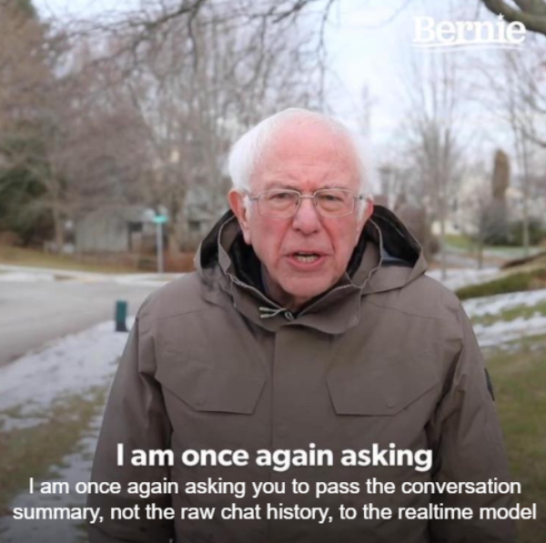
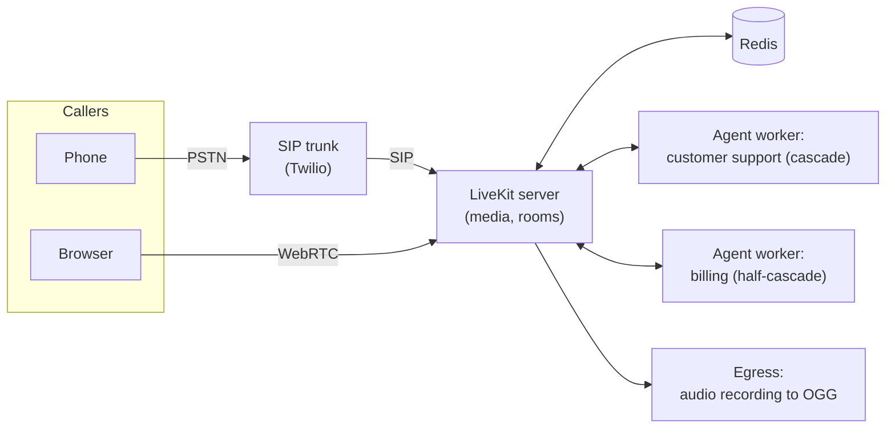

# Lesson 04: Voice Frameworks and the LiveKit Demo

### What a voice framework does for you, LiveKit Agents versus Pipecat, and a customer-support agent built on LiveKit

The previous lessons described the parts of a voice agent one at a time: speech recognition, a language model with tools, speech synthesis, VAD, a turn detector and noise cancellation. Wiring them together by hand means moving audio frames between them in real time, streaming partial results, cancelling speech when the caller interrupts, keeping the conversation history consistent, and connecting to browsers and phone lines. Voice frameworks do this work, in the same way that agent frameworks such as LangGraph or LlamaIndex orchestrate text agents in lecture 2.

This lesson explains what a voice framework provides, compares the two main open-source options, LiveKit Agents and Pipecat, and then walks through the [livekit-demo](https://github.com/2010b9/livekit-demo) repository, a customer-support voice agent that brings every concept of the lecture together.

  

### Learning Objectives

By the end of this lesson, you will be able to:

- **Describe** the responsibilities of a voice framework: transport, streaming orchestration, turn-taking, interruptions and plugins.
- **Compare** LiveKit Agents and Pipecat and choose between them for a use case.
- **Read** the architecture of the demo: its components, its call flow, its handoff between architectures and its deployment.
- **Plan** how to evaluate a voice agent before it takes real calls.

---

### Lesson Content

#### What a voice framework does

| Responsibility | What it involves |
| :-- | :-- |
| Transport | Receiving and sending audio over WebRTC for browsers and apps, and over SIP for phone calls |
| Streaming orchestration | Passing audio and partial results between speech recognition, the model and speech synthesis as they arrive |
| Turn-taking and interruptions | Running VAD and the turn detector, stopping speech on barge-in, updating the history to what was actually said |
| Plugins | Interchangeable providers for each stage, so that a cascade can switch speech recognition or synthesis with one line of configuration |
| Agent logic | Instructions, tools, shared session state and handoffs between agents |
| Operations | Dispatching agents to calls, scaling workers, recording, metrics and traces |

#### LiveKit Agents and Pipecat

| | [LiveKit Agents](https://github.com/livekit/agents) | [Pipecat](https://github.com/pipecat-ai/pipecat) |
| :-- | :-- | :-- |
| Core model | Agents that join a room on a WebRTC media server, with an event-driven session | A pipeline of processors through which audio, text and control frames flow |
| Transport | Tightly integrated with the LiveKit media server, including SIP telephony | Pluggable transports: Daily, LiveKit, Twilio, local and peer-to-peer WebRTC |
| Languages | Python and TypeScript | Python |
| Licence | Apache-2.0 | BSD-2-Clause |
| Built-in turn-taking | Silero VAD plugin, LiveKit turn detectors, interruption handling | Silero VAD, Smart Turn, interruption handling |
| Noise cancellation | Krisp and ai-coustics through LiveKit Cloud | Krisp through Pipecat Cloud, open-source filters |
| Fits | WebRTC-centred products, multi-party rooms, video, telephony through the same server | Telephony and custom transports, fine-grained control of the pipeline, frequent provider swaps |

Both are open source and self-hostable, both support cascade, half-cascade and speech-to-speech models through plugins, and comparisons agree that the framework adds little latency compared with the models themselves ([Forasoft, 2026](https://www.forasoft.com/blog/article/pipecat-vs-livekit-agents)). The choice is mostly about transport: LiveKit when the product is built around WebRTC rooms or needs one media server for web and phone, Pipecat when the pipeline should plug into an existing telephony or transport stack. Most published comparisons come from the vendors or their partners, so test the shortlisted framework with your own providers.

#### The applied case: a customer-support voice agent on LiveKit

The [livekit-demo](https://github.com/2010b9/livekit-demo) repository implements a support line for a fictional company. A first agent greets the caller, answers general questions about orders, products, returns and accounts, and, when the question is about billing, collects the caller's name and customer number and transfers the call to a billing specialist. It can also place outbound phone calls.

*Figure 1. The deployment of the demo: one media server for phone and web, two agent workers and a recorder, all in Docker Compose.*

| Stage | Customer-support agent | Billing agent |
| :-- | :-- | :-- |
| Architecture (lesson 03) | Cascade | Half-cascade |
| Speech-to-text | ElevenLabs Scribe v2 realtime, through ElevenLabs' EU data-residency endpoint | Inside the multimodal model |
| Language model | Azure OpenAI GPT-4.1 mini | Ultravox realtime model |
| Text-to-speech | ElevenLabs Turbo v2.5, with a chosen voice and stability, similarity and speed settings | Ultravox voice |
| VAD and turn detection (lesson 02) | Silero VAD with activation threshold 0.9, LiveKit multilingual turn detector | Provider-side |
| Noise and voice isolation (lesson 01) | Krisp BVC for browser callers, BVC telephony for SIP callers | Same |
| Tools | `record_name` and `record_id_number`, which fill shared session data | None |

The handoff follows the pattern of lecture 2. Both tools write to a typed session object that holds the caller's name and customer number, and once both are filled the tool returns a new billing agent instead of a plain result, which the framework treats as a transfer. One detail shows the practical difference between architectures: the billing agent's realtime model tried to replay and voice the whole chat history when it received it directly, so the demo passes the earlier conversation to the billing agent as a text summary inside its instructions instead. The billing agent's prompt then tells it to continue without asking the caller to repeat themselves, and never to invent account data.

Outbound calls work through dispatch: a request creates a room, dispatches the support agent to it with the number to call as metadata, and the agent asks the media server to dial out through the SIP trunk, waiting until the call is answered before speaking. Every call is recorded as audio by the Egress service, and the project lists Langfuse among its dependencies for tracing, the observability practice of lecture 5.

The residency choices connect to lecture 6: speech recognition and synthesis go through ElevenLabs' EU endpoint and the language model through Azure OpenAI. Vaz ([2026](https://blog.daredata.engineering/voice-architectures/)) notes that Ultravox was not available in European environments, so the half-cascade billing agent is the part that a production deployment with EU residency requirements would have to revisit.

#### Evaluating a voice agent before it takes calls

A voice agent is an agent, so the evaluation practices of lectures 2 and 5 apply: task completion checked against the expected outcome, several runs per task, and traces for every turn. Voice adds its own layer. τ-Voice ([Ray et al., 2026](https://arxiv.org/abs/2603.13686)) evaluates agents with a simulated caller that speaks with varied accents in realistic audio environments and interrupts naturally, and Full-Duplex-Bench-v3 ([Lin et al., 2026](https://arxiv.org/abs/2604.04847)) uses real human recordings with disfluencies and chained tool calls; both report task success next to latency and turn-taking. For the demo, that means scripted test calls for each path (general question, transfer to billing, outbound call), each run with clean and noisy audio, checking that the right tools were called with the right values, that the transfer kept the context, and how long each turn took.

**Practices overview**

| Practice | Why | Evidence |
| :-- | :-- | :-- |
| Use a voice framework for transport, streaming and interruptions | Hand-built orchestration is where latency and barge-in bugs live | Framework documentation |
| Choose the framework by transport needs, then test with your providers | Framework latency is small; comparisons are mostly vendor-written | [Forasoft (2026)](https://www.forasoft.com/blog/article/pipecat-vs-livekit-agents) |
| Pass context to a realtime model as a summary in its instructions | Some realtime models replay raw chat history aloud | [livekit-demo](https://github.com/2010b9/livekit-demo) |
| Collect required fields with tools into typed session state before a transfer | The next agent starts with verified data | [livekit-demo](https://github.com/2010b9/livekit-demo) |
| Record calls and trace every turn | Voice failures are only diagnosable from audio and timings | [livekit-demo](https://github.com/2010b9/livekit-demo); lecture 5 |
| Evaluate with simulated callers in realistic audio, with tool checks | Voice agents lose much of their text capability | [Ray et al. (2026)](https://arxiv.org/abs/2603.13686) |

#### In practice

Run the demo locally with Docker Compose and talk to it from a browser first, then connect a SIP trunk and repeat the same calls by phone, listening for the differences in latency, recognition and turn-taking between the two channels. Change one stage at a time through the plugins, for example another speech recogniser or a speech-to-speech model for the support agent, and compare the recordings and traces. Before any real caller reaches an agent like this, write down the success metric with the business, build the scripted test calls, and check where every provider in the chain processes and stores audio.

**Summary:**
- Voice frameworks handle transport (WebRTC, SIP), streaming orchestration, turn-taking, interruptions, plugins and dispatch.
- LiveKit Agents is built around a WebRTC media server and fits room-based and combined web and phone products; Pipecat is a frame pipeline with pluggable transports.
- The demo combines a cascade support agent with a half-cascade billing agent, tools that fill session state, a handoff with a summarised history, outbound SIP calls, noise cancellation and recording.
- Evaluate voice agents with realistic audio, task outcomes and tool checks, not only with how natural they sound.

---

### References

- [livekit-demo](https://github.com/2010b9/livekit-demo) (accessed October 2026). The applied customer-support voice agent studied in this lesson.
- LiveKit, [Agents framework](https://github.com/livekit/agents), [Telephony](https://docs.livekit.io/telephony/) and [Egress](https://docs.livekit.io/transport/media/ingress-egress/egress/) (accessed October 2026).
- Pipecat, [Pipecat framework](https://github.com/pipecat-ai/pipecat) (accessed October 2026).
- Forasoft (2026), [Pipecat vs LiveKit Agents](https://www.forasoft.com/blog/article/pipecat-vs-livekit-agents). Comparison blog post.
- Vaz, B. (2026), [Voice architectures](https://blog.daredata.engineering/voice-architectures/), DareData blog.
- Ray et al. (2026), [τ-Voice](https://arxiv.org/abs/2603.13686); Lin et al. (2026), [Full-Duplex-Bench-v3](https://arxiv.org/abs/2604.04847).

### Further Reading

- [Lesson 03: Voice Architectures](03-voice-architectures.md) - the previous lesson.
- [Lecture 2, Lesson 03: Building Agents: Orchestration, State and Memory](../L2_Agentic_systems_and_tool_calling/03-building-agents-orchestration-and-memory.md) - session state and handoffs in text agents.
- [Lecture 5, Lesson 01: Observability and Telemetry](../L5_LLMOps/01-observability-and-telemetry.md) - traces for every turn.
- [Lecture 6, Lesson 01: Data Privacy and PII](../L6_Governance_and_risk/01-data-privacy-and-pii.md) - where each provider processes audio.
