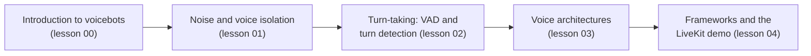

# Lecture 8: A Voicebot Use Case

**Block E: Applied use cases**

### Scope

How to build an agent that people talk to instead of type to. The lecture starts with what makes voice different from chat and then follows one spoken turn through the system: hearing the caller through noise, deciding when they have finished speaking, choosing the architecture that reasons and speaks back (cascade, half-cascade or speech-to-speech), and finally the frameworks that assemble these parts, with an applied customer-support voice agent built on LiveKit.

### Learning Objectives

By the end of this lecture, you will be able to:

- **Explain** what makes a voice conversation harder than a text chat, and which metrics a voicebot is judged by.
- **Decide** where and how to remove noise and background voices from the user's audio.
- **Configure** voice activity detection, turn detection and interruption handling, and know what each one decides.
- **Choose** between cascade, half-cascade and speech-to-speech architectures for a given use case.
- **Compare** LiveKit Agents and Pipecat, and read the architecture of a production-style voice agent.

### Running example

A customer-support voice agent that answers calls, collects the caller's name and customer number with tool calls, and hands billing questions over to a second agent. It is the [livekit-demo](https://github.com/2010b9/livekit-demo) repository, studied in lesson 04: a cascade agent for general support, a half-cascade agent for billing, outbound phone calls over SIP, noise cancellation and call recording.

### Lessons in this lecture

00. [Introduction to Voicebots](00-introduction-to-voicebots.md)
01. [Noise and Voice Isolation](01-noise-and-voice-isolation.md)
02. [Turn-Taking: VAD and Turn Detection](02-turn-taking-vad-and-turn-detection.md)
03. [Voice Architectures](03-voice-architectures.md)
04. [Voice Frameworks and the LiveKit Demo](04-voice-frameworks-and-livekit-demo.md)

### Prerequisites

Lecture 2 (tool calling and handoffs between agents), lecture 5 (observability), lecture 6 (data privacy and latency budgets) and lecture 7 (conversation management).
