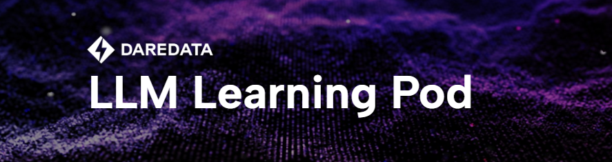
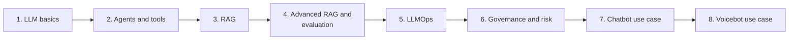

# LLM Learning Pod

  

LLM application engineering is a field that changes under your feet. Models that were frontier a year ago are now cheap commodities, practices that were best advice six months ago are already being replaced, and every week brings new papers, new protocols and new tools. Much more is still coming. That makes it an uncomfortable field to teach and an exciting one to learn: there is a large and growing body of literature to draw on, and at the same time a lot of room left for experiment, because many questions do not have a settled answer yet and the best way to find out is often to build a small set-up and measure.

This learning pod is an 8-week course for engineers (curious people!) on how LLM applications are designed, built, operated and governed. It does not try to teach a single stack. It focuses on the architecture choices behind these systems: the options that exist at each layer, what each one costs, how to choose between them, and where the literature stands on each. The tools named in the lessons are examples of a pattern, and many of them will have changed by the time you read this; the reasoning behind the choice is what lasts.

The future asks more than ever that engineers be creative, highly skilled and open to experiment- and above all, critical thinkers. In practice we are often held back by enterprise guidelines, approved tool lists and budgets, and it is easy to conclude that nothing interesting can be built without the latest platform. That is rarely true. A tokenizer, an embedding model, a few hundred lines of plain code and a careful evaluation can take you surprisingly far, and most of the ideas in this course can be tried with no fancy tools at all. I hope this pod gives you both the foundations and the curiosity to keep chasing knowledge long after the eight weeks are over: question what you know, challenge your intuition and build the experiment that settles the argument.

## Learning Objectives

By the end of this course, participants will be able to:

1. **Work with LLMs directly:** explain how a model turns a prompt into a reply token by token, set the context and generation parameters, get structured output your code can validate, and choose between proprietary, open-weight and self-hosted models.
2. **Design agentic systems:** decide how much autonomy a task needs, from a fixed workflow to a ReAct agent or an orchestrator with subagents, design tools the model uses correctly, build an agent with state, memory and human approval, and connect it to tools through MCP servers.
3. **Build retrieval:** prepare, chunk and embed documents, retrieve passages for a question, and choose a vector database for your scale and filters.
4. **Improve and evaluate retrieval:** transform queries, filter by metadata, combine keyword and vector search, re-rank, and measure both retrieval (recall@k, MRR, nDCG) and the faithfulness of answers with a calibrated judge.
5. **Operate LLM systems:** explain what LLMOps adds to MLOps, instrument an application with OpenTelemetry traces, metrics and logs, and version prompts like code.
6. **Govern LLM systems:** layer guardrails against wrong answers, what the EU AI Act asks of a use case and budget cost and latency per request.
7. **Put the pieces together in a chatbot:** design the architecture, conversation storage and context management of a multi-user chat product, and secure it against leakage, injection and misuse.
8. **Build voice agents:** clean the caller's audio, configure turn detection and interruptions, choose between cascade, half-cascade and speech-to-speech architectures, and compare voice frameworks such as LiveKit Agents and Pipecat.

---

## 8-Week Plan

| Week | Lecture | Key architecture decision | Lessons | Demo |
| :-- | :-- | :-- | :-- | :-- |
| 1 | [L1 Building with LLMs](L1_Building_with_LLMs/) | Which model, and how to get output your code can trust | 00 foundations, 01 structured outputs, 02 model selection | |
| 2 | [L2 Agentic systems and tool calling](L2_Agentic_systems_and_tool_calling/) | Single call, workflow or agent; framework or plain code; direct tools or MCP | 00 to 04 | [order_support_agent.ipynb](L2_Agentic_systems_and_tool_calling/code/order_support_agent.ipynb) |
| 3 | [L3 Retrieval-augmented generation](L3_Retrieval_augmented_generation/) | How to prepare, chunk, embed and retrieve documents | 00 to 04 | [simple_rag.ipynb](L3_Retrieval_augmented_generation/code/simple_rag.ipynb) |
| 4 | [L4 Advanced RAG and evaluation](L4_Advanced_RAG_and_evaluation/) | Which retrieval lever to pull, which vector database supports it, and how to measure whether it helped | 00 to 04 | |
| 5 | [L5 LLMOps](L5_LLMOps/) | What an LLMOps platform needs, which observability stack, and how prompts are versioned | 00 to 01 | |
| 6 | [L6 Governance and risk](L6_Governance_and_risk/) | Which guardrail layers, privacy controls and budgets to enforce | 00 to 02 | |
| 7 | [L7 AI chatbot use case](L7_AI_Chatbot_Use_Case/) | End-to-end chat architecture, conversation storage, context management and security | 00 to 03 | |
| 8 | [L8 Voicebot use case](L8_Voicebot_Use_Case/) | Cascade, half-cascade or speech-to-speech; turn detection and noise handling; LiveKit or Pipecat | 00 to 04 | [livekit-demo](https://github.com/2010b9/livekit-demo) (external repository) |

---

## Architecture Choices Map

The decisions the course exposes and the main options for each. None of them has a universally right answer; the right option depends on your data, your users and your constraints, and the "choose by" column says what to measure or ask before deciding.

| Decision | Options | Choose by |
| :-- | :-- | :-- |
| Model | Proprietary API, open-weight hosted, self-hosted | Quality on your own tasks, cost, latency, data constraints, licensing |
| Output control | Free text, schema-constrained structured output with validation and bounded retries | Whether code consumes the output |
| Control flow | Single call, fixed workflow (chain, router, parallel), ReAct agent, orchestrator with subagents | How predictable the steps are, cost of an error, how much context one agent can hold |
| Orchestration | Plain code, graph with state, code loop, event-driven workflow | Branches, pauses and approvals, resuming runs, team familiarity |
| Tool integration | Direct function calls, connecting to MCP servers | Number of tools and applications that share them, security duties |
| Knowledge | Prompt, long context, retrieval, fine-tuning | Whether the gap is facts or behaviour, corpus size, how often it changes |
| Ingestion and chunking | Fixed-size, structure-aware, semantic or parent-child chunks; metadata and personal-data handling before indexing | Document structure, measured retrieval on your questions |
| Embedding model | Closed API bi-encoders from the main providers | Retrieval quality on your own data, language, dimensions and price |
| Vector store | Managed service, open-source engine, add-on to a store you already run | Retrieval quality, latency, filtering, operations capacity |
| Retrieval | Similarity search, query transformation, metadata filtering, index enrichment, hybrid search, re-ranking, self-correcting retrieval | The failure type found in evaluation |
| Evaluation | Retrieval metrics on questions labelled with relevance judgments, nugget-based scoring, model as judge for faithfulness, human review | What code can check, judge calibration, whether an improvement beats the noise |
| LLMOps tooling | Data and AI platforms, specialised LLMOps platforms, evaluation platforms, low-code builders, end-to-end agent platforms | Existing platform, governance needs, who builds and who operates |
| Observability | LLM observability platform, enterprise monitoring stack, cloud-native tracing, lakehouse tables; all on OpenTelemetry | Who reads the data, existing tooling, how long data is kept |
| Prompt versioning | Strings in code, prompt repository, prompt registry; immutable versions, release tags and environment labels | Change frequency, need for rollback |
| Guardrails | Intent detection, grounding, structured outputs, citation validation, routing to clarification or human review | Cost of a wrong answer |
| Privacy | US-owned cloud in an EU region, with or without your own keys; European-owned provider; self-hosted open-weight model; plus permission checks, data minimisation and clean logs | Data sensitivity, which country's laws may reach the provider, legal obligations |
| Cost and latency | Call and token limits, timeouts, retry limits, fallback models, caching, streaming | Percentiles rather than averages, time to first token, cost per successful task |
| Conversation storage | Relational, document, key-value, cache in front of a durable store, provider-managed, managed conversation service | The database you already run, how central conversations are, team size, residency and export |
| Conversation memory | Send everything, sliding window, summarisation, tool-result compression, structured state, notes and tiered memory, hybrid | Conversation length, token budget, what must be remembered across conversations |
| Chatbot security | Authentication and least-privilege roles, input and upload validation, response limits and redaction, API gateways, separate environments, sparse logging | What the bot can read and do, who uses it, regulatory exposure |
| Voice architecture | Cascade (STT, LLM, TTS), half-cascade, speech-to-speech | Tool calling and instruction following against latency and naturalness; provider availability in your region |
| Turn-taking | VAD only, VAD with a text or audio turn detector, provider-side turn detection | Early and late ends of turn, interruptions, control across providers |
| Audio cleanup | Noise suppression, voice isolation, telephony models; open-source or commercial | Channel (phone or web), background voices, deployment and licensing |
| Voice framework | LiveKit Agents, Pipecat, hand-built | Transport (WebRTC rooms, SIP, custom), language, provider plugins |
